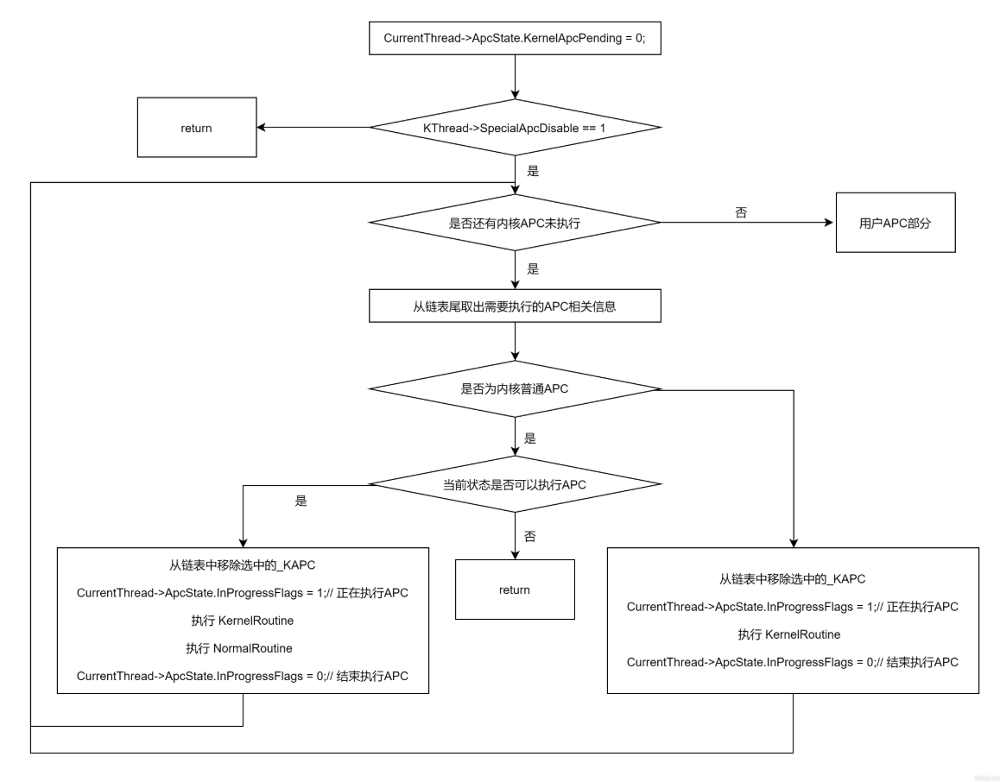
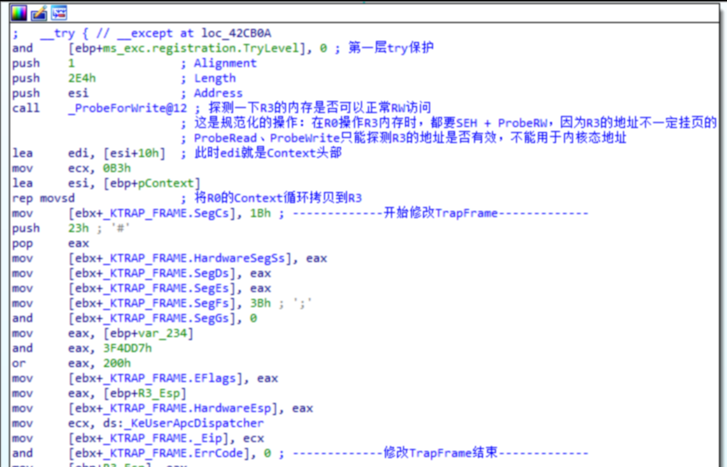
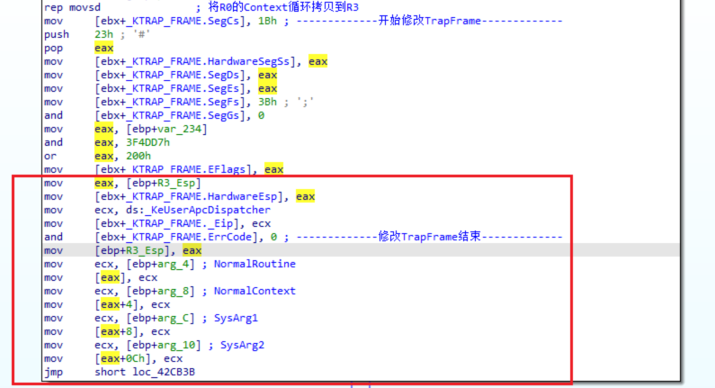
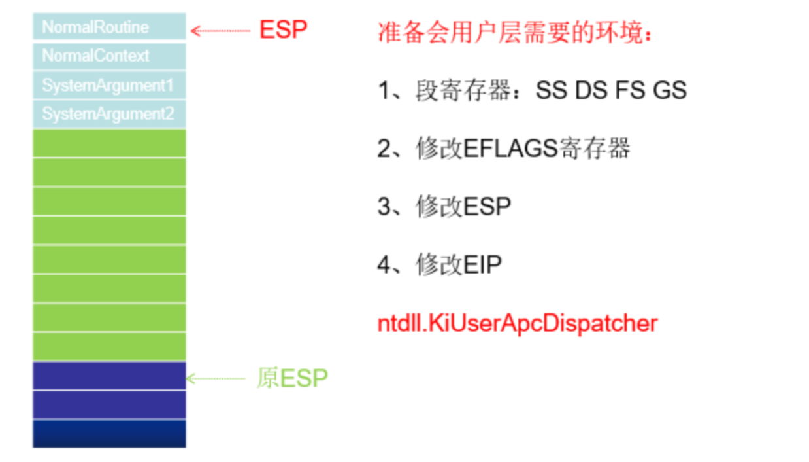
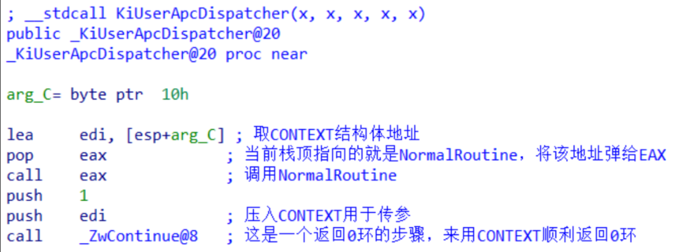

<!--more-->

## KiDeliverApc

1. 实现APC的派发，内核中调用的是`KiDeliverApc`函数，该函数被大量调用，这样保证系统调用、中断、异常发生时都有机会派发APC
2. 关于派发APC部分的代码，从Xp到如今高版本Win11，没太大变动，所以这里直接参考WRK的源码：
3. 由以下代码可知，不管是内核、用户APC，其中的`KernelRoutine`都必定是最早执行的

```c
VOID
KiDeliverApc (
    IN KPROCESSOR_MODE PreviousMode,		// 先前模式
    IN PKEXCEPTION_FRAME ExceptionFrame,	// 异常帧
    IN PKTRAP_FRAME TrapFrame				// 陷阱帧
    )
{

    PKAPC Apc;
    PKKERNEL_ROUTINE KernelRoutine;
    KLOCK_QUEUE_HANDLE LockHandle;
    PLIST_ENTRY NextEntry;
    PVOID NormalContext;
    PKNORMAL_ROUTINE NormalRoutine;
    PKTRAP_FRAME OldTrapFrame;
    PKPROCESS Process;
    PVOID SystemArgument1;
    PVOID SystemArgument2;
    PKTHREAD Thread;

	// 从KPCR中取出当前线程
    Thread = KeGetCurrentThread();
	
	// 备份TrapFrame，这里应该是为R3 APC调用做准备
    OldTrapFrame = Thread->TrapFrame;
    Thread->TrapFrame = TrapFrame;

	// 取出养父进程对象
    Process = Thread->ApcState.Process;
	
	// 因为每调用一次KiDeliverApc，都会执行所有的内核APC，所以这里直接将KernelApcPending设置为FALSE
    Thread->ApcState.KernelApcPending = FALSE;
	
	// 总开关，如果SpecialApcDisable为TRUE，这个函数相当于啥都没干
    if (Thread->SpecialApcDisable == 0) 
	{
		// 判断内核APC链表中是否有成员
        while (IsListEmpty(&Thread->ApcState.ApcListHead[KernelMode]) == FALSE) 
		{
			// 要操作APC链表，这里要加锁
            KeAcquireInStackQueuedSpinLock(&Thread->ApcQueueLock, &LockHandle);
			
			// 取出一个节点，如果为空则跳走
            NextEntry = Thread->ApcState.ApcListHead[KernelMode].Flink;
            if (NextEntry == &Thread->ApcState.ApcListHead[KernelMode]) {
                KeReleaseInStackQueuedSpinLock(&LockHandle);
                break;
            }

			// 这里又将KernelApcPending设置为FALSE
            Thread->ApcState.KernelApcPending = FALSE;
			
			// 取出APC对象
            Apc = CONTAINING_RECORD(NextEntry, KAPC, ApcListEntry);
            ReadForWriteAccess(Apc);
            KernelRoutine = Apc->KernelRoutine;
            NormalRoutine = Apc->NormalRoutine;
            NormalContext = Apc->NormalContext;
            SystemArgument1 = Apc->SystemArgument1;
            SystemArgument2 = Apc->SystemArgument2;
			
			// 如果NormalRoutine为空，则为特殊APC
            if (NormalRoutine == (PKNORMAL_ROUTINE)NULL) 
			{
				// 将当前节点从链表中摘除
                RemoveEntryList(NextEntry);
                Apc->Inserted = FALSE;
				
				// 解锁
                KeReleaseInStackQueuedSpinLock(&LockHandle);
				
				// 调用内核回调
				// 注意！
				// 这里传递的参数2~5，是栈上的局部变量，所以在KernelRoutine中可用过滤、修改参数2~5的内容
                (KernelRoutine)(Apc,
                                &NormalRoutine,
                                &NormalContext,
                                &SystemArgument1,
                                &SystemArgument2);
   

            } 
			else 
			{
				// 执行常规APC
                if ((Thread->ApcState.KernelApcInProgress == FALSE) &&
                   (Thread->KernelApcDisable == 0)) 
				{
                    RemoveEntryList(NextEntry);
                    Apc->Inserted = FALSE;
                    KeReleaseInStackQueuedSpinLock(&LockHandle);
                    (KernelRoutine)(Apc,
                                    &NormalRoutine,
                                    &NormalContext,
                                    &SystemArgument1,
                                    &SystemArgument2);
    
					// 在KernelRoutine中可用修改NormalRoutine的值，所以这里再判断是否为空
                    if (NormalRoutine != (PKNORMAL_ROUTINE)NULL) {
                        Thread->ApcState.KernelApcInProgress = TRUE;
						
						// IRQL降为PASS_LEVEL，再执行NormalRoutine
                        KeLowerIrql(0);
                        (NormalRoutine)(NormalContext,
                                        SystemArgument1,
                                        SystemArgument2);
    
                        KeRaiseIrql(APC_LEVEL, &LockHandle.OldIrql);
                    }
    
                    Thread->ApcState.KernelApcInProgress = FALSE;
    
                } else {
                    KeReleaseInStackQueuedSpinLock(&LockHandle);
                    goto CheckProcess;
                }
            }
        }

		// 用户APC的执行
		// 1. 判断先前模式为用户模式
		// 2. 并且用户APC链表中有对象
		// 3. UserApcPending为TRUE
        if ((PreviousMode == UserMode) &&
            (IsListEmpty(&Thread->ApcState.ApcListHead[UserMode]) == FALSE) &&
            (Thread->ApcState.UserApcPending != FALSE)) {

			// 加锁
            KeAcquireInStackQueuedSpinLock(&Thread->ApcQueueLock, &LockHandle);

			// 判断链表是否为空，为空则跳走
            Thread->ApcState.UserApcPending = FALSE;
            NextEntry = Thread->ApcState.ApcListHead[UserMode].Flink;
            if (NextEntry == &Thread->ApcState.ApcListHead[UserMode]) {
                KeReleaseInStackQueuedSpinLock(&LockHandle);
                goto CheckProcess;
            }

			// 取出APC对象，并复制其中的内容到栈局部变量
            Apc = CONTAINING_RECORD(NextEntry, KAPC, ApcListEntry);
            ReadForWriteAccess(Apc);
            KernelRoutine = Apc->KernelRoutine;
            NormalRoutine = Apc->NormalRoutine;
            NormalContext = Apc->NormalContext;
            SystemArgument1 = Apc->SystemArgument1;
            SystemArgument2 = Apc->SystemArgument2;
            RemoveEntryList(NextEntry);
            Apc->Inserted = FALSE;
            KeReleaseInStackQueuedSpinLock(&LockHandle);
			
			// 执行KernelRoutine
            (KernelRoutine)(Apc,
                            &NormalRoutine,
                            &NormalContext,
                            &SystemArgument1,
                            &SystemArgument2);
    
            if (NormalRoutine == (PKNORMAL_ROUTINE)NULL) {
                KeTestAlertThread(UserMode);
            } 
            else 
			{
				// 执行处于R3用户态的APC函数
				// 这较为复杂，因为要权限切换，所以需要切换环境（换栈）
                KiInitializeUserApc(ExceptionFrame,
                                    TrapFrame,
                                    NormalRoutine,
                                    NormalContext,
                                    SystemArgument1,
                                    SystemArgument2);
            }
        }
    }

    //
    // Check if process was attached during the APC routine.
    //

CheckProcess:
    if (Thread->ApcState.Process != Process) {
        KeBugCheckEx(INVALID_PROCESS_ATTACH_ATTEMPT,
                     (ULONG_PTR)Process,
                     (ULONG_PTR)Thread->ApcState.Process,
                     (ULONG)Thread->ApcStateIndex,
                     (ULONG)KeIsExecutingDpc());
    }

    //
    // Restore the previous thread trap frame address.
    //

    Thread->TrapFrame = OldTrapFrame;
    return;
}
```


## 内核APC的派发

1. 有上一小节的代码可知，内核APC的派发其实很简单，就是检查内核APC对象链表中是否有内容，如果有就循环派发，流程图如下所示：




## 用户APC派发

1. 用户APC的派发，就相对麻烦一些了，因为用户APC的回调例程是在R3用户态的，但是派发函数是处于R0的，那么就需要切换堆栈退回到R3执行APC回调
2. 退回到R3执行APC，调用的是`KiInitializeUserApc`函数，该函数的工作跟**用户异常派发**几乎一样，工作流程如下：
   1. 将TrapFrame备份到Context对象中
   2. 修改TrapFrame中的Cs、Eip、Ss、Esp：
      1. 修改Eip为`KiUserApcDispatcher`，这是R3派发APC的总入口（落脚点），Hook这个点可以实现检测所有的用户APC例程**是否合法**
      2. 抬升Esp堆栈，分配堆栈空间，分配大小为`Context + NormalRoutine + 3个携带参数`
      3. 构造R3堆栈，将`Context + NormalRoutine + 3个携带参数`写到R3堆栈
   3. 这样当回退到R3执行代码时，就会从`KiUserApcDispatcher`开始执行，该函数会从堆栈中取出内容、并调用`NormalRoutine`
   4. 执行完`NormalRoutine`后，调用`NtContinue`，而在内核的`NtContinue`函数中又会调用`KiDeliverApc`，所以会循环往复知道所有用户APC派发完成


### 修改TrapFrame结构




### 构造R3堆栈内容






### KiUserApcDispatcher函数

1. 该函数功能就是解析堆栈、并调用NormalRoutine




### 用户APC派发流程图

1. 用户APC的派发，流程大体上跟内核APC派发没什么区别，其中需要关注的点无非就是如何退回到R3、如何构造R3堆栈、KiUserApcDispatcher如何执行的
2. 所以这里就不重复画图了


## 小结

1. 当插入内核APC时，一般很快就会被执行，但是用户APC就不好说了
2. 当派发APC时，内核会循环派发内核、用户APC，直到派发结束
