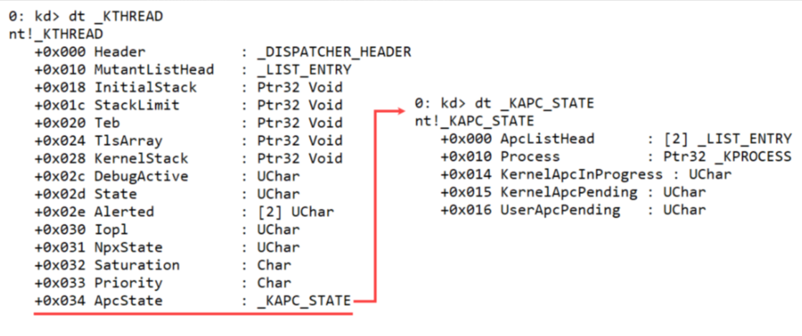
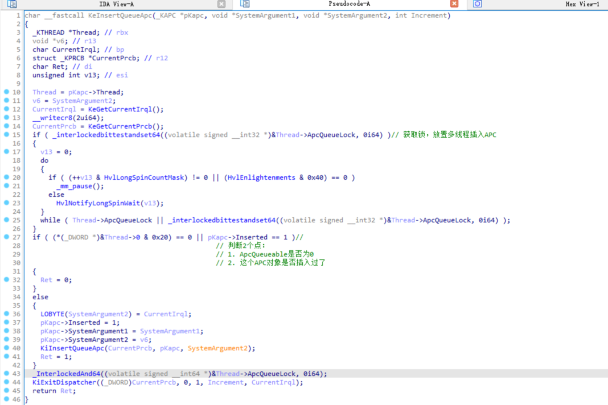

<!--more-->

## APC机制

1. 线程是不能**被**结束、挂起、恢复的，线程在运行时，会占据当前CPU。设想一种极端的情况：一条线程不调用任何API、屏蔽中断、不触发任何异常，那么这条线程就会永久占用CPU，线程只有自己执行代码将自己结束。
2. 如果我们要控制线程的行为，就要提供一个函数让线程去执行，这个过程就是APC
3. 这里可以有一个形象的比喻：每一个线程都存在一个"信箱"，往这个信箱送信就是**插入APC**，至于这个线程什么时候查看信件（什么时候执行APC回调），就是随机的，有时候快、有时候慢


## 线程中保存的APC状态

1. `_KTHREAD`对象下保存着`ApcState`，定义如下所示：

```c
//0x600 bytes (sizeof)
struct _KTHREAD
{
    struct _DISPATCHER_HEADER Header;                                       //0x0
    VOID* SListFaultAddress;                                                //0x18
    ULONGLONG QuantumTarget;                                                //0x20
    VOID* InitialStack;                                                     //0x28
    VOID* volatile StackLimit;                                              //0x30
    VOID* StackBase;                                                        //0x38
	// ...
	union
    {
        struct _KAPC_STATE ApcState;                                        //0x98
        // ...
    };
	// ...
};
```

2. 关于`KAPC_STATE`对象结构，如下所示：

```c
//0x30 bytes
struct _KAPC_STATE
{
    struct _LIST_ENTRY ApcListHead[2];                                      //0x0
    struct _KPROCESS* Process;                                              //0x20
    union
    {
        UCHAR InProgressFlags;                                              //0x28
        // ...
    };
    UCHAR KernelApcPending;                                                 //0x29
    union
    {
        UCHAR UserApcPendingAll;                                            //0x2a
        // ...
    };
};
```

3. 其实关键字段定义如下所示：

| 成员字段         | 定义                                |
| ---------------- | ----------------------------------- |
| ApcListHead[2]   | 双向链表，分别保存内核、用户APC对象 |
| Process          | 当前线程的"养父"进程是谁            |
| InProgressFlags  | 当前线程是否正在处理APC             |
| KernelApcPending | 有KernelMode的APC等待被处理         |
| UserApcPending   | 有UserMode的APC等待被处理           |

4. 使用WinDbg双机调试，可以查看`ApcState`的对象结构，如图所示：




## 备用APC队列

1. 通过之前内容的学习，我们知道了一个线程是可以暂时`附加` 到其他的进程上下文的，那么线程处于挂靠状态时，原有的`ApcState`需要进行备份，就引出了`_KTHREAD.SavedApcState`
2. A线程附加到其他进程上下文时，会提前将`ApcState`备份到`SavedApcState`（也可以说是交换两者内容），解除附加状态时，就会还原其中内容
3. 到了这里我们知道，当一个线程附加到其他进程上下文时，此时插入Apc，是插入到了备用Apc对应中


## _KAPC

1. Apc对象定义如下所示：

```c
//0x58 bytes (sizeof)
struct _KAPC
{
    UCHAR Type;                                                             //0x0
    UCHAR SpareByte0;                                                       //0x1
    UCHAR Size;                                                             //0x2
    UCHAR SpareByte1;                                                       //0x3
    ULONG SpareLong0;                                                       //0x4
    struct _KTHREAD* Thread;                                                //0x8
    struct _LIST_ENTRY ApcListEntry;                                        //0x10
	VOID (KernelRoutine)(struct _KAPC arg1, VOID (arg2)(VOID arg1, VOID arg2, VOID* arg3), VOID** arg3, VOID** arg4, VOID** arg5); //0x20
	VOID (RundownRoutine)(struct _KAPC arg1);                     //0x28
	VOID (NormalRoutine)(VOID arg1, VOID* arg2, VOID* arg3);      //0x30
    VOID* NormalContext;                                                    //0x38
    VOID* SystemArgument1;                                                  //0x40
    VOID* SystemArgument2;                                                  //0x48
    CHAR ApcStateIndex;                                                     //0x50
    CHAR ApcMode;                                                           //0x51
    UCHAR Inserted;                                                         //0x52
};
```

2. 其实关键字段定义如下所示：

| 成员字段                      | 定义                                                         |
| ----------------------------- | ------------------------------------------------------------ |
| Thread                        | 当前APC对象所属的线程对象是谁                                |
| ApcListEntry                  | 猜想可以通过这个对象找到同线程对象下的其他APC对象            |
| KernelRoutine                 | **不能为NULL**，提供一个内核态回调函数，**轻量级别任务，参数检查之类的** |
| RundownRoutine                | APC插入失败时调用这个函数，一般传NULL                        |
| NormalRoutine                 | 分为以下2种情况：（1）用户APC：指向的其实是用户态APC总分发入口`KiUserApcDispatcher`  （2）内核APC：指向一个自定义的内核函数入口 |
| NormalContext、SystemArgument | 携带参数                                                     |
| ApcMode                       | 用户模式、内核模式                                           |
| Inserted                      | 当前APC对象是否已插入                                        |


## 内核模式特殊APC

1. 什么叫`内核特殊APC`，就是一个内核态的APC对象，其中的`NormalRoutine = NULL`
2. 此时该APC对象就是特殊的，在插入APC时，会优先插入到普通内核APC的前面（头插法），如图所示：


3. 由图可知，内核特殊APC的**执行优先级是更高**的


## 线程可警醒与APC

1. 在用户态开发中，有时需要主动交出CPU所有权，例如延时、等待事件，可以调用如下函数：

```c
DWORD SleepEx(
  DWORD dwMilliseconds, // time-out interval
  BOOL bAlertable        // early completion option
);

DWORD WaitForSingleObjectEx(
  HANDLE hHandle,       // handle to object
  DWORD dwMilliseconds, // time-out interval
  BOOL bAlertable       // alertable option
);
```

2. 以上函数的最后一个参数都是`bAlertable`（是否可警醒），这里粗俗的理解就是是否能提前唤醒该线程
3. 当`bAlertable = TRUE`时，此时插入用户APC是可以**提前唤醒**该线程的，否则就不能


## 初始化APC

1. 本篇笔记中涉及到的函数原型、指针类型定义，均来自WRK，如下所示：

```c
// 初始化一个APC对象
VOID
KeInitializeApc (
    __out PRKAPC Apc,
    __in PRKTHREAD Thread,
    __in KAPC_ENVIRONMENT Environment,		// 要插入APC的环境
    __in PKKERNEL_ROUTINE KernelRoutine,	// 内核APC例程
    __in_opt PKRUNDOWN_ROUTINE RundownRoutine,	// 插入APC失败时的例程
    __in_opt PKNORMAL_ROUTINE NormalRoutine,	// 普通例程
    __in_opt KPROCESSOR_MODE ApcMode,		    // 内核、用户APC
    __in_opt PVOID NormalContext			// 携带参数
    );
```


## 插入APC

1. 在初始化好一个APC对象后，可以调用如下函数插入APC：

```c
// 插入APC对象
BOOLEAN
KeInsertQueueApc (
    __inout PRKAPC Apc,		// 初始化好的APC对象
    __in_opt PVOID SystemArgument1,	// 携带参数1
    __in_opt PVOID SystemArgument2,	// 携带参数2
    __in KPRIORITY Increment
    );
```

2. `KeInsertQueueApc`其实是一个很薄的`Wrapper`，内核主要是做检查：
   1. 获取APC插入锁，多线程同步、安全问题（禁止多线程插入APC、禁止APC派发中插入APC）
   2. 判断当前线程是否禁用了APC，即判断`ApcQueueEnable == 0`
   3. 判断APC对象是否已经插入过了，避免重复插入
   4. 最后调用`KiInsertQueueApc`实现插入APC




## 附加参考内容（WRK）

```c
typedef enum _KAPC_ENVIRONMENT 
{
    OriginalApcEnvironment,
    AttachedApcEnvironment,
    CurrentApcEnvironment,
    InsertApcEnvironment
} KAPC_ENVIRONMENT;
```

```c
typedef
VOID
(*PKNORMAL_ROUTINE) (
    IN PVOID NormalContext,
    IN PVOID SystemArgument1,
    IN PVOID SystemArgument2
    );

typedef
VOID
(*PKKERNEL_ROUTINE) (
    IN struct _KAPC *Apc,
    IN OUT PKNORMAL_ROUTINE *NormalRoutine,
    IN OUT PVOID *NormalContext,
    IN OUT PVOID *SystemArgument1,
    IN OUT PVOID *SystemArgument2
    );

typedef
VOID
(*PKRUNDOWN_ROUTINE) (
    IN struct _KAPC *Apc
    );
```
