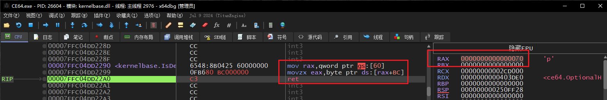
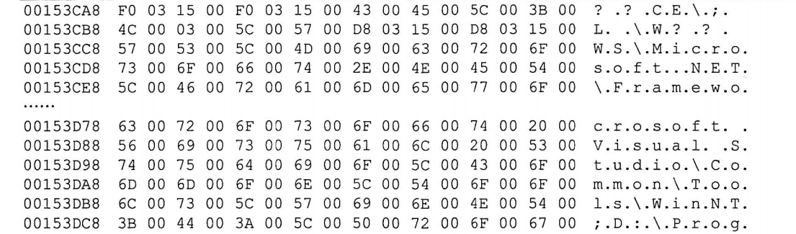
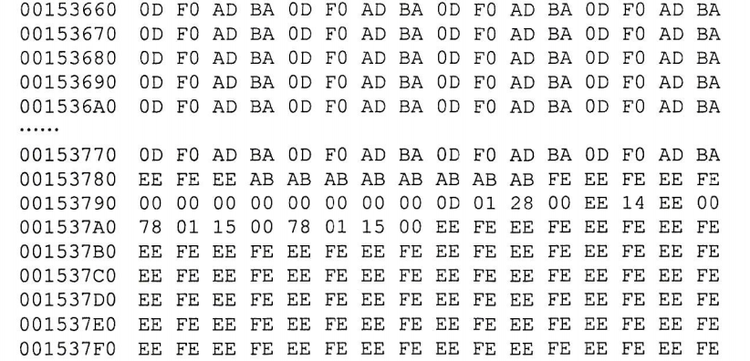
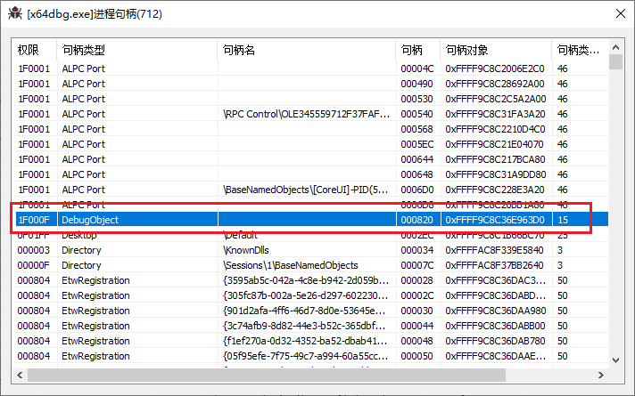
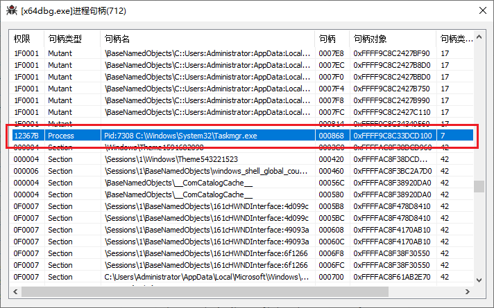
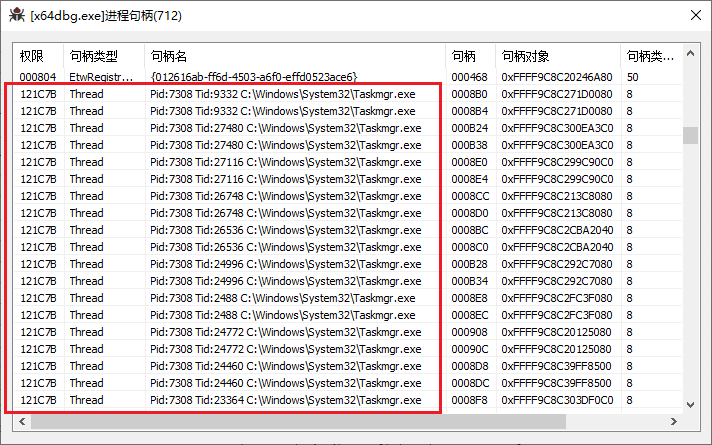
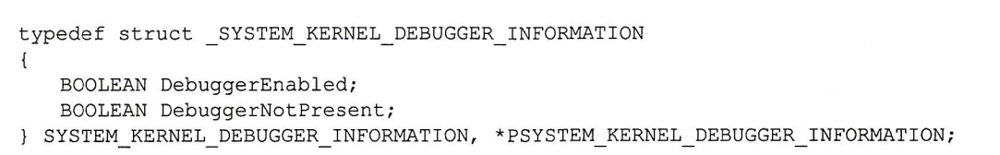

<!--more-->

## PEB.BeingDebugged（附加调试）

1. 当附加调试时，会将`PEB.BeingDebugged = 1`
2. `IsDebuggerPresent`函数查的就是这个标志位，代码反汇编如下

```c
mov rax,qword ptr gs:[60]
movzx eax,byte ptr ds:[rax+2]
ret 
```


## PEB.BeingDebugged（创建子进程）

1. 将可执行文件拖入调试器时，会将`PEB.BeingDebugged = 1`
2. 但是由于此时进程刚刚创建，大量的**进程初始化函数**、**_crt库函数**会被调用，很多点都会判断这个标志位`BeingDebugged = 1`是否成立，如果是则会设置一些关联标志位

### PEB.NtGlobalFlag

1. 拖入可执行文件到调试器调试，此时`PEB.NtGlobalFlag = 0x70`，否则为NULL



2. 所以很多商业化的VT调试器，往往**仅支持附加调试**


### Heap Magic标志位

1. 拖入可执行文件到调试器调试，程序在初始化流程中，一个重要步骤就是会初始化堆（Heap）
2. 在调用`RtlCreateHeap`函数时，该函数内部会判断`PEB.BeingDebugged = 1`，如果成立，那么在新创建的堆中会写入一系列的`Magic Number`
3. 正常状态下的Heap，只有一些没有初始化的数值：



4. 拖入调试状态下，会明显发现有非常规律排布的内容：
    1. 例如`0D F0 AD BA`这个字节序列大量、反复出现
    2. 反调试方可以循环扫描所有的Heap，检查其中的特征点




## TEB.DbgSsReserved[1]

1. 在上一章节的调试体系分析中，我们知道`TEB.DbgSsReserved[1]`保存的是调试句柄
2. 那么我们枚举扫描所有线程，检查这个位是否不为NULL，通过这种方式可以判断该进程是不是一个调试器


## CheckRemoteDebuggerPresent

1. 这个函数内部其实是调用`NtQueryInformationProcess`检查`EPROCESS.DebugPort`进程调试端口
2. 如果DebugPort不为NULL，说明被调试了


## DebugObject（内核调试对象）

1. 已知不管是拖入可执行文件调试、附加调试，都会调用`DebugActiveProcess`来附加到目标进程
2. 我们在前面章节中已经详细分析过了Win调试体系，知晓内核态最终会调用`ZwCreateDebugObject`创建一个DebugObject调试对象，其对象类型为`DbgkDebugObjectType`
3. 我们知道Win下万物皆对象，`DbgkDebugObjectType`本身也是一个对象实例，有着初始权限、创建、销毁时的回调，那么就有以下操作：
    1. 将这个默认的`DbgkDebugObjectType`初始权限设置为0，这样新创建出来的调试对象就没任何权限，不会PG，但是这样会导致全局调试器失效
    2. 每创建一个`DbgkDebugObjectType`类型的调试对象，都有计数的，可以调用`NtQueryObject`获取所有对象信息，判断其中的DebugObject数量，不为0则当前系统下有调试器，**但是无法判断被调试进程是谁**，只能友善地提示用户关闭调试器、重启机器


## ThreadHideFromDebugger（异常逃逸）

1. 在内核态中，会调用`DbgkForwardException`函数将异常派发到R3调试器，在该函数内部，存在如下代码：
2. 在如下代码中，判断线程`PS_CROSS_THREAD_FLAGS_HIDEFROMDBG`标志位，如果置位了，将`Port = NULL`，后续该函数直接返回FALSE，停止异常派发

```c
BOOLEAN
DbgkForwardException(
    IN PEXCEPTION_RECORD ExceptionRecord,
    IN BOOLEAN DebugException,
    IN BOOLEAN SecondChance
    )
{
    // ...
    
    Process = PsGetCurrentProcess();
    if (DebugException) {
        if (PsGetCurrentThread()->CrossThreadFlags&PS_CROSS_THREAD_FLAGS_HIDEFROMDBG) {
            Port = NULL;
        } else {
            Port = Process->DebugPort;
        }
        LpcPort = FALSE;
    } else {
        Port = Process->ExceptionPort;
        m.h.u2.ZeroInit = LPC_EXCEPTION;
        LpcPort = TRUE;
    }
    
    if (Port == NULL) {
        return FALSE;
    }   


    // ...
}
```


## 调试器占坑（双进程保护）

1. 在Win调试体系中，调试器、被调试进程属于是一一对应的关系，不存在一调试多的情况
2. 那么我们可以使用双进程策略，A进程先启动，A进程调用`CreateProcess`函数，创建时传入参数`DEBUG_PROCESS`，这样真正的主进程B创建出来时，`Process.DebugPort`就被占坑了，后续其他调试器都会附加失败
3. 当然，如果是自建调试体系，在`Hook_DbgkForwardException`中判断当前出异常的进程是不是我们关心的，如果是，就发往我们自己的DebugObject


## 父进程检查

1. 这种方式只要检测拖入调试的情况
2. 正常运行一个程序，其父进程往往是资源管理器explorer.exe、cmd.exe、service.exe
3. 检查父进程名，如果不是这些常见的进程，虽然不能断定处于被调试状态，但是风险系数可以提高


## 句柄表扫描（调试句柄、进程句柄、线程句柄）

1. 在前文中，已提及`TEB.DbgSsReserved[1]`下保存的是调试句柄，但是从该变量名可知这是一个供系统内部保留使用的字段，其实在句柄表中也会保存一份**调试句柄**



2. 一个调试器，要想实现反汇编、软件断点、页面异常断点、扫描内存，就需要获取**目标进程句柄**，就会在进程句柄表中留下痕迹，进程句柄只有一个



3. 当要下硬件断点、单步走获取寄存器环境时，必须要获取**线程句柄**，调试器往往会获取多个线程句柄
    1. 由下图中可以发现，调试器获取了大量的线程句柄，应该是每条线程都获取了句柄




## 内核调试器（双机调试）

1. 这种检测主要针对双机调试，R3调用`ZwQuerySystemInformation`时，查询`SystemKernelDebuggerInformation`，此时返回如下对象：



2. 会返回给调用者当前环境下**是否启用内核调试**、是否**处于内核调试状态**


## 时间测信道检测

1. 假设正常调用一个函数耗时`20ms`，如果该函数被调试、单步走了，那么这个函数执行一次所需的时间必定大幅度上升，从**毫秒级到秒级**
2. 这个检测原理非常好理解，哪怕使用调试器的自动Trace功能，涉及到了异常派发，需要反复进入、退出R0，肯定会造成明显的时间增加
3. 单步调试的情况下，我们看到会走几步就停下来，观察寄存器环境、堆栈，也会显著增加执行耗时
4. 我们在敏感函数的开始、结束处调用`__readtsc`获取CPU时间戳计数（当然，只要是可以获取时间相关信息的函数都可以GetLocalTime、QueryPerformanceCounter等等都可以），可以大概计算出运行耗时，如果实际耗时远远超过合理范围内，那么风险系数增加（不能武断认为就是被调试了，用户使用场景千奇百怪，说不定真是偶尔卡了）
5. 时间测信道检测，是一个非常常用、且强力的检测手段：
    1. 在检测无痕Hook、调试、hv方面都有着应用
    2. 但是其缺点也非常明显，只能**针对敏感函数进行检测**，无法全局化
    3. Hv中可以进行**时间补偿**


## 扫描软件断点、硬件断点

1. 没啥好说的，扫描内存块，扫描函数体中是否存在`0xCC`
2. 扫描自身所有线程上下文，检查Dr0~Dr3是否有线性地址，如果有可以直接清空、上报服务器


## 主动制造异常

1. 我们可以利用SEH机制，因为处于被调试状态时，异常会优先派发到调试器，我们可以利用这一点，例子如下所示：
2. 如下例子中，就是利用主动抛出异常来检测调试状态

```c
BOOL CheckDbgState()
{
    __try
    {
        // 1. 关闭一个不存在句柄，会导致EXCEPTION_INVALID_HANDLE异常
        CloseHandle(0xABABABAB);

        // 2. 写入空指针，会导致权限异常C0000005
        *(ULONG*)0 = 1;

        // 3. 模拟触发异常
        RaiseException(...);

        // 如果存在调试器，这个异常首先会被调试器接管
        // 用户F9放行后，回到出现异常的下一行代码继续执行，就会返回TRUE
        return TRUE;
    }
    __except(GetExceptionCode() == xxx ? 
             EXCEPTION_EXECUTE_HANDLER : 
             EXCEPTION_CONTINUE_SEARCH)
    {
        // 如果没有调试器，会正常走到这里，返回FALSE即可
        return FALSE;
    }
}
```

3. 但是这种检测方式是有缺陷的，在x64Dbg这款调试器中，我们可以设置让**被调试进程自己处理首次异常**


## 利用内存工作集实现反调试

1. 这种方式有点类似安卓中的缺页反调试，大概原理是分配一个初始的内存工作集（我们自己不能访问该工作集），当调试器x64Dbg扫描区域字符串、扫描引用，CE扫描内存特征时，如果访问了我们初始化的内存工作集，那么这个工作区的状态就会被改变
2. 我们就可以通过这个状态的变化，来判断调试状态


## 扫描调试器信息（窗口、进程信息）

1. 这种方式属于是**主动出击**，扫描外部环境有没有可疑的窗口信息、进程信息
2. 当然，这种方式往往也是被调试器开发者重点关注的地方，会专门实现窗口隐藏、进程隐藏等等手段，需要注意的是，Win平台下不存在完美的窗口隐藏、进程隐藏的方式：
    1. 处理各种窗口相关的函数，例如NtUserFindWindow、NtUserEnumWindow、NtUserWindowFromPoint等等，可以干掉常规的窗口扫描
    2. 窗口的内核对象是不能随便断链的，将tagWnd断链后，系统就无法正常派发窗口消息到窗口处理过程函数了，看到的现象就是窗口白屏无响应
    3. 进程完美隐藏也做不到，因为在Win系统下，进程核心作用就是**提供内存空间（Cr3）**，真正执行代码的实体的线程，将进程断链、抹除各种痕迹后，表面上查不到进程信息了，但是可以通过线程来反查进程
    4. 这是就有聪明的偏朋友说了，那我把线程也断链不就行了！问题是线程断链后，内核线程调度器就找不到你这个线程了，即线程断链后都没法正常运行了，那你这隐藏线程有什么意义？
3. 我们还可以搜集常用的调试，**提取调试器特征码**，这种做法其实很类似杀软的病毒库


## 小结

1. 关于反调试这部分章节的内容，大多数操作都是基于用户层的对抗，没什么很深入的奇技淫巧


## 参考资料

1. 反调试、反反调试Git仓库：[ScyllaHide](https://github.com/x64dbg/ScyllaHide)、[al-khaser](https://github.com/ayoubfaouzi/al-khaser)
2. 《加密与解密》第18章
3. 网站收录了很多反调试技术（很全）

[Anti-Debug Tricks](https://anti-debug.checkpoint.com/)
