<!--more-->

## 调试器与被调试程序

1. 在Win调试体系中，`调试器`与`被调试程序`是通过调试对象进行关联的
2. 而这个调试对象是保存在内核层中的

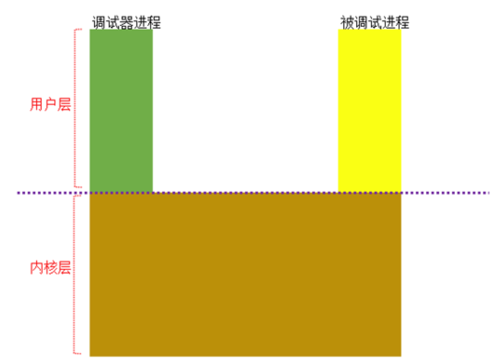

## 建立调试关系

### DebugActiveProcess

1. `DebugActiveProcess`内部主要调用的是`DbgUiConnectToDebug`，如下所示：

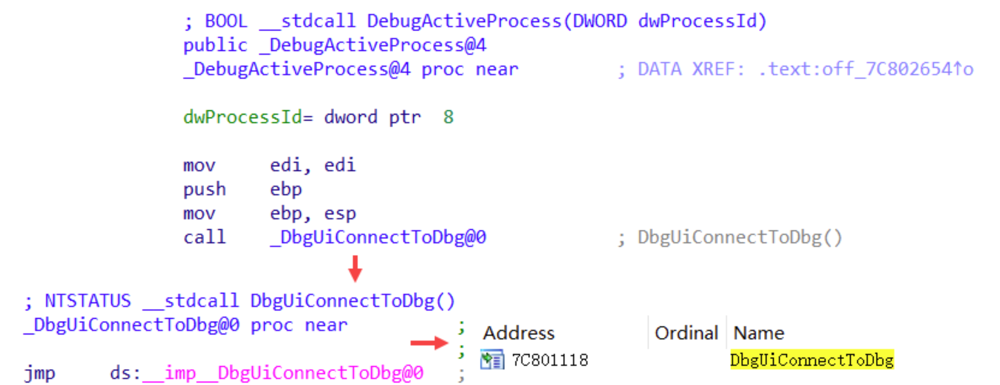


### DbgUiConnectToDbg

1. 如何创建：调用`ZwCreateDebugObject`为调试器创建一个调试对象，该函数原型如下：

```c
//
// System calls
//

/**
 * Creates a debug object.
 *
 * \param DebugObjectHandle A pointer to a variable that receives the debug object handle.
 * \param DesiredAccess The access rights desired for the debug object.
 * \param ObjectAttributes Optional. A pointer to an OBJECT_ATTRIBUTES structure that specifies the attributes of the debug object.
 * \param Flags Flags for the debug object creation. (DEBUG_KILL_ON_CLOSE)
 * \return NTSTATUS Successful or errant status.
 */
_Kernel_entry_
NTSYSCALLAPI
NTSTATUS
NTAPI
NtCreateDebugObject(
    _Out_ PHANDLE DebugObjectHandle,	// 接受返回的调试对象句柄
    _In_ ACCESS_MASK DesiredAccess,		// 调试权限
    _In_opt_ POBJECT_ATTRIBUTES ObjectAttributes,	// 对象属性
    _In_ ULONG Flags
    );
```

2. 其中的`参数1`其实传入的是一个指针，在传递参数时传递的是`TEB.DbgSSReserved[1]`的指针，所以可知`TEB.DbgSSReserved[1]`保持的是调试句柄
3. 关于`DbgUiConnectToDbg`函数的流程，如下所示：

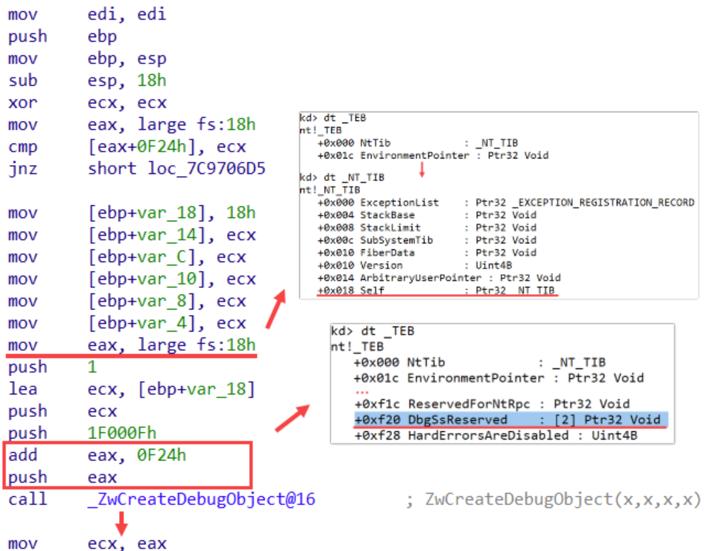


### ProcessIdToHandle

1. 这个函数的用途是将进程ID转为进程句柄，这里打开目标进程获取其句柄
2. 再将获取到的进程句柄作为参数1传入，调用`DbgUiDebugActiveProcess`

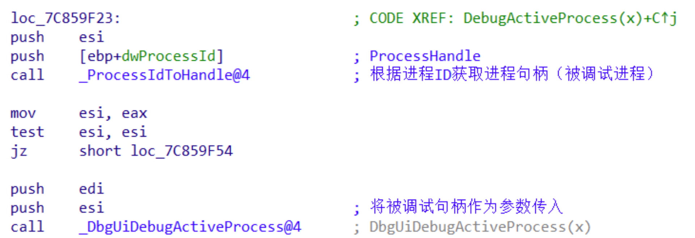


### DbgUiDebugActiveProcess

1. 该函数内部就是调用了`NtDebugActiveProcess`，传入参数为`被调试进程句柄`、`调试对象句柄`

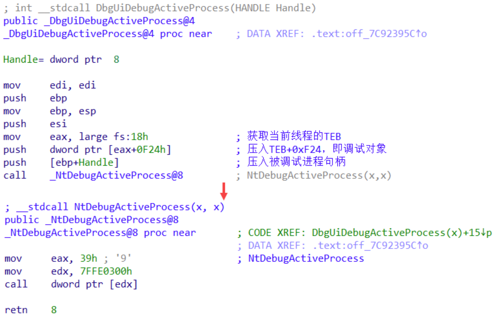


### NtDebugActiveProcess

1. 这里需要复习、强调的是：

> 1. 句柄这玩意设计出来是给R3进程使用的，避免R3进行直接操作内核对象本身
> 2. 在内核开发中，都应该先将句柄对象转换为内核对象本身，很眼熟的函数是`ObReferenceObjectByHandle` 
>

2. 在本函数中会将被调试进程句柄、调试对象句柄转为内核对象，如下所示：

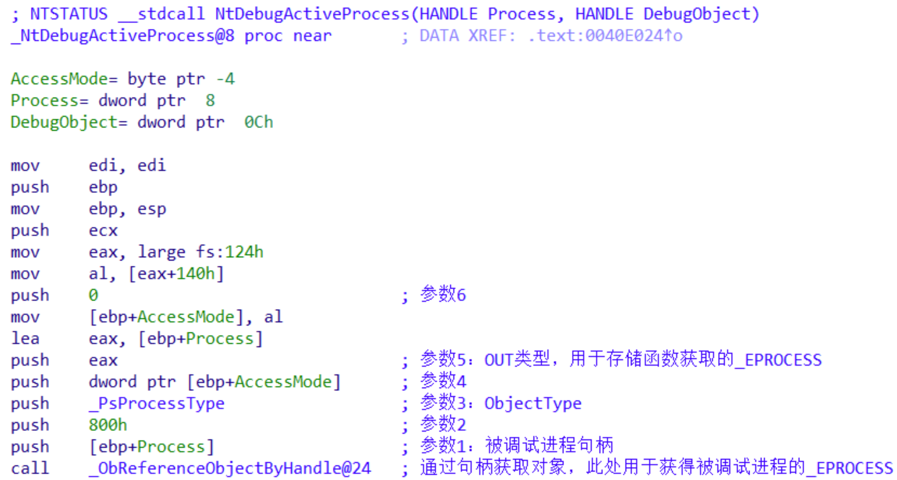

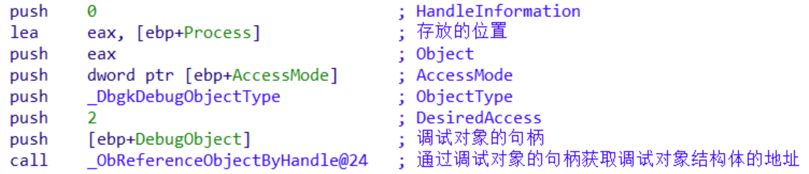

3. 继续判断两种不能调试的情况：

> 1. 不能调试自身
> 2. 不能调试`System`进程
>


### DbgkpSetProcessDebugObject

1. 该函数的作用只有一点：将`DebugObject`对象设置到`被调试进程EPROCESS`中
2. 这里有一个反调试的点：

> 1. 要对进程对象进行设置，肯定要先获取进程Rundown锁，确保进程是有效的，那么作为反调试的一方，我们可以自己长时间占有这把锁
>

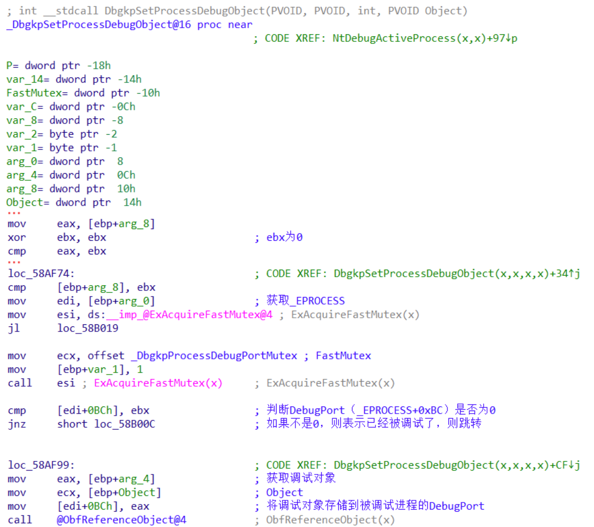


### 小结

1. 到了这里，调试对象创建好了，`调试器`、`被调试进程`之间也创建好联系了
2. 两者调试的`"管道"`如下所示：

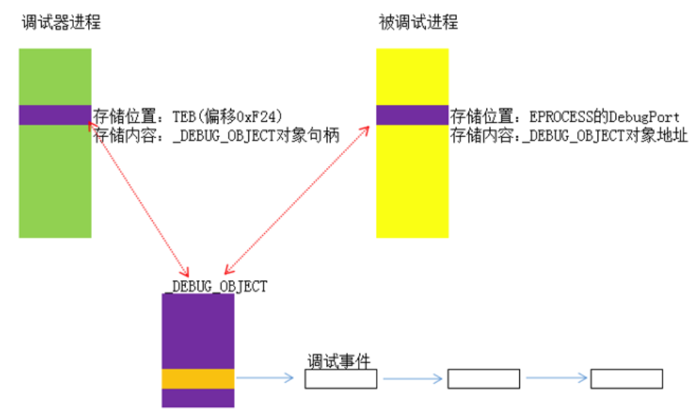


## DEBUG_OBJECT调试对象

1. 关于调试对象`DEBUG_OBJECT`，这个对象其实是一个结构体，如下所示：

```c
typedef struct _DEBUG_OBJECT
{
    KEVENT EventsPresent;		// 事件对象，有调试事件时，会激活该事件
    FAST_MUTEX Mutex;			// 锁，多线程操作这个调试对象，必须要加锁
    LIST_ENTRY EventList;		// 链表，用来保存所有的调试事件，其中节点为DEBUG_EVENT

    union
    {
        ULONG Flags;

        struct
        {
            ULONG DebuggerInactive : 1;		// 调试器处于"不活跃"状态，不在接受调试事件
            ULONG KillProcessOnExit : 1;	// 调试器退出时结束被调试进程
            ULONG Reserved          : 30;
        };
    };
} DEBUG_OBJECT, *PDEBUG_OBJECT;
```


## DEBUG_EVENT调试事件

1. 调试事件对象，`DEBUG_OBJECT.EventList`的每一个节点，保存的是`DEBUG_EVENT`对象，其结构如下所示：
2. 在R3存在一个同名的对象，所以为了方便区分，可以将R0对象称为`DBGKM_DEBUG_EVENT`

```c
typedef struct _DEBUG_EVENT
{
    LIST_ENTRY EventList;
    KEVENT ContinueEvent;

    CLIENT_ID ClientId;
    PEPROCESS Process;
    PETHREAD Thread;

    NTSTATUS Status;
    ULONG Flags;

    PETHREAD BackoutThread;
    DBGKM_MSG ApiMsg;
} DEBUG_EVENT, *PDEBUG_EVENT;
```


## 调试事件采集

1. 在Win内核中，提供了一些了`Dbgk`开头的函数，用于调试事件的采集
2. 在系统的某些核心函数调用路径上，就会调用这些`Dbgk`函数，将调试事件发送到调试端口，如下所示：
3. 调用这些`Dbgk`系列函数时，都会判断`EPROCESS.DebugPort`是否为NULL，不为空则发送调试事件

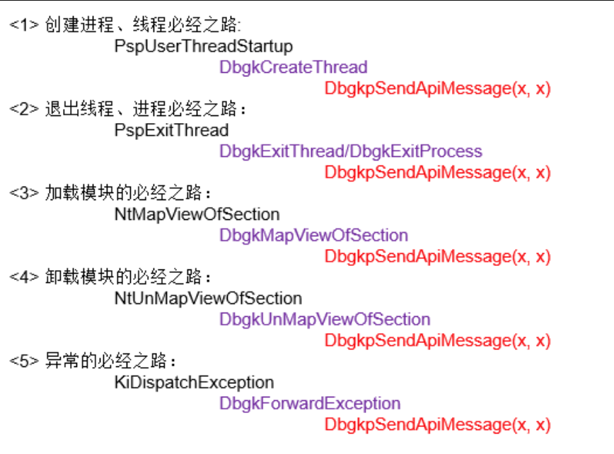


### 创建进程、线程（退出进程、线程）

1. 创建进程的本质其实就是创建线程，一般进程创建的第一个线程称为主线程，此时会有一个标志，表示为该进程的第一个线程，此时就会将调试信息封装为`创建进程`
2. 退出进程的本质其实就是退出线程，退出的最后一个线程，就会将其视为退出进程，将调试信息封装为`退出进程`


### DbgkSendApiMessage

1. 如同可知，该函数接受2个参数，分别为`封装好的调试事件`、`是否挂起进程（排除当前线程）`
2. 由下图也可以得知，调试事件内部一个字段为事件类型，跟如下枚举值对的上：

```c
typedef enum _DBGKM_APINUMBER
{
    DbgKmExceptionApi = 0, 			// 异常
    DbgKmCreateThreadApi = 1, 		// 创建线程
    DbgKmCreateProcessApi = 2, 		// 创建进程
    DbgKmExitThreadApi = 3, 		// 线程退出
    DbgKmExitProcessApi = 4, 		// 进程退出
    DbgKmLoadDllApi = 5,  			// 加载DLL
    DbgKmUnloadDllApi = 6, 			// 卸载DLL
    DbgKmErrorReportApi = 7, 		// 已废弃
    DbgKmMaxApiNumber = 8, 			// 最大值
} DBGKM_APINUMBER; 
```

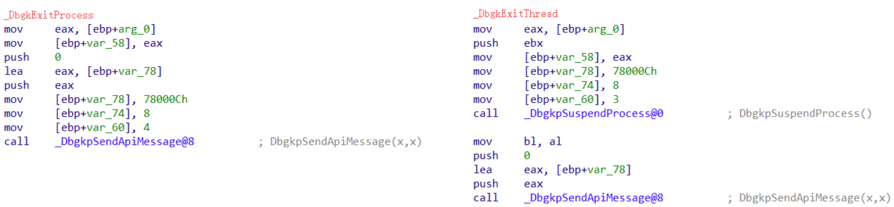

3. 该函数内部其实主要调用的是`DbgkQueueMessage`函数，如图所示：

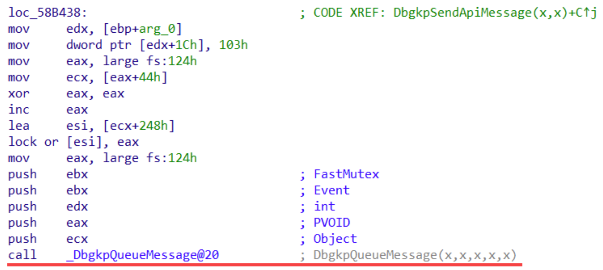


### DbgkQueueMessage

1. 该函数的主要功能，是取出当前进程下的`DebugPort`，将调试事件加入到`DebugPort.EventList`中

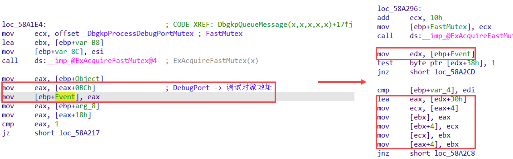


## 调试假消息

1. 调试器附加一个已经存在的进程时，调试器还是会收到`模块加载`、`线程创建`等**"早已过时"**的消息
2. 这其实是调试体系为了补齐调试信息，但是笔者这里认为，如果出于自建调试体系的目的，这个假消息似乎并不是那么重要，一是我们并不关心附加调试前发生了什么，二是这些假消息其实并不保真（模块消息是根据PEB.Ldr模块链表构造的，PEB中的信息，R3都能随意修改）
3. 在调用`NtDebugActiveProcess`函数开头，调用了`DbgkPostFakeProcessCreateMessage`，该函数内部如下所示：

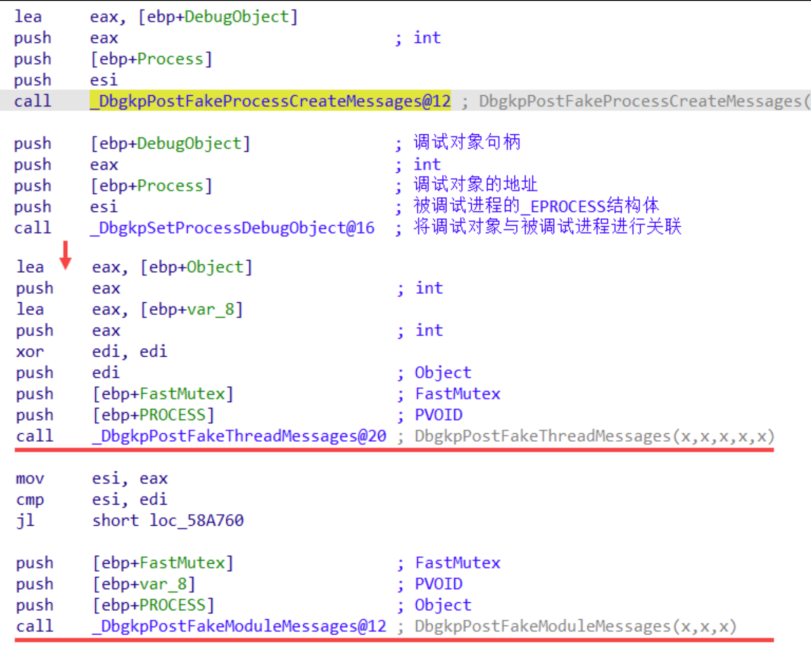


## 首次附加断点

1. 调试器在调用`DebugActiveProcess`时，该函数内部在成功建立调试链接后，会调用`DbgUiIssueRemoteBreakin`，这个函数内部其实就是创建远程线程，远程线程入口点为`DbgUiRemoteBreakin`（其实就是`int 3`）
2. 大部分的AC都会Hook `DbgUiRemoteBreakin`，将其指向`ExitProcess`等函数
3. 所以我们要处理首次附加断点，有2种方式：

> 1. 本地Hook`DbgUiIssueRemoteBreakin`要直接返回成功，首次附加断点其实不是必要功能
> 2. 热补丁`DbgUiIssueRemoteBreakin`，远程线程入口直接就是一个`int 3`
>


## 调试器软件断点修正

1. 使用`调试器`下软件断点时，命中断点时，调试器UI会显示在目标代码那行，其实调试器内部做了以下操作：

> 1. 保存原1字节
> 2. 写入0xCC
> 3. 软件断点命中
> 4. 还原1字节代码
> 5. 修正Rip - 1
>

2. 有以上步骤可知：当CPU在执行当前指令的时候，`RIP`存储的是**下一行指令的地址**，所有调试器需要将Rip - 1处理

### 提前接管异常派发（吞掉软件断点）

1. 所以当我们要`反调试`时，遇到软件断点，直接放行即可，如果再次手动修正`Rip++`，就有问题了
