<!--more-->

## CPU异常、IDT表

1. 当CPU发生异常（例如：除0异常）时会发出中断，到`IDT表` 根据中断向量号查询对应的`ISR`中断处理回调
2. 在IDA中`Alt + T` 搜索字符串`_IDT`，定位到IDT表

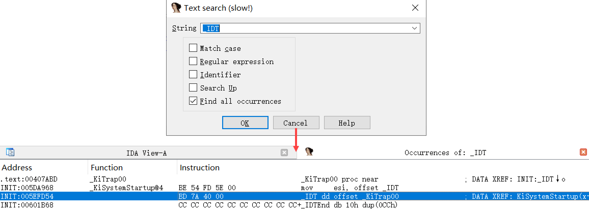


### KiTrap00函数

1. 已知IDT表中的0号异常为除零异常，如图所示：

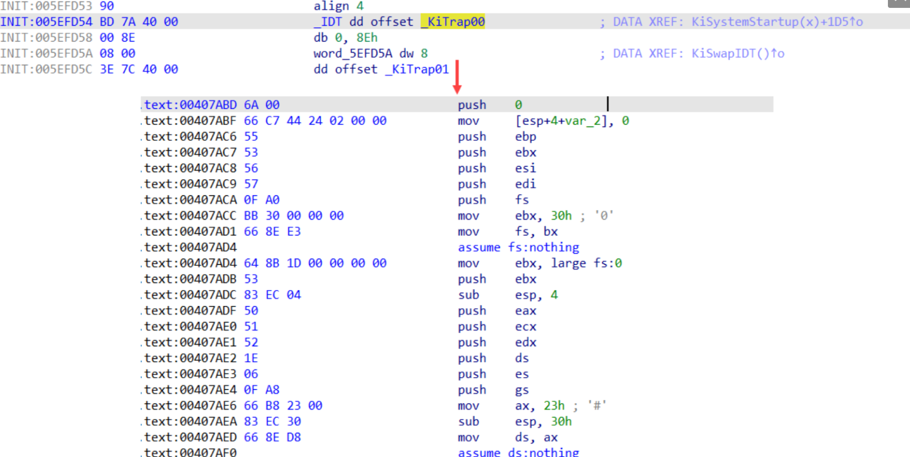

2. 在中断处理函数中，并没有直接处理异常，微软在设计异常处理体系时，是希望程序员自己优先处理异常。该函数核心调用点为`CommonDispatchException` 函数

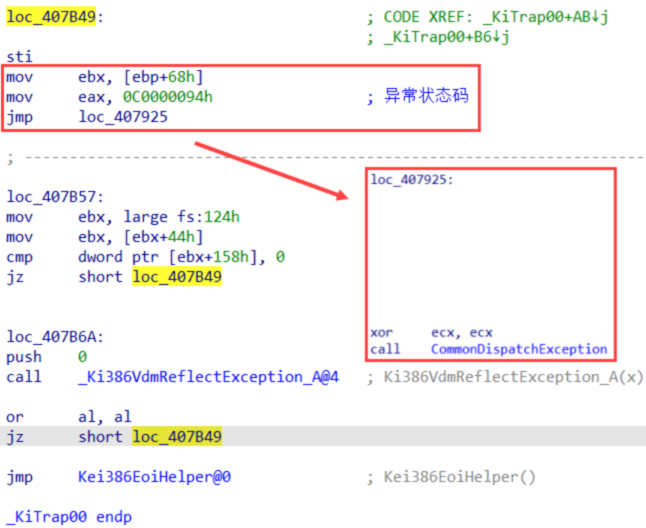


### CommonDispatchException函数

1. 这个函数头部抬升堆栈，分配了一个局部变量`ExceptRecord`对象
2. 填充`ExceptRecord`对象的各个字段内容，该过程就是**异常的记录**
3. 最后调用`KiDipatchException` ，异常的分发

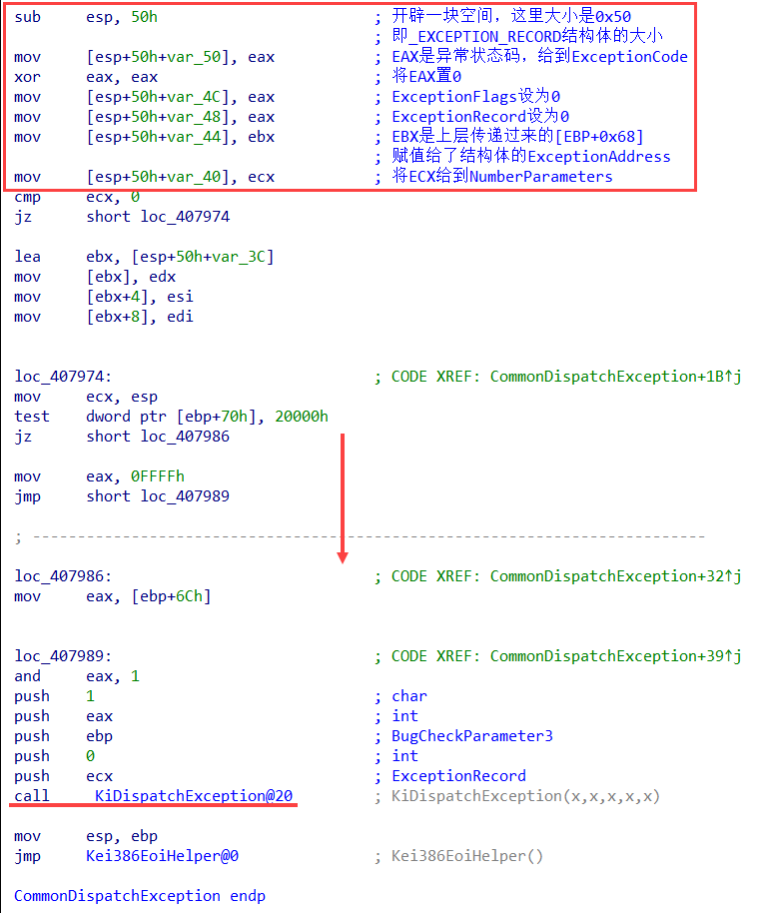


## 模拟异常

1. 代码如下所示，主动抛出一个异常：

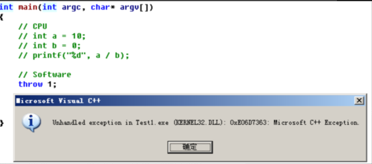

2. 该代码的反汇编如下所示，很明显第一个参数`push 1`，然后`call __CxxThrowException`，这层属于编译器拓展，不用深入分析

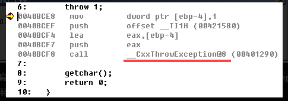

3. 继续跟进这个函数，该函数内部调用了`RaiseException`，该函数是R3模拟异常起始点

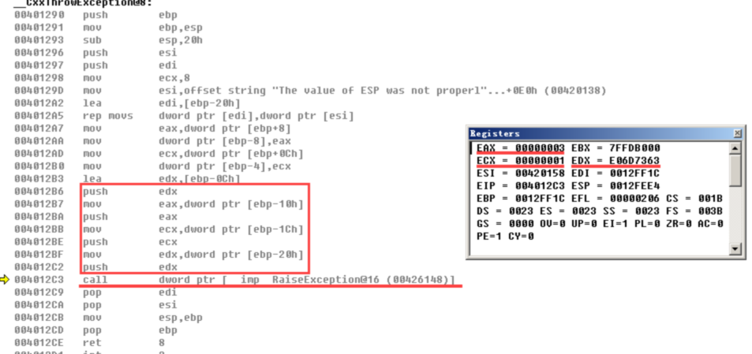


### RaiseException

1. 在这个函数会在堆栈中构造`ExceptionRecord`对象，完成异常的记录
2. 在模拟异常中，`ExceptionAddress`是`RaiseException`函数地址，并不是原代码中`throw 1`代码地址

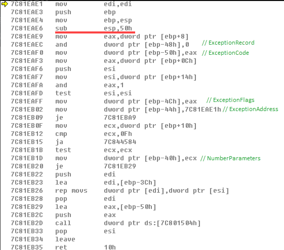


### KiRaiseException

1. 后续代码执行流程：

```c
RaiseException 
	-> RtlRaiseException 
		-> ntdll!NtRaiseException 
			-> nt!NtRaiseException 
				-> KiRaiseException 
					-> KiDispatchException
```


## CPU异常、模拟异常小结

1. CPU异常：CPU异常发生时，一定会到IDT表中根据异常向量号查询对应的异常处理回调

> 换句话说：想知道哪些属于CPU异常，直接查IDT表即可0

1. 模拟异常：依赖编译器拓展，主动调用`Kernel32!RaiseException`抛出异常
2. 最后的共同点都是调用`KiDispatchException` 函数实现异常派发（总的分发点）

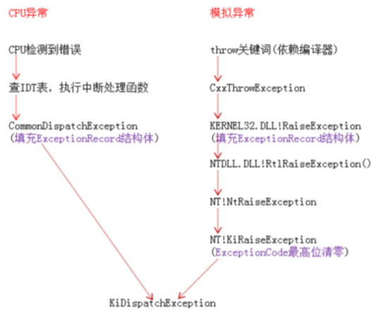


## KiDispatchException（内核异常派发核心）

1. 该函数签名如下所示：

```c
VOID KiDispatchException(
   IN PEXCEPTION_RECORD ExceptionRecord,    // 异常记录
   IN PKEXCEPTION_FRAME ExceptionFrame,     // 异常帧，不用管，都是NULL
   IN PKTRAP_FRAME TrapFrame,            	// R3最后现场
   IN KPROCESSOR_MODE PreviousMode,    		// 先前模式
   IN BOOLEAN FirstChance    				// 是否第一次分发
);
```


### KeContextFromKframes

1. 在`KiExceptionDispatch` 函数开始，首先调用`KeContextFromKframes` 将`TrapFrame`备份到`Context`

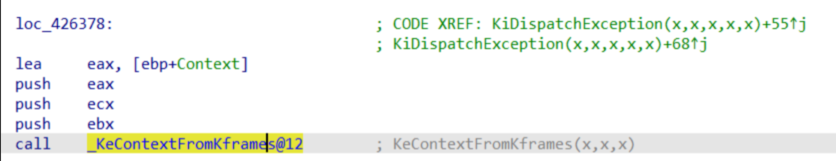


### 内核调试器接管

1. 判断`PreviousMode` 是否为内核模式，如果不成立就跳走
2. 再判断`FirstChance` 是否第一次，不成立则跳走
3. 再判断`_KiDebugRoutine` 是否为空，成立则跳走
4. `_KiDebugRoutine` 不为空，说明此时挂着内核调试器，将本次异常分发给内核调试器

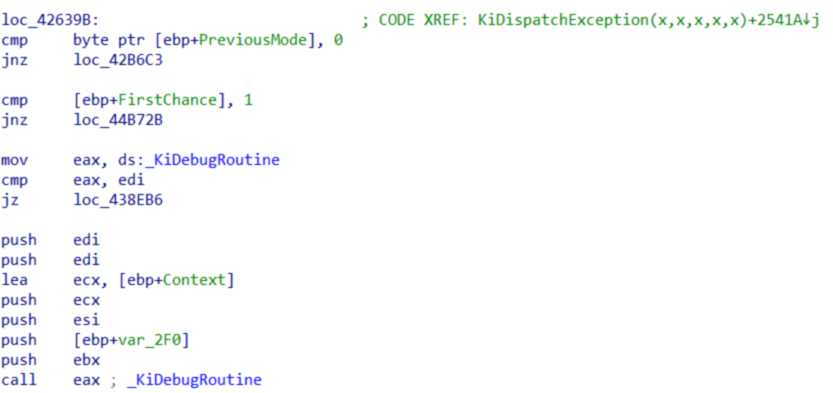

5. 继续看汇编：没有内核调试器、内核调试器没有处理该异常（即返回0），最后都会跳到同一处代码段`loc_438EB6`
6. 如果内核调试顺利处理了异常，就会调用`KeContextToKframes` 将`Context`恢复到`TrapFrame`，`KiDispatchException` 正常返回，R0恢复执行

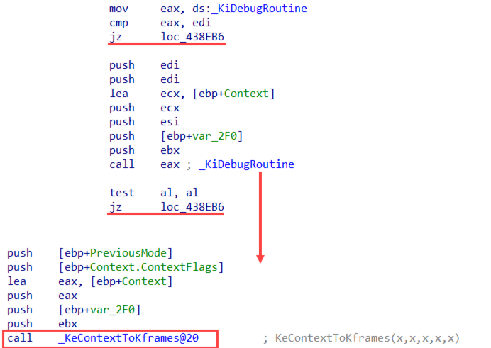


### 内核调试不接管

1. 不存在内核调试器、或者内核调试器没处理时，都会跳转到`loc_438EB6` 执行，这部分代码如下：
2. 将`ExceptionRecord`、`Context`压入堆栈，调用`RtlDispatchException` 函数

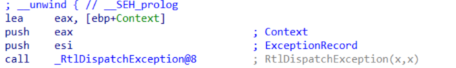


### nt!RtlDispatchException

1. 这个函数是负责异常的分发，内核调试器不处理的话，只剩下`内核SEH`了
2. 该函数内部主要调用`RtlpGetRegistrationHead` 函数，该函数会去获取当前线程SEH异常链表头

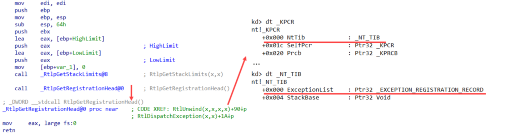


## 小结

1. 分析了以上异常体系，可以知道**用户异常**发生时的接管优先级：R0调试器 > R3调试器 > VEH > SEH（VEH、SEH在后续章节中会展开）
2. `KiDispatchException`这个函数，可以是说异常体系的战略要地，所有的异常分发都要经过它，想办法Hook这个函数，就能接管所有的异常
