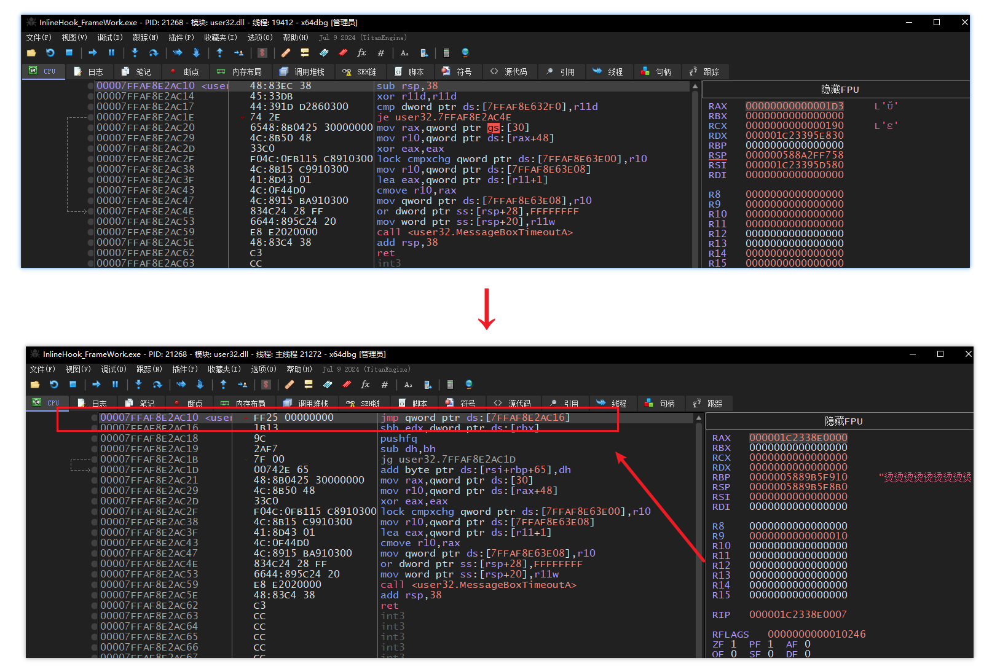
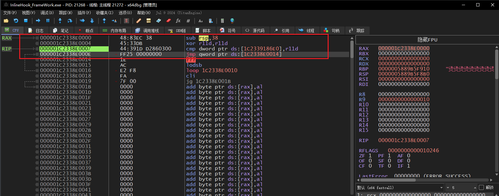
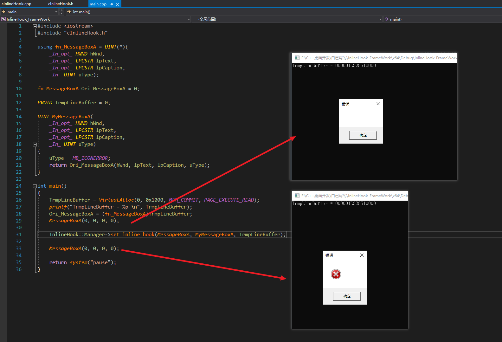
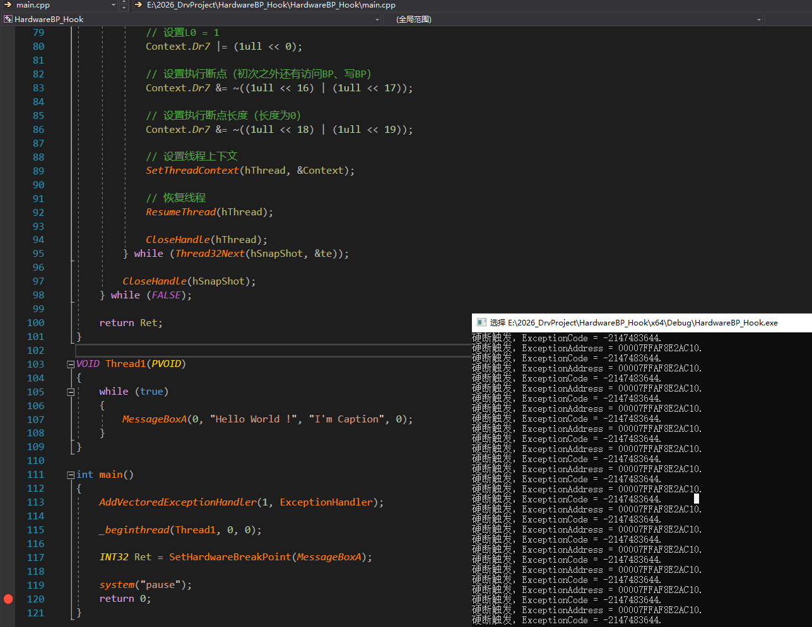

<!--more-->

## InlineHook实现原理

1. 笔者这里总结原理：把目标函数开头的指令**覆盖成跳转指令**，CPU执行到函数入口就跳到了我们的接管函数中
2. 流程如下所示：

```c
Hook前：
	MessageBoxA:
		push xxx        <- 函数正常指令
		sub rsp, 28h
		......

Hook后：
	MessageBoxA:
		jmp [rip+0]     <- 覆盖成跳转壳（14字节）
		8字节绝对地址     -> 跳到MyMessageBoxA（接管函数）
		......（原函数剩余部分，原封不动）
```


### x64跳转指令的坑

1. x86下一条`E9 rel32`近跳转（5字节）就够用了，`rel32`能表达±2GB的范围，32位进程模块之间相距不会超过这个范围
2. x64下地址空间巨大，`E9 rel32`是跳不过去的
3. 所以x64下普遍采用`FF 25 00 00 00 00`（`jmp qword ptr [rip+0]`）+ 紧跟8字节绝对地址的方案，一共`6 + 8 = 14`字节：

```c
CHAR JmpCode[14] =
{
	0xFF, 0x25,
	0x00, 0x00, 0x00, 0x00,
	0x90, 0x90, 0x90, 0x90, 0x90, 0x90, 0x90, 0x90		// Jmp xxx
};
// FF 25 00000000 解析为 jmp qword ptr [rip+0]
// rip指向下一条指令，也就是JmpCode+6处，正好从这里取出8字节作为跳转目标
*(ULONG64*)(JmpCode + 6) = (ULONG64)jmp_func;
```

4. Hook前后内存对比：以`user32.MessageBoxA`为例，函数开头本来是正常指令，Hook后被替换成了14字节的跳转壳




### 破坏字节数的计算

1. 一个问题：函数开头的指令长短是任意排布的，如果直接暴力覆盖14字节，往往会破坏掉原代码n行的汇编
3. 所以我们需要计算被破坏的置零字节数：逐条反汇编、累加指令长度，直到累计长度 ≥ 14字节
4. 笔者这里使用的是hde反汇编引擎，这是一个非常轻量的反汇编引擎

```c
// 计算inline hook要破坏多少字节
ULONG InlineHook::cInlineHook::calc_break_byte_count(PVOID src_func, ULONG JmpCodeSize)
{
	hde64s hde = { 0 };
	ULONG break_byte_count = 0;
	while (break_byte_count < JmpCodeSize)		// JmpCodeSize = 14
	{
		hde64_disasm(reinterpret_cast<PUCHAR>(src_func) + break_byte_count, &hde);
		break_byte_count += hde.len;			// 累加每条指令的长度
	}
	return break_byte_count;
}
```


### 跳板（Trampoline）

2. 在我们的Hook函数中，常规用途的过滤、监控参数信息，大部分的情况下还是需要调用原始函数，但是原始函数头部硬件被我们破坏了，所以这里需要构建跳板
2. 跳板的组成：先在跳板里执行被InlineHook破坏的n行汇编置零，再跳回原函数没被破坏的部分继续执行

```c
ULONG InlineHook::cInlineHook::set_inline_hook(PVOID src_func, PVOID jmp_func, PVOID trampline_buffer)
{
	// 计算破坏的字节数
	ULONG break_byte_count = calc_break_byte_count(src_func);

	// 构造跳转壳：FF 25 00 00 00 00 + 8字节绝对地址
	CHAR JmpCode[14] = { 0xFF, 0x25, 0x00, 0x00, 0x00, 0x00, /* 后面8字节是地址 */ };
	ULONG OldProtect = 0;

	// 跳转目标 = 原函数入口 + 破坏字节数（即原函数没被覆盖的剩余部分）
	*(ULONG64*)(JmpCode + 6) = (ULONG64)((PUCHAR)src_func + break_byte_count);

	// 跳板内存默认不可写，先改属性
	VirtualProtect(trampline_buffer, 8, PAGE_EXECUTE_READWRITE, &OldProtect);

	// 复制原有字节集到跳板
	RtlCopyMemory(trampline_buffer, src_func, break_byte_count);
	// 跳板尾部拼上"跳回去"的跳转壳
	RtlCopyMemory((PUCHAR)trampline_buffer + break_byte_count, JmpCode, sizeof JmpCode);

	// 构造HookCode：跳转目标改成接管函数
	*(ULONG64*)(JmpCode + 6) = (ULONG64)jmp_func;

	// 代码页默认不可写，改属性后把HookCode覆盖到原函数入口
	VirtualProtect(src_func, 8, PAGE_EXECUTE_READWRITE, &OldProtect);
	RtlCopyMemory(src_func, JmpCode, sizeof JmpCode);
	VirtualProtect(src_func, 8, OldProtect, &OldProtect);

	return 0;
}
```




### Hook测试

1. 测试目标：Hook `MessageBoxA`，把弹窗图标强制篡改成"错误"图标
2. 完整测试代码如下所示：

```c
#include <iostream>
#include "cInlineHook.h"

using fn_MessageBoxA = UINT(*)(
	_In_opt_ HWND hWnd,
	_In_opt_ LPCSTR lpText,
	_In_opt_ LPCSTR lpCaption,
	_In_ UINT uType);

fn_MessageBoxA Ori_MessageBoxA = 0;		// "原函数"其实指向跳板

PVOID TrmpLineBuffer = 0;

UINT MyMessageBoxA(
	_In_opt_ HWND hWnd,
	_In_opt_ LPCSTR lpText,
	_In_opt_ LPCSTR lpCaption,
	_In_ UINT uType)
{
	uType = MB_ICONERROR;		// 篡改参数
	return Ori_MessageBoxA(hWnd, lpText, lpCaption, uType);		// 走跳板调用原函数
}

int main()
{
	// 分配跳板内存
	TrmpLineBuffer = VirtualAlloc(0, 0x1000, MEM_COMMIT, PAGE_EXECUTE_READ);
	printf("TrmpLineBuffer = %p \n", TrmpLineBuffer);
	Ori_MessageBoxA = (fn_MessageBoxA)TrmpLineBuffer;

	MessageBoxA(0, 0, 0, 0);	// Hook前：正常弹窗

	InlineHook::Manager->set_inline_hook(MessageBoxA, MyMessageBoxA, TrmpLineBuffer);

	MessageBoxA(0, 0, 0, 0);	// Hook后：图标被篡改成了"错误"图标

	return system("pause");
}
```

3. 运行效果如下所示：




## 硬件断点Hook（"无痕" Hook）

1. x86/x64的CPU提供了一组**调试寄存器**：`DR0~DR3`可以各保存一个断点的线性地址，线程执行（访问）这些地址时，CPU抛出`#DB`调试异常
2. 我们可以自己注册一个Veh异常接管回调，在异常接管中判断出现异常的线性地址是不是我们的目标函数，如果是就修改ExceptionRecord.Rip实现Hook
3. 整个Hook过程**没有修改任何代码字节**


### 调试寄存器（DR0~DR7）

1. 关于调试寄存器，关键寄存器整理如下所示：

| 寄存器   | 作用                                                         |
| -------- | ------------------------------------------------------------ |
| DR0~DR3  | 4个断点线性地址，也就是说**最多同时下4个硬件断点**，这是硬件层面的限制 |
| DR4、DR5 | Reserved                                                     |
| DR6      | 调试状态寄存器：`B0~B3`位表示是哪个断点触发的                |
| DR7      | 调试控制寄存器：是否启用、触发类型、长度都在这里配置         |

2. 重点说一下`DR7`的位段排布（每4位管理一个DRn断点）：

| 位段         | 含义                                                       |
| ------------ | ---------------------------------------------------------- |
| L0~L3        | 局部启用对应DRn断点（本工程用的就是它）                    |
| G0~G3        | 全局启用对应DRn断点                                        |
| R/W0~R/W3    | 触发类型：`00`=执行断点、`01`=写入断点、`11`=读/写断点     |
| LEN0~LEN3    | 断点长度：执行断点必须为`00`（1字节）                      |


### 代码实验

1. 先注册VEH回调，这里使用头插法：

```c
int main()
{
	// VEH插到链表头，抢最先处理异常
	AddVectoredExceptionHandler(1, ExceptionHandler);
	// ...
}
```

2. 回调的实现如下所示，判断`异常类型` + `异常地址`双条件，命中就接管：

```c
LONG ExceptionHandler(
	struct _EXCEPTION_POINTERS *ExceptionInfo)
{
	if (ExceptionInfo->ExceptionRecord->ExceptionCode == EXCEPTION_SINGLE_STEP && 
		ExceptionInfo->ExceptionRecord->ExceptionAddress == MessageBoxA)
	{
		printf_s("硬断触发，ExceptionAddress = %p. \n", ExceptionInfo->ExceptionRecord->ExceptionAddress);
		printf_s("硬断触发，ExceptionCode = %d. \n", ExceptionInfo->ExceptionRecord->ExceptionCode);

		// 这里可以修改Rip跳转到我们的自定义逻辑
		//ExceptionInfo->ContextRecord->Rip = NULL;

		// 表示这个异常妥善处理好了，可以继续执行了
		return EXCEPTION_CONTINUE_EXECUTION;
	}

	// 继续搜索下一个Handler
	return EXCEPTION_CONTINUE_SEARCH;
}
```

3. 想做成完整Hook（修改Rip接管）的话，有一个坑必须处理：

> 1. 接管函数里想调用原函数，又会执行到`MessageBoxA`的第一条指令，断点再次命中，VEH又把Rip改回接管函数——**递归死循环**
> 2. 所以调原函数前，要先把当前线程的断点临时摘掉，调完再恢复，如下所示
>

```c
UINT MyMessageBoxA(HWND hWnd, LPCSTR lpText, LPCSTR lpCaption, UINT uType)
{
	// 调原函数前，摘掉当前线程的断点，否则又断在自己身上
	CONTEXT Ctx = { 0 };
	Ctx.ContextFlags = CONTEXT_DEBUG_REGISTERS;
	GetThreadContext(GetCurrentThread(), &Ctx);
	Ctx.Dr0 = 0;
	Ctx.Dr7 &= ~1ull;
	SetThreadContext(GetCurrentThread(), &Ctx);

	UINT Ret = MessageBoxA(hWnd, "硬件断点Hook：内容被替换", lpCaption, uType);

	// 调完恢复断点
	Ctx.Dr0 = (DWORD64)MessageBoxA;
	Ctx.Dr7 |= 1ull;
	SetThreadContext(GetCurrentThread(), &Ctx);
	return Ret;
}
```

4. 对当前线程使用`GetCurrentThread()`伪句柄操作自己的调试寄存器是可行的：VEH与接管函数都在**同一线程**里执行，而Dr寄存器在这两次操作之间不会变化

### 设置硬件断点

1. 调试寄存器是**线程上下文**的一部分，也就是说断点是"跟线程走"的，所以要遍历目标进程的所有线程，逐个`GetThreadContext`改`Dr`再`SetThreadContext`
2. 完整实现如下所示：

```c
INT32 SetHardwareBreakPoint(PVOID ExceptionAddr)
{
	INT32 Ret = 0;

	do 
	{
		// 快照当前进程的所有线程
		DWORD CurPid = GetCurrentProcessId();
		DWORD CurTid = GetCurrentThreadId();
		HANDLE hSnapShot = CreateToolhelp32Snapshot(TH32CS_SNAPTHREAD, CurPid);
		if (INVALID_HANDLE_VALUE == hSnapShot)
		{
			printf_s("Err Code = %d. \n", GetLastError());
			Ret = -1;
			break;
		}

		THREADENTRY32 te = { 0 };
		te.dwSize = sizeof te;
		if (!Thread32First(hSnapShot, &te))
		{
			printf_s("Err Code = %d. \n", GetLastError());
			Ret = -2;
			break;
		}

		do 
		{
			// 跳过其他进程的线程、跳过当前线程
			if (CurPid != te.th32OwnerProcessID || CurTid == te.th32ThreadID)
			{
				continue;
			}

			HANDLE hThread = OpenThread(THREAD_ALL_ACCESS, FALSE, te.th32ThreadID);
			if (NULL == hThread)
			{
				Ret = -3;
				break;
			}

			// 挂起目标线程
			// 目标线程挂起后，获取到的线程上下文才是可靠的
			SuspendThread(hThread);

			// 获取线程上下文
			CONTEXT Context = { 0 };
			Context.ContextFlags = CONTEXT_ALL;
			GetThreadContext(hThread, &Context);

			// 设置断点地址
			Context.Dr0 = (DWORD64)ExceptionAddr;

			// 设置L0 = 1
			Context.Dr7 |= (1ull << 0);

			// 设置执行断点（初次之外还有访问BP、写BP）
			Context.Dr7 &= ~((1ull << 16) | (1ull << 17));

			// 设置执行断点长度（长度为0）
			Context.Dr7 &= ~((1ull << 18) | (1ull << 19));

			// 设置线程上下文
			SetThreadContext(hThread, &Context);

			// 恢复线程
			ResumeThread(hThread);

			CloseHandle(hThread);
		} while (Thread32Next(hSnapShot, &te));

		CloseHandle(hSnapShot);
	} while (FALSE);

	return Ret;
}
```


### Hook测试

1. 起一个工作线程循环调用`MessageBoxA`，主线程负责下断：

```c
VOID Thread1(PVOID)
{
	while (true)
	{
		MessageBoxA(0, "Hello World !", "I'm Caption", 0);
	}
}

int main()
{
	AddVectoredExceptionHandler(1, ExceptionHandler);

	_beginthread(Thread1, 0, 0);

	INT32 Ret = SetHardwareBreakPoint(MessageBoxA);

	system("pause");
	return 0;
}
```

2. 运行后可以看到：`Thread1`每次调用`MessageBoxA`都会断下来，控制台持续打印触发日志




### 硬件断点Hook的局限

1. `DR0~DR3`只有4个槽位，一个线程最多同时下4个断点，想断更多函数就不够用了
2. 存在线程逃逸问题，设置硬件断点是针对线程的，当进程创建新线程后，会存在脱钩问题


## IATHook原理（导入表Hook）

### 导入表回顾

1. 这里简单复习一下PE的导入表结构，一个模块导入的所有DLL，每个DLL对应一个`IMAGE_IMPORT_DESCRIPTOR`导入描述符：

```c
typedef struct _IMAGE_IMPORT_DESCRIPTOR {
    union {
        DWORD Characteristics;
        DWORD OriginalFirstThunk;	// RVA，指向INT（导入名称表），保存函数名/序号
    } DUMMYUNIONNAME;
    DWORD TimeDateStamp;
    DWORD ForwarderChain;
    DWORD Name;						// RVA，指向DLL名称字符串
    DWORD FirstThunk;				// RVA，指向IAT（导入地址表），加载器填充函数地址
} IMAGE_IMPORT_DESCRIPTOR;
```

2. 加载器加载模块时，会遍历每个导入描述符：
    1. 根据描述符`Name`加载对应的DLL
    2. 遍历`INT`（`OriginalFirstThunk`）中的函数名/序号，逐个`GetProcAddress`
    3. 把拿到的函数地址填到`IAT`（`FirstThunk`）对应的表项中
3. 而代码中调用API的本质，编译成汇编后是`间接调用IAT表项`：

```c
MessageBoxA(0, 0, 0, 0);
// 编译后：
call qword ptr [rip+xxxx]		// xxxx就是本模块IAT中MessageBoxA表项的位置
```

4. 那么思路就清晰了：我们可以修改IAT槽位中的函数指针实现Hook


### IATHook实验

1. 实现思路：拿到目标模块的导入表 -> 匹配DLL名 -> 匹配函数名-> 修改IAT对应表项，代码如下所示：

```c
PVOID IATHook(HMODULE hTargetModule, PCHAR lpDllName, PCHAR lpFuncName, PVOID pFakeFunc)
{
	PIMAGE_DOS_HEADER pDosHeader = (PIMAGE_DOS_HEADER)hTargetModule;
	PIMAGE_NT_HEADERS pNtHeader = (PIMAGE_NT_HEADERS)((PUCHAR)hTargetModule + pDosHeader->e_lfanew);

	// 2. 检查导入表目录是否存在
	IMAGE_DATA_DIRECTORY ImportTable = pNtHeader->OptionalHeader.DataDirectory[IMAGE_DIRECTORY_ENTRY_IMPORT];
	if (!ImportTable.Size)
	{
		return NULL;
	}

	// 3. 遍历导入描述符（一个DLL对应一个描述符）
	PIMAGE_IMPORT_DESCRIPTOR pImportDesc = 
		(PIMAGE_IMPORT_DESCRIPTOR)((PUCHAR)hTargetModule + ImportTable.VirtualAddress);
	for (; pImportDesc->Name != 0; pImportDesc++)
	{
		// 匹配DLL名
		PCHAR lpName = (PCHAR)((PUCHAR)hTargetModule + pImportDesc->Name);
		if (_stricmp(lpName, lpDllName) != 0)
		{
			continue;
		}

		// 4. INT保存函数名/序号，IAT保存加载器填好的函数地址
		PIMAGE_THUNK_DATA pInt = 
			(PIMAGE_THUNK_DATA)((PUCHAR)hTargetModule + pImportDesc->OriginalFirstThunk);
		PIMAGE_THUNK_DATA pIat = 
			(PIMAGE_THUNK_DATA)((PUCHAR)hTargetModule + pImportDesc->FirstThunk);

		if (!pInt)
		{
			pInt = pIat;
		}

		// 5. 遍历导入项
		for (; pInt->u1.AddressOfData != 0; pInt++, pIat++)
		{
			BOOL bHit = FALSE;

			if (IMAGE_SNAP_BY_ORDINAL(pInt->u1.Ordinal))
			{
				// 按序号导入
				bHit = (IMAGE_ORDINAL(pInt->u1.Ordinal) == (WORD)(ULONG_PTR)lpFuncName);
			}
			else
			{
				// 按名称导入
				PIMAGE_IMPORT_BY_NAME pImport = \
					(PIMAGE_IMPORT_BY_NAME)((PUCHAR)hTargetModule + pInt->u1.AddressOfData);
				bHit = (strcmp(pImport->Name, lpFuncName) == 0);
			}

			if (bHit)
			{
				// 6. 找到了目标IAT表项，IAT所在页面默认只读，改属性后替换
				DWORD OldProtect = 0;
				VirtualProtect(&pIat->u1.Function, sizeof(PVOID), PAGE_READWRITE, &OldProtect);

				PVOID pOriFunc = (PVOID)pIat->u1.Function;
				pIat->u1.Function = (ULONG_PTR)pFakeFunc;

				VirtualProtect(&pIat->u1.Function, sizeof(PVOID), OldProtect, &OldProtect);
				return pOriFunc;
			}
		}
	}

	return NULL;
}
```

2. 测试代码如下所示：

```c
using fn_MessageBoxA = int(WINAPI*)(HWND, LPCSTR, LPCSTR, UINT);

fn_MessageBoxA Ori_MessageBoxA = NULL;

int WINAPI MyMessageBoxA(HWND hWnd, LPCSTR lpText, LPCSTR lpCaption, UINT uType)
{
	// 篡改参数后，调用原函数
	return Ori_MessageBoxA(hWnd, "IAT已被Hook", lpCaption, uType);
}

int main()
{
	// Hook主模块（自己的exe）导入表中，来自USER32.dll的MessageBoxA
	Ori_MessageBoxA = (fn_MessageBoxA)IATHook(
		GetModuleHandleA(NULL), "USER32.dll", "MessageBoxA", MyMessageBoxA);

	MessageBoxA(0, "Hello", "Test", MB_OK);		// 实际弹窗内容已被替换

	return 0;
}
```


### IATHook的问题点

1. 如果目标进程不依赖静态导入表，自己动态得到函数地址并调用，那么这种方式无法Hook


## Hook方式对比、小结

1. 本篇笔记介绍的这几种Hook方式，对比如表格所示：

| 对比项   | InlineHook               | IATHook                 | 硬件断点Hook     |
| -------- | ------------------------ | ----------------------- | ---------------- |
| 修改对象 | 代码段（函数机器码）     | 数据段（IAT函数指针）   | 线程寄存器上下文 |
| Hook范围 | 全局，所有调用路径都劫持 | 针对目标模块的IAT导入表 | 设置过硬断的线程 |

2. 提及的这几种Hook代码方式，都是很基础、入门的手法，初学者可以用来理解Hook原理


## 参考资料

1. HDE64反汇编引擎：[hde64](https://github.com/zhuxianjun/hde64)
2. 成熟Hook框架：[Detours](https://github.com/microsoft/Detours)、[MinHook](https://github.com/TsudaKageyu/minhook)
4. 《加密与解密》第四版
