<!--more-->

## 为什么要做这个实验？

1. 是因为脱壳后需要修导入表，那么导入表放哪里？
2. 就需要手动加节，将导入表信息放到这个手动增加的新节区中

## 尝试新工具

1. `010Editor`这个工具，其实对于静态修改PE文件，还是挺方便的
2. 但是先入为主，之前用惯了`CFF`
3. 本实验以练习`010Editor`工具为主，`CFF`辅助验证修改情况（CFF完全可以独立支持本实验）

## 文件尾部添加空白段

1. 在文件尾部添加`0x200`字节的空白段，现有文件大小为`0x2400`，Edit -> Set File Size，填入`0x2600`：

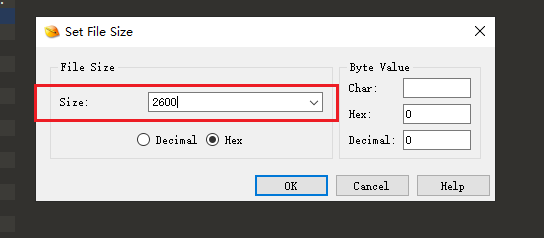

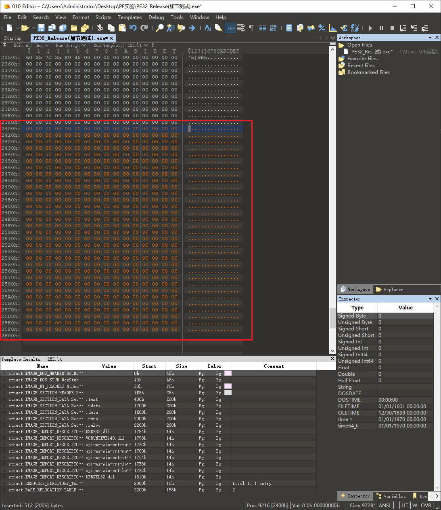

2. 保存、覆盖原程序后，此时双击是可以正常运行程序的：

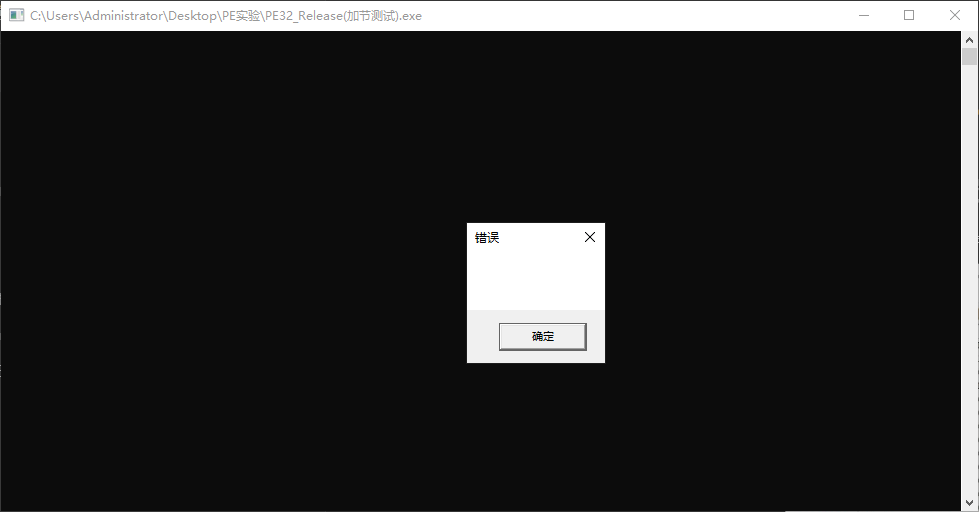

## 修改文件头节区数量

1. 将原本节区数量5改成6，保存

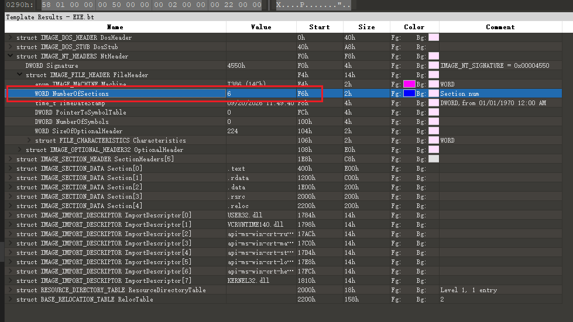

2. 双击后exe无法运行

## 修改节表

1. 我们关闭文件，重新将文件拖入`010Editor`，不重新载入的话，编辑器不会马上识别到新增节区头
2. 这是因为我们修改为6个节区，但是**有效节表**的数量还是原本的5个，如图所示：

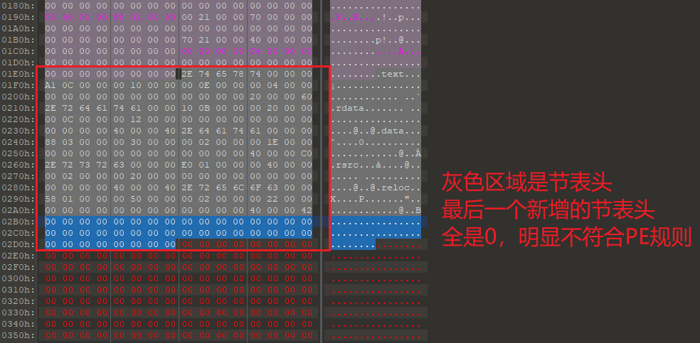

3. 由于文件对齐值默认为`0x200`，文件头向上对齐到`0x400`了，所以我们添加新的节区头，并不会影响该文件在磁盘中的大小

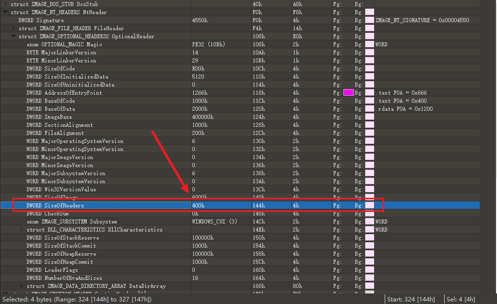

4. 此时我们需要手动编辑第6个节表头的数据，这里借助`CFF`来辅助
    1. 因为节区跟节区之间是紧挨着的，所以要计算得到最后一个节区的`PointerToRawData`、`SizeOfRawData`、`VirtualSize`、`VirtualAddress`，就要看倒数第2个节区的数据（算出来）

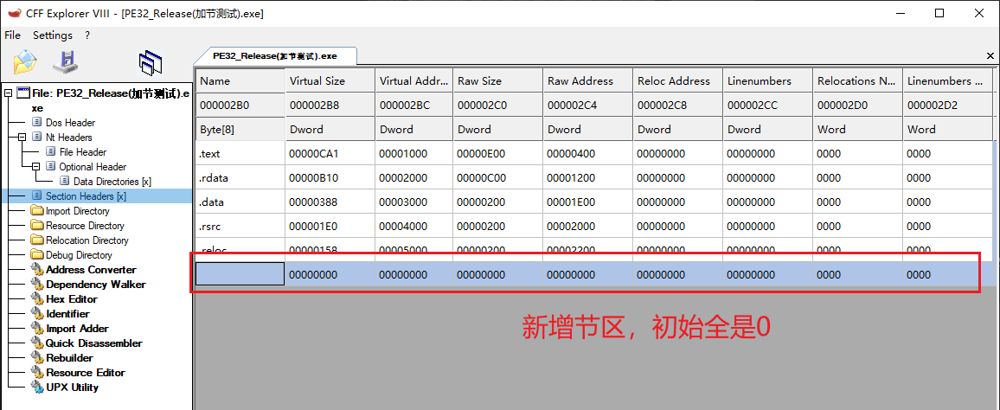

5. 填充节区头内容，节区属性给`RW`

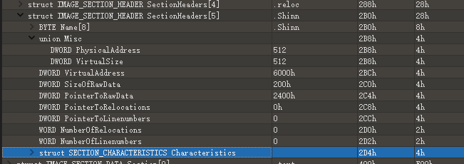

6. 使用`CFF`验证修改结果

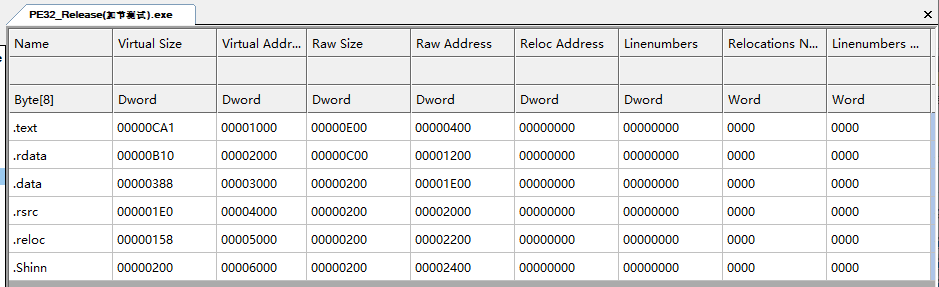

7. 双击后exe无法运行

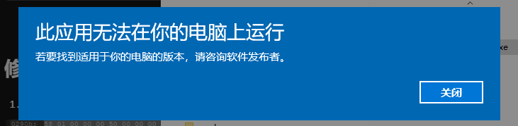

## 修改SizeOfImage

1. 由于我们手动加节比较简单，增加了一个`0x200`节区，那么内存向上对齐，就是增加`0x1000`，所以继续修改`OptHdr->SizeOfImage`

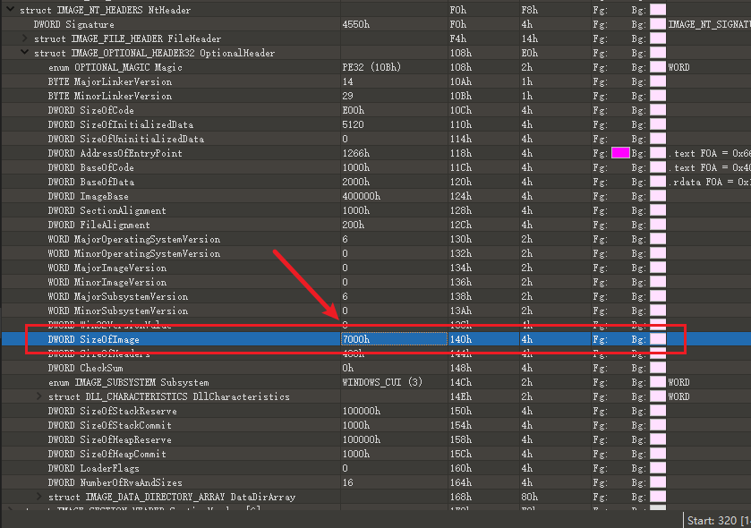

2. 使用`CFF`验证

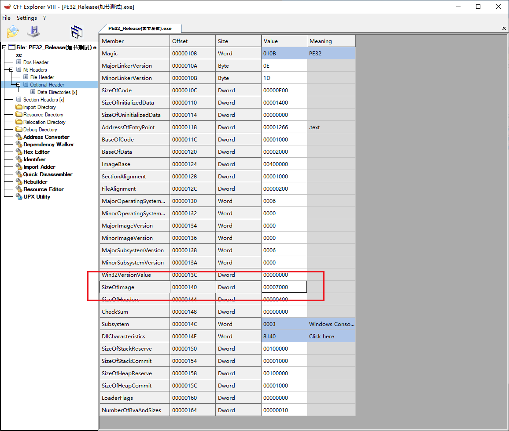

3. 双击程序，正常运行

## 总结

1. 要手动加节，那么要同时修改以下内容：
    1. 文件尾部增加`0x200`字节的空白区域，存放导入表足够了
    2. 修改`FileHdr->NumOfSections`
    3. 修改节表属性，即：RawOffset、RawSize，VirtualAddr、VirtualSize，节区属性
    4. 修改`OptHdr->SizeOfImage`文件在内存中的占用大小，向上对齐后的值
2. 自己上手做一遍实验后，发现手动加节其实很简单，套路大多都是固定的，知道原理即可自己用**代码实现一键添加节区**，或者**使用现有的工具**（例如PE DIY）
