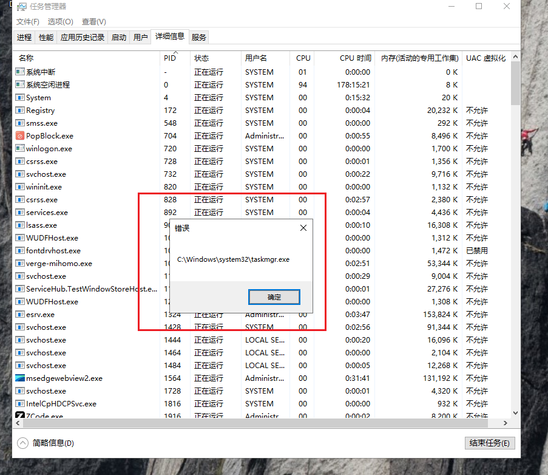

<!--more-->

## 手动映射注入

1. 只要深入学习了PE文件原理，就可以自己模拟加载镜像，步骤如下：

```c
1. 把DLL文件读进内存，按内存对齐拉伸PE
2. 修复重定位表
3. 修复导入表（LoadLibrary + GetProcAddress 填IAT）
4. 修复异常、TLS回调
5. 调用DllMain(DLL_PROCESS_ATTACH)
```


### 拉伸PE（StretchPE）

1. 手动拉伸PE，就是把磁盘文件从文件对齐展开到内存对齐

```c
int StretchPE(PUCHAR pDll, ULONG64 DllSize, PVOID& pLocalMemory, ULONG& SizeOfImage)
{
	IMAGE_DOS_HEADER* pDosHeader = (IMAGE_DOS_HEADER*)pDll;
	IMAGE_NT_HEADERS* pNtHeader = (IMAGE_NT_HEADERS*)(pDll + pDosHeader->e_lfanew);

	IMAGE_FILE_HEADER* pFileHeader = &pNtHeader->FileHeader;
	IMAGE_OPTIONAL_HEADER* pOptHeader = &pNtHeader->OptionalHeader;

	// 该Dll文件在内存中的大小
	SizeOfImage = pOptHeader->SizeOfImage;

	// 本地按SizeOfImage分配"内存态"缓冲区
	pLocalMemory = VirtualAlloc(NULL, SizeOfImage, MEM_COMMIT, PAGE_EXECUTE_READWRITE);
	if (!pLocalMemory)
	{
		return -1;
	}

	// 先把PE头写到目标内存
	RtlCopyMemory(pLocalMemory, pDll, PAGE_SIZE);

	// 拉伸PE结构：把每个节从文件偏移搬到对应RVA处
	IMAGE_SECTION_HEADER* pSectionHeader = IMAGE_FIRST_SECTION(pNtHeader);
	for (ULONG i = 0; i < pFileHeader->NumberOfSections; i++, pSectionHeader++)
	{
		if (pSectionHeader->SizeOfRawData && strcmp((PCHAR)pSectionHeader->Name, ".pdata") != 0)
		{
			RtlCopyMemory((PUCHAR)pLocalMemory + pSectionHeader->VirtualAddress, 
				pDll + pSectionHeader->PointerToRawData, pSectionHeader->SizeOfRawData);
		}
	}

	return 0;
}
```


### 远程分配与写入

1. 把拉伸好的PE整体写到目标进程里：

```c
    // 远程分配Dll内存（从高地址往下分配，减少与低地址堆内存相撞的概率）
    ULONG64 RemoteMapAddr = ProcMem.MemAlloc(SizeOfImage);
    if (!RemoteMapAddr)
    {
        printf("Errcode = %d \n", GetLastError());
        return -2;
    }

    // 将拉伸好的结构写过去
    if (!ProcMem.WriteMem(RemoteMapAddr, pLocalMemory, SizeOfImage))
    {
        return -3;
    }

    // 到这里可以释放本地DLL内存了
    VirtualFree(pLocalMemory, SizeOfImage, MEM_RELEASE);
```


### Loader参数设计

1. `Loader ShellCode`本质上是一段位置无关代码，没有静态导入表，调用参数只能靠参数传进去，参数结构如下所示：

```c
using fn_LoadLibraryA = HINSTANCE(WINAPI*)(PCHAR lpLibFilename);
using fn_GetProcAddress = PVOID(WINAPI*)(HMODULE hModule, PCHAR lpProcName);
using fn_DllEntryPoint = BOOLEAN(WINAPI*)(PVOID hDll, DWORD dwReason, PVOID pReserved);
using fn_RtlAddFunctionTable = BOOLEAN(__stdcall*)(PRUNTIME_FUNCTION FunctionTable, DWORD EntryCount, DWORD64 BaseAddress);

typedef struct _REFLECT_LOADER_PARAM
{
	fn_LoadLibraryA pLoadLibraryA;			// 修导入表要用
	fn_GetProcAddress pGetProcAddress;		// 修导入表要用
	fn_RtlAddFunctionTable pRtlAddFunctionTable;	// 注册异常表要用

	PCHAR pBase;			// DLL在目标进程中的基址
	BOOLEAN ErasePEHeader;	// 完成标志：Loader跑完后置TRUE

	_REFLECT_LOADER_PARAM()
	{
		RtlZeroMemory(this, sizeof _REFLECT_LOADER_PARAM);
	}
}REFLECT_LOADER_PARAM, *PREFLECT_LOADER_PARAM;
```

2. 参数与Loader的远程内存布局、写入与启动：

```c
	// 构造Loader的携带参数
	REFLECT_LOADER_PARAM LoaderParam;
	LoaderParam.pLoadLibraryA = (fn_LoadLibraryA)LoadLibraryA;
	LoaderParam.pGetProcAddress = (fn_GetProcAddress)GetProcAddress;
	LoaderParam.pRtlAddFunctionTable = RtlAddFunctionTable;
	LoaderParam.pBase = (PCHAR)RemoteMapAddr;
	LoaderParam.ErasePEHeader = FALSE;

	// 远程分配一页：前0x500字节放参数，[base + 0x500, ...)放Loader
	ULONG64 RemoteMemory = ProcMem.MemAlloc(PAGE_SIZE);
	ULONG64 RemoteLoaderParam = RemoteMemory;

	// 将参数写到目标内存
	ProcMem.WriteMem(RemoteLoaderParam, &LoaderParam, sizeof LoaderParam);

	// 分配Loader的内存（同一页内）
	ULONG64 RemoteLoader = RemoteMemory + 0x500;

	// 将Loader的机器码写到目标内存
	// 注意：sizeof不能作用于函数，只能估一个足够大的长度（500字节足够覆盖函数体）
	ProcMem.WriteMem(RemoteLoader, (PVOID)LoaderShellCode, 500);

	// 启动Loader
	ProcMem.CreateThread(RemoteLoader, RemoteLoaderParam);
```


### LoaderShellCode

1. 要编译出位置无关的Shellcode，要关闭以下编译设置：

> 1. 禁用GS安全检查（`/GS-`）
> 2. 禁用控制流防护CFG（`/guard:cf-`）
> 3. 禁用SDL检查
> 4. 使用Release编译
>

2. Shellcode修复重定位表

```c
	// 计算重定位偏移量
	PCHAR LocationDelta = pBase - pOptHeader->ImageBase;
	if (LocationDelta)
	{
		// 检查基础重定位目录是否存在
		if (pOptHeader->DataDirectory[IMAGE_DIRECTORY_ENTRY_BASERELOC].Size)
		{
			// 获取重定位数据（起始、结束）
			IMAGE_BASE_RELOCATION* pRelocData = \
				(IMAGE_BASE_RELOCATION*)(pBase + pOptHeader->DataDirectory[IMAGE_DIRECTORY_ENTRY_BASERELOC].VirtualAddress);
			IMAGE_BASE_RELOCATION* pRelocEnd = \
				(IMAGE_BASE_RELOCATION*)((ULONG64)(pRelocData)+pOptHeader->DataDirectory[IMAGE_DIRECTORY_ENTRY_BASERELOC].Size);

			while (pRelocData < pRelocEnd && pRelocData->SizeOfBlock)
			{
				// 本块有多少个条目（每条2字节：高4位类型，低12位页内偏移）
				UINT64 AmountOfEntries = (pRelocData->SizeOfBlock - sizeof(IMAGE_BASE_RELOCATION)) / sizeof(short);
				// 指向重定位偏移的指针
				unsigned short* pRelativeInfo = (unsigned short*)(pRelocData + 1);

				// 处理每个重定位条目
				for (UINT64 i = 0; i != AmountOfEntries; ++i, ++pRelativeInfo)
				{
					// 只处理DIR64类型（x64绝对地址寻址）
					if (RELOC_FLAG64(*pRelativeInfo))
					{
						// 计算需要修补的地址
						ULONG_PTR* pPatch = \
							(ULONG_PTR*)(pBase + pRelocData->VirtualAddress + ((*pRelativeInfo) & 0xFFF));

						// 补上差值
						*pPatch += (ULONG_PTR)(LocationDelta);
					}
				}

				// 移动到下一个重定位块
				pRelocData = (IMAGE_BASE_RELOCATION*)((PCHAR)pRelocData + pRelocData->SizeOfBlock);
			}
		}
	}
```

3. Shellcode修复导入表，这个过程其实是模拟系统修复IAT

```c
	// 修复导入表
	if (pOptHeader->DataDirectory[IMAGE_DIRECTORY_ENTRY_IMPORT].Size)
	{
		IMAGE_IMPORT_DESCRIPTOR* pImportDescr = \
			(IMAGE_IMPORT_DESCRIPTOR*)(pBase + pOptHeader->DataDirectory[IMAGE_DIRECTORY_ENTRY_IMPORT].VirtualAddress);

		// 遍历导入描述符
		while (pImportDescr->Name)
		{
			// 根据导入描述符中的名称加载DLL
			HMODULE hDll = pData->pLoadLibraryA(pBase + pImportDescr->Name);

			// 指向原始thunk（INT）
			ULONG_PTR* pInt = (ULONG_PTR*)(pBase + pImportDescr->OriginalFirstThunk);
			// 指向导入地址表（IAT）
			ULONG_PTR* pIat = (ULONG_PTR*)(pBase + pImportDescr->FirstThunk);

			// 如果没有原始thunk，则直接使用IAT
			if (!pInt)
			{
				pInt = pIat;
			}

			// 解析每个导入条目
			for (; *pIat; ++pIat, ++pInt)
			{
				if (IMAGE_SNAP_BY_ORDINAL(*pInt))
				{
					// 按序号导入
					*pIat = (ULONG_PTR)pData->pGetProcAddress(hDll, (PCHAR)(*pInt & 0xffff));
				}
				else
				{
					// 按名称导入
					IMAGE_IMPORT_BY_NAME* pImport = (IMAGE_IMPORT_BY_NAME*)(pBase + *pInt);
					*pIat = (ULONG_PTR)pData->pGetProcAddress(hDll, pImport->Name);
				}
			}

			// 移动到下一个导入描述符
			pImportDescr++;
		}
	}
```

4. 执行TLS回调，手动映射注入的DLL内可能使用了TLS线程局部存储

```c
	// 填充TLS回调
	if (pOptHeader->DataDirectory[IMAGE_DIRECTORY_ENTRY_TLS].Size)
	{
		auto* pTLS = (IMAGE_TLS_DIRECTORY*)\
			(pBase + pOptHeader->DataDirectory[IMAGE_DIRECTORY_ENTRY_TLS].VirtualAddress);

		auto* pCallback = (PIMAGE_TLS_CALLBACK*)pTLS->AddressOfCallBacks;

		for (; pCallback && *pCallback; ++pCallback)
			(*pCallback)(pBase, DLL_PROCESS_ATTACH, nullptr);
	}
```

6. 修复异常，不然SEH没法处理

```c
	// 修复x64下异常表
	auto Exception = pOptHeader->DataDirectory[IMAGE_DIRECTORY_ENTRY_EXCEPTION];
	if (Exception.Size)
	{
		pData->pRtlAddFunctionTable(
			(_IMAGE_RUNTIME_FUNCTION_ENTRY*)(pBase + Exception.VirtualAddress),
			Exception.Size / sizeof(IMAGE_RUNTIME_FUNCTION_ENTRY),
			(DWORD64)pBase);
	}
```

7. 调用EP入口点

```c
	// 调用DLL的入口点
	((fn_DllEntryPoint)(pBase + pOptHeader->AddressOfEntryPoint))(pBase, DLL_PROCESS_ATTACH, 0);

	// 标记PE头为可擦除（完成标志）
	pData->ErasePEHeader = TRUE;
```


### 抹除PE头

1. 注入器这边轮询完成标志，做最后收尾：

```c
	while (TRUE)
	{
		ProcMem.ReadMem(RemoteLoaderParam, &LoaderParam, sizeof LoaderParam);

		if (LoaderParam.ErasePEHeader)
		{
			// 清空PE头（远程DLL内存的第一页）
			CHAR Buffer[PAGE_SIZE] = { 0 };
			ProcMem.WriteMem(RemoteMapAddr, Buffer, PAGE_SIZE);

			// 释放参数、Loader所在的远程内存
			ProcMem.MemFree(RemoteMemory, PAGE_SIZE);

			break;
		}

		Sleep(100);
	}
```


### 测试效果

1. 顺利注入DLL模块，并且目标Ldr中找不到模块信息：


