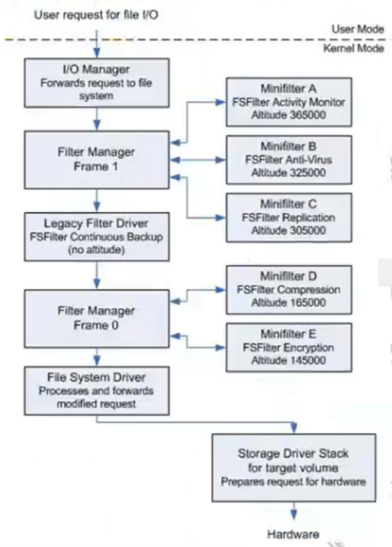

<!--more-->

## MiniFilter、Legacy驱动区别

1. 加载顺序可控，假设系统中安装了2个过滤驱动，都是`Attach`到设备栈上，那么谁在上、谁在下呢？这其实是不可控的
2. `MiniFilter`引入了`Altitude`海拔高度的概念，这样一个驱动发布后，其所在位置就是固定的
3. `MiniFilter`支持**安全卸载**，过滤驱动跟Hook驱动其实某些极限场景非常相似，派遣回调、Hook回调正在使用中，驱动被卸载了，代码页面释放了，这时候当然蓝屏
4. `MiniFilter`跟`WDF`驱动框架一样，都属于回调注册式的驱动框架，内核开发者只需要向系统注册一个回调即可处理自己关心、跟业务有关的功能了
5. `MiniFilter`中可以非常方便地获取文件全路径信息，这一点在下文有印证
6. 注册成为`MiniFilter`驱动后，**`DriverObject->DriverUnload`卸载例程就不用注册**了，可以参考微软官方示例工程`NullFilter`中的写法，此时驱动卸载工作由`FltUnload`回调负责


## MiniFilter总体框架

1. 由下面的框架图可以合理推测，`MiniFilter`框架内部其实也是基于驱动过滤的，内部自己创建了一个过滤设备对象Filter DO附加到设备栈上
2. 该框架内部做了大量处理，`MiniFilter`自己维护了一个`Filter栈`，谁注册了`Filter`，就把谁加入到内部的栈中
3. `MiniFilter`驱动、`Legacy过滤`驱动是可以共存的，从框架图中也可以看出
4. 从框架图中也可以得知，不同行为的驱动会被安排在不同的`Altitude`海拔高度处




## 海拔高度（Altitude）

1. 每一个`MiniFilter`驱动必须有一个叫做`Altitude`的唯一标识符，它定义了该驱动加载时在`I/O栈`中相对其他`MiniFilter`驱动的位置，值越小，栈中位置就越低
2. 关于`Altitude`海拔高度，这个属于**申请制**，跟微软申请，微软内部会维护一个数据库，然后颁发一个独立的`Altitude`给你，申请到哪个开发者是决定不了的
3. `Altitude`高度，同一个分组内（假设都是反病毒），海拔高低没优劣之分

### 海拔高度，Pre、Post执行顺序关系

1. 其实非常好理解，遵循一个入栈、出栈的顺序，如下所示：

```c
                Pre                  Post
高 Altitude     A  ───────────────→  A
                ↓                    ↑
                B  ───────────────→  B
                ↓                    ↑
低 Altitude     C  ───────────────→  C
                ↓                    ↑
                    File System
```


## 注册MiniFilter

1. 要注册`MiniFilter`其实非常简单，就是构造一个结构体，将该结构体作为一个参数向系统注册即可，如下所示：

```c
const FLT_REGISTRATION fileMonitorRegistration = 
{
    sizeof( FLT_REGISTRATION ),         // Size
    FLT_REGISTRATION_VERSION,           // Version
    0,                                  // Flags
    ContextRegistration,                // ContextRegistration，上下文注册表
    fileMonitorCallbacks,               // Operation callbacks，操作回调数组
    fileMonUnload,                      // FilterUnload
    fileMonInstanceSetup,               // InstanceSetup
    NULL,                               // InstanceQueryTeardown
    fileMonInstanceTeardownStart,       // InstanceTeardownStart
    NULL,                               // InstanceTeardownComplete
    NULL,                               // GenerateFileName
    NULL,                               // GenerateDestinationFileName
    NULL                                // NormalizeNameComponent
};
```

2. 内核开发者可以自由地设置回调，你要处理哪些就设置哪些，如下代码所示：

```c
const FLT_OPERATION_REGISTRATION fileMonitorCallbacks[] = 
{
    {   // 接管文件创建请求，Flags设置为跳过PAGING_IO，即分页IO请求不通知
        IRP_MJ_CREATE,
        FLTFL_OPERATION_REGISTRATION_SKIP_PAGING_IO,
        HOOK_PreNtCreateFile,
        HOOK_PostNtCreateFile
    },
    {
        IRP_MJ_CLEANUP,
        0,
        HOOK_PreNtCleanup,
        NULL
    },
    {
        IRP_MJ_WRITE,
        0,
        HOOK_PreNtWriteFile,
        HOOK_PostNtWriteFile
    },
    {
        IRP_MJ_SET_INFORMATION,
        0,
        HOOK_PreNtSetInformationFile,
        HOOK_PostNtSetInformationFile
    },
    { IRP_MJ_OPERATION_END }    // 数组结束标志，类似"终止符"
};
```


## MiniFilter回调返回值

2. `Pre前回调`的返回值，主要是以下三种（最常用）：

```c
// 需要执行后回调
FLT_PREOP_SUCCESS_WITH_CALLBACK

// 不执行后回调
FLT_PREOP_SUCCESS_NO_CALLBACK

// 本次文件请求结束，不继续下发
FLT_PREOP_COMPLETE

// 禁用FastIO
FLT_PREOP_DISALLOW_FASTIO
```


## MiniFilter中获取IRP参数

1. `MiniFilter`本质上也是基于`IO Manager`工作的，也会接收到IRP，那么注册进其中的Filter，该如何获取原始IRP参数信息呢？方法如下

```c
PFLT_CALLBACK_DATA Data;

// 发起请求的进程、PID
PEPROCESS processObject = 
    Data->Thread ? IoThreadToProcess(Data->Thread) : PsGetCurrentProcess();
HandleToUlong(PsGetProcessId(processObject));   // PID

// 设置本次请求的返回结果（相当于Legacy中的pIrp->IoStatus）
Data->IoStatus.Status = ntStatus;
Data->IoStatus.Information = 0;

// 关联对象
FltObjects->Volume,
FltObjects->Instance,
FltObjects->FileObject,
FltObjects->FileObject->DeviceObject

// 读取类请求的参数
PMDL pReadMdl        = Data->Iopb->Parameters.Read.MdlAddress;
PVOID pReadBuffer    = Data->Iopb->Parameters.Read.ReadBuffer;
ULONG uReadLength    = Data->Iopb->Parameters.Read.Length;

// 创建类请求的参数
Data->Iopb->Parameters.Create.SecurityContext->DesiredAccess;

// 目录查询类请求的参数
PVOID pQueryBuffer     = Data->Iopb->Parameters.DirectoryControl.QueryDirectory.DirectoryBuffer;
ULONG uQueryBufferSize = Data->Iopb->Parameters.DirectoryControl.QueryDirectory.Length;

// 拦截本次请求：设置错误码 + 不再下发
Data->IoStatus.Status = STATUS_ACCESS_DENIED;
Data->IoStatus.Information = 0;
return FLT_PREOP_COMPLETE;
```


## MiniFilter中获取文件全路径

1. 这里有一个小细节，获取文件全路径，一般是在`后回调`中获取（在SFilter中也是在CompleteRoutine中获取全路径），因为只有文件打开成功了，此时获取文件全路径才有意义

```c
// 在PostCreate里获得
PFLT_FILE_NAME_INFORMATION pNameInfo = NULL;

ntStatus = FltGetFileNameInformation(Data,
            FLT_FILE_NAME_NORMALIZED |
            FLT_FILE_NAME_QUERY_DEFAULT,
            &pNameInfo);
FltParseFileNameInformation(pNameInfo);

pNameInfo->Name;        // 规范化的文件全路径
pNameInfo->Volume;      // 卷信息

FltReleaseFileNameInformation(pNameInfo);   // 使用完毕必须释放

// 重命名目标路径的获得：
PFILE_RENAME_INFORMATION pFileRenameInformation = 
    (PFILE_RENAME_INFORMATION)Data->Iopb->Parameters.SetFileInformation.InfoBuffer;

// 或者直接调用专门的函数获取重命名目标：
FltGetDestinationFileNameInformation();
```


## MiniFilter回调运行时的IRQL

1. `Pre前回调`可以运行在`PASSIVE_LEVEL`、`APC_LEVEL`中，大多数情况是`PASSIVE_LEVEL`
2. `Post后回调`大多数情况下是`PASSIVE_LEVEL`，但是少数情况是**有可能运行在`DPC_LEVEL`的**，需要开发者额外注意
3. 微软文档中关于回调IRQL的几点补充：
    1. `Pre前回调`可以在IRQL = PASSIVE_LEVEL或IRQL = APC_LEVEL被调用，典型情况是PASSIVE_LEVEL
    2. 如果`Pre前回调`对一个基于IRP的I/O操作返回了`FLT_PREOP_SYNCHRONIZE`，那么对应的`Post后回调`会在IRQL <= APC_LEVEL、与`Pre前回调`相同的线程上下文中被调用
    3. FastIO操作的`Post后回调`在IRQL = PASSIVE_LEVEL、与`Pre前回调`相同的线程上下文中被调用
    4. Post-Create回调在IRQL = PASSIVE_LEVEL、发起`IRP_MJ_CREATE`操作的线程上下文中被调用


## MiniFilter回调内的文件操作

1. 由于我们的`MiniFilter`回调中，已经处于`IO Manager`派发的流程中了，此时还调用常规的`Zw/NtCreateFile`必然会发起新的文件IRP请求，导致**重入问题**
2. `MiniFilter`提供了一组`Flt*`函数，供开发者安全地操作文件：`FltCreateFile`、`FltReadFile`、`FltWriteFile`、`FltClose`等

```c
ntStatus = FltCreateFile(pFilter,
    pDstInstance,
    &hDstFile,
    GENERIC_WRITE | SYNCHRONIZE,
    &objDstAttrib,
    &ioStatus,
    0,
    FILE_ATTRIBUTE_NORMAL,
    FILE_SHARE_READ |
    FILE_SHARE_WRITE |
    FILE_SHARE_DELETE,
    FILE_CREATE,
    CreateOptions,
    NULL,0, 0);
```


## MiniFilter对象上下文

1. 这里有点类似`WDF`驱动中的对象上下文
2. 这里有一个形象的例子，对象比做人，那么上下文就是衣服上的口袋，可以**快速存取**自定义的数据
3. 比较常用的上下文如下：
    1. 流句柄上下文（Stream Handle Ctx）：就是文件句柄（File Object）上下文，比如用来保存本次是写打开、还是读打开
    2. 实例上下文（Instance）：`MiniFilter`中，卷数量、实例数量是一一对应的，分配实例上下文，一般是保存卷名、卷文件系统、卷设备类型等等数据

> 一个卷设备就有着一个独立的设备栈，那么`fltmgr.sys`在工作时，就会给**每一个卷都创建一个FLT实例**（合理推测内部工作原理跟SFilter一样，创建Filter DO附加上去），使每个卷都可以正常过滤文件消息
>

4. 流上下文（Stream Ctx）：透明加解密会用到


## 强化MiniFilter上下文理解

1. 这里需要明确一个前置概念，`MiniFilter`框架不会自动分配上下文内存、并且采用**引用计数**实现生命周期管理
2. 需要自己手动`FltAllocateCtx`、`FltSetxxxCtx`之后，就可以调用`FltGetxxxCtx`使用了
3. 关于生命周期管理，可以参考如下（**Instance上下文为例**）：

```c
初始化分配Ctx---------------------------------------------------------
FltAllocateCtx 引用计数 = 1

FltSetxxxCtx 引用计数 + 1 = 2	 <--- 将这个Ctx关联到xxx对象

FltReleaseCtx 引用计数 - 1 = 1    <--- 这里的Release本不是释放内存的意思，而是交出自己的占用
                                        让FltMgr自己管理Ctx生命周期

后续使用这个Ctx---------------------------------------------------------
FltGetxxxCtx 引用计数 + 1

FltReleaseCtx 引用计数 - 1		<--- Ctx使用结束，释放占用


关联的对象被销毁---------------------------------------------------------
FltMgr自动将引用计数 - 1
Ctx引用计数归零，先调用我们注册的Cleanup回调、释放内存
```


## MiniFilter通讯端口

1. 使用`MiniFilter`的通讯端口能力，可以轻松实现R3、R0互相通讯，通讯模型如下所示：

```c
【R3主动】
R3：FilterSendMessage（R3 Port）
        │  通过 FilterConnectCommunicationPort 连接到R0端口
        ↓
R0：fnMessageFromClient（R0 Port）

【R0主动】
R0：FltSendMessage（R0 Port）
        ↓
R3：FilterGetMessage / FilterReplyMessage（R3 Port）
```

2. R0端通过`FltCreateCommunicationPort`创建通讯端口，如下所示：

```c
FltCreateCommunicationPort(
    g_pFilter,
    &g_pServerPort,
    &oa,                        // 设置PORT的名字
    NULL,                       // ServerPortCookie
    fnConnectFromClient,        // R3连接端口时回调
    fnDisconnectFromClient,     // R3断开端口时回调
    fnMessageFromClient,        // 处理从R3 FilterSendMessage的请求
    1);
```

3. 根据如下对R3缓冲区的处理方式，可以合理推测这里使用的是`Neither`，既不是复制缓冲区、也不是MDL锁住访问，居然是直接操作R3缓冲区
4. 所以安全用法是**内核SEH+ProbeForxxx探测**

```c
// 处理从R3 FilterSendMessage的请求
NTSTATUS
fnMessageFromClient(
    IN PVOID PortCookie,
    IN PVOID InputBuffer OPTIONAL,
    IN ULONG InputBufferLength,
    OUT PVOID OutputBuffer OPTIONAL,
    IN ULONG OutputBufferLength,
    OUT PULONG ReturnOutputBufferLength
    )
{
    __try
    {
        ProbeForRead(InputBuffer, InputBufferLength, sizeof(ULONG));
        // GET InputBuffer
        // Do something
        ProbeForWrite(OutputBuffer, OutputBufferLength, sizeof(ULONG));
        // Copy Result to OutputBuffer
    }
    __except(EXCEPTION_EXECUTE_HANDLER)
    {
        return STATUS_NOT_IMPLEMENTED;
    }

    return STATUS_SUCCESS;
}
```

> 知识拓展，当某些特殊场景下，无法使用内核SEH时，可以使用MmCopyVirtualMemory安全地访问R3内存，因为该函数内部有SEH保护、且处于ntoskrnl中，可以正常走异常派发流程修复异常
>


## MiniFilter R0发送通知到R3（双向通讯）

1. 要实现R3、R0双向通讯，那么首先要做的肯定是约定通讯协议，我们简单设置如下：

```c
struct _COMM_PACK
{
    ULONG CtlCode;
    PVOID pBuffer;
    ULONG BufLen;
    BOOLEAN NeedReplay;     // 本次消息是否需要回复
};
```

2. 处于内核态的驱动，调用`FltSendMessage`发送消息到R3：

```c
FltSendMessage(
        g_hFilter,
        &g_ClientPort,
        Message,
        MessageLength,
        NULL,			// 单向通知
        0,				// 单向通知
        &Timeout);
```

3. 处于R3的应用程序，调用`FilterGetMessage`接收到的就不是`_COMM_PACK`对象了，被增加了一个协议头，结构如下所示：

```c
typedef struct _FILTER_MESSAGE_HEADER 
{
    // R0接收回复数据，缓冲区的大小
    ULONG ReplyLength;		

    // 本次信息ID，通讯标识符
    ULONGLONG MessageId;			
} FILTER_MESSAGE_HEADER, *PFILTER_MESSAGE_HEADER;

struct _FLT_MSG_PACK
{
    // 相当于Flt通讯的协议头
    _FILTER_MESSAGE_HEADER Header;

    // 存放实际数据内容
    _COMM_PACK Payload;
};
```

```c
typedef struct _FILTER_REPLY_HEADER 
{
    // 告诉R0结果
    NTSTATUS  Status;

    // 本次信息ID，通讯标识符
    ULONGLONG MessageId;
} FILTER_REPLY_HEADER, *PFILTER_REPLY_HEADER;

struct _FLT_MSG_PACK_REPLAY
{
    // 相当于Flt通讯的协议头
    _FILTER_REPLY_HEADER Header;

    // 存放实际数据内容
    _COMM_PACK Payload;
};
```

4. 示例R3代码如下所示：

```c
void NotifyThread()
{
    while(1)
    {
        // 阻塞、死等
        FLT_MSG_PACK RecvMsg;
        FilterGetMessage(..., &RecvMsg.Header, NULL);
    
        // 等到Msg了，解析、执行动作...
    
        // 如果需要回复消息、且R0缓冲区足够大
        if (RecvMsg.Payload.NeedReplay && 
            RecvMsg.Header.ReplyLength > sizeof(FLT_MSG_PACK_REPLAY))
        {
            FLT_MSG_PACK_REPLAY ReplayMsg;
            ReplayMsg.Header.Status = 0;
            ReplayMsg.Header.MessageId = RecvMsg.Header.MessageId;
            ReplayMsg.Payload = /**/;
            
            FilterReplyMessage(..., &ReplayMsg.Header, sizeof(ReplayMsg));        
        }
    }
}
```


## MiniFilter中的Create回调

1. 不管`SFilter`、还是现代化的`MiniFilter`，都不应该在`Pre前回调`中做业务逻辑，因为在`Pre回调`中获取的文件路径不保真
2. 正经操作一个是在`Post后回调`中可以根据打开的结果，安全地获取文件路径、扫描等等操作，如果扫描到敏感特征，**后回调中是可以取消本次文件打开**的

```c
// 在Post回调，也是有机会关闭已打开的文件
VOID FLTAPI FltCancelFileOpen(
  [in] PFLT_INSTANCE Instance,
  [in] PFILE_OBJECT  FileObject
);
```


### Create回调中的文件扫描策略

1. 在`Scanner`示例工程中，在`Post后回调`中，将文件内容读出来，再将内容发回R3进行处理
2. 这里其实是规范的操作：
    1. 我们的`Hips`主防驱动，核心在于实现**文件请求监控**
    2. 内核中有着IRQL规范要求，对调用API有着限制，而且内核中**不会、也不应该**承载沉重、复杂的扫描逻辑
    3. 将文件内容发回R3处理，主防引擎可以自由地**调用各种库**、**各种算法**实现扫描，必要时主防引擎还可以**动态热更新**
    4. 扫描的动作放置在R3，哪怕出现异常崩溃了，也不会导致用户系统BSOD


### 用户打开超大文件时Hips策略

1. 当用户打开一个非常大的文件（假设2g），那么此时Hips就不能沿用常规的全量扫描策略了
    1. 应该扫描文件关键区域，例如扫描PE头，定位到导入表，有没有调用敏感的跨进程操作、内存操作相关的API
    2. 校验文件签名
    3. 计算文件熵值，如果熵值过高，极有可能是一个压缩文件，此时可以降低扫描优先级、或者跳过

> 信息论、文件压缩的知识，压缩的本质就是去除冗余的信息，那么压缩后的文件就代表"信息熵"很大，即不可预测性，此时就能说这个文件熵值很高
>


## MiniFilter中的Write、Cleanup回调

1. `Write前回调`没啥好说的，参数中的缓冲区内，就保存有待写入的字节集，此时直接Copy、发回R3扫描即可
2. `Cleanup`回调，就是计算文件`MD5`发回服务器搜索，再判断是删除、隔离、还是放行
