<!--more-->

## PE文件格式概览

1. PE文件格式概览如下所示（**缩进表示层级关系**）：

```c
DOS头
NT头
  PE标识
  文件头
  可选头
    数据目录表数组
节区表数组

IMAGE_DOS_HEADER
IMAGE_NT_HEADERS
  IMAGE_FILE_HEADER
  IMAGE_OPTIONAL_HEADER
    IMAGE_DATA_DIRECTORY[16]
IMAGE_SECTION_HEADER[FileHeader.NumberOfSections]
```

2. 从如下这个图也能直观查看，哪些部分之间是相邻的、哪些部分之间有填充

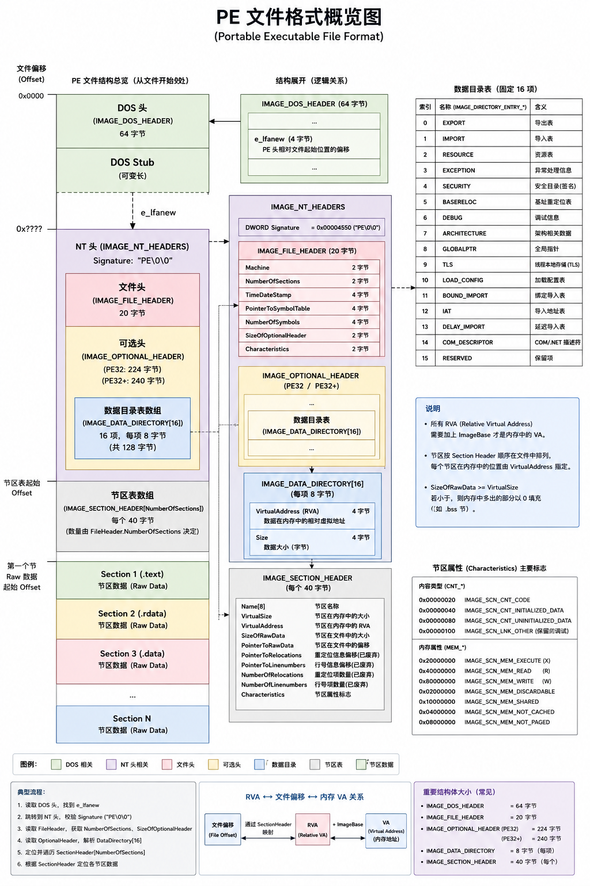


## DOS头（固定64字节）

1. 如下结构来自手册，其中有一些字段会比较熟悉，例如`ss`、`sp`、`cs`、`ip`等等都是Dos时期16位汇编开发时用到的字段，告诉系统入口点在哪、堆栈在哪
2. `IMAGE_DOS_HEADER.e_magic = MZ`，Dos头的固定特征，被修改后系统不承认你是一个可执行文件，会拒绝执行
3. `IMAGE_DOS_HEADER.e_lfanew`是指向**新文件格式的偏移**

```c
typedef struct _IMAGE_DOS_HEADER {      // DOS .EXE header
    WORD   e_magic;                     // Magic number
    WORD   e_cblp;                      // Bytes on last page of file
    WORD   e_cp;                        // Pages in file
    WORD   e_crlc;                      // Relocations
    WORD   e_cparhdr;                   // Size of header in paragraphs
    WORD   e_minalloc;                  // Minimum extra paragraphs needed
    WORD   e_maxalloc;                  // Maximum extra paragraphs needed
    WORD   e_ss;                        // Initial (relative) SS value
    WORD   e_sp;                        // Initial SP value
    WORD   e_csum;                      // Checksum
    WORD   e_ip;                        // Initial IP value
    WORD   e_cs;                        // Initial (relative) CS value
    WORD   e_lfarlc;                    // File address of relocation table
    WORD   e_ovno;                      // Overlay number
    WORD   e_res[4];                    // Reserved words
    WORD   e_oemid;                     // OEM identifier (for e_oeminfo)
    WORD   e_oeminfo;                   // OEM information; e_oemid specific
    WORD   e_res2[10];                  // Reserved words
    LONG   e_lfanew;                    // File address of new exe header
  } IMAGE_DOS_HEADER, *PIMAGE_DOS_HEADER;
```

4. 这里的`64字节`~`e_lfanew偏移`之间其实是保存了一段可运行的Dos代码，如下图所示：
5. `Dos头`大小固定为64字节，那么Hex模式下，直接数4行，之后的内容就是Dos存根
6. `Dos存根`这部分内容，除了`MZ`不能修改，其余内容修改后是不影响正常运行的，当然，文件签名会被破坏

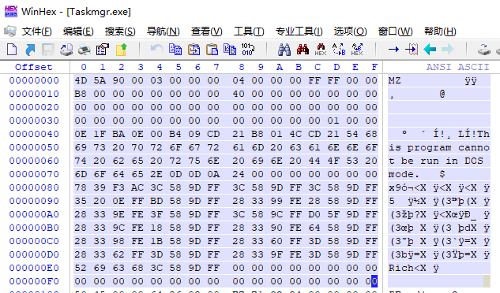


## NT文件头（拓展文件格式）

1. `Dos头及其Stub`的存在，微软为了兼容（又是技术债），只能在Dos头**尾部拓展**出新的文件格式，叫`NT文件格式`，这个格式如下所示：
2. 这个文件格式是区分32、64位的，是因为指针宽度影响导致的，其中的字段成员是一样的

```c
// x64下的NT头
typedef struct _IMAGE_NT_HEADERS64 
{
    DWORD Signature;
    IMAGE_FILE_HEADER FileHeader;
    IMAGE_OPTIONAL_HEADER64 OptionalHeader;
} IMAGE_NT_HEADERS64, *PIMAGE_NT_HEADERS64;

// x86下的NT头
typedef struct _IMAGE_NT_HEADERS
{
    DWORD Signature;
    IMAGE_FILE_HEADER FileHeader;
    IMAGE_OPTIONAL_HEADER32 OptionalHeader;
} IMAGE_NT_HEADERS32, *PIMAGE_NT_HEADERS32;
```

3. 如何定位到NT文件头，如下框选出来的就是NT头偏移：

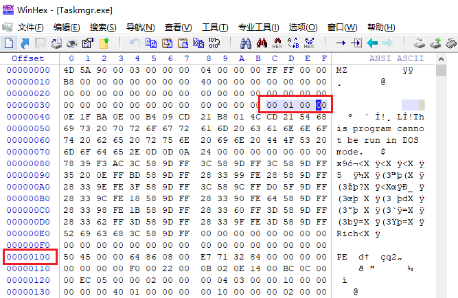

4. `IMAGE_NT_HEADERS.Signature`NT文件格式的标识符，对于Ansi码为`PE`，如下所示：

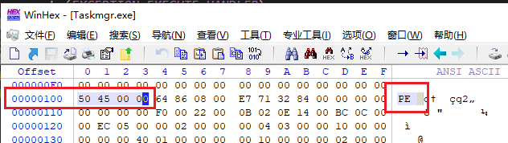


### 文件头（IMAGE_FILE_HEADER）

1. 使用`CFF`查看一个PE32文件的`IMAGE_FILE_HEADER`

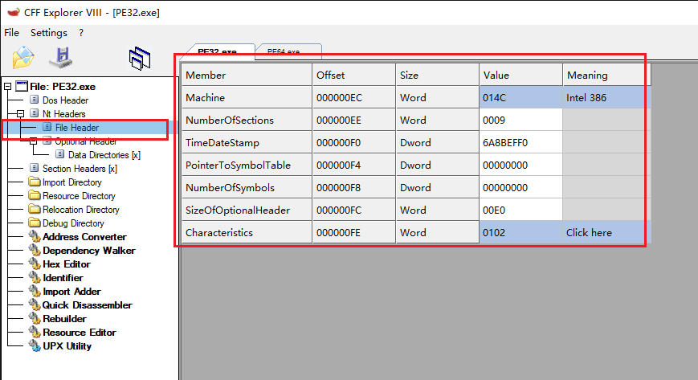

2. 首先介绍`IMAGE_NT_HEADERS.IMAGE_FILE_HEADER`，这个对象结构如下所示：
3. 按照字段成员推测这个结构的用途，用来描述一些**比较"表面"**的文件信息，例如：

```c
typedef struct _IMAGE_FILE_HEADER {
    WORD    Machine;			// 用的是什么汇编，32（i386）、64（AMD64）
    WORD    NumberOfSections;	// 节区数量
    DWORD   TimeDateStamp;		// 文件的时间戳
    DWORD   PointerToSymbolTable;	
    DWORD   NumberOfSymbols;	// 符号表的信息，如果将PDB内嵌到二进制中
                                // 就是符号表的RVA，否则为0
                                // 很多其他平台的编译器，Debug时都是将符号表内嵌到二进制中
                                // MSVC编译器是生成一个单独的PDB文件
    WORD    SizeOfOptionalHeader; // 可选头（选项头）对象的大小，32、64下分别是固定的数值
    WORD    Characteristics;	// 指示这个PE可执行文件的一些特性
                                // 是不是一个dll、是不是系统文件等等，完整如下图所示
} IMAGE_FILE_HEADER, *PIMAGE_FILE_HEADER;
```

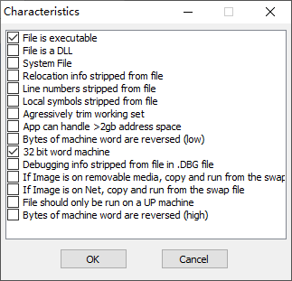


### 可选头（IMAGE_OPTIONAL_HEADER）

1. 使用`CFF`查看一个PE32文件的`IMAGE_OPTIONAL_HEADER`

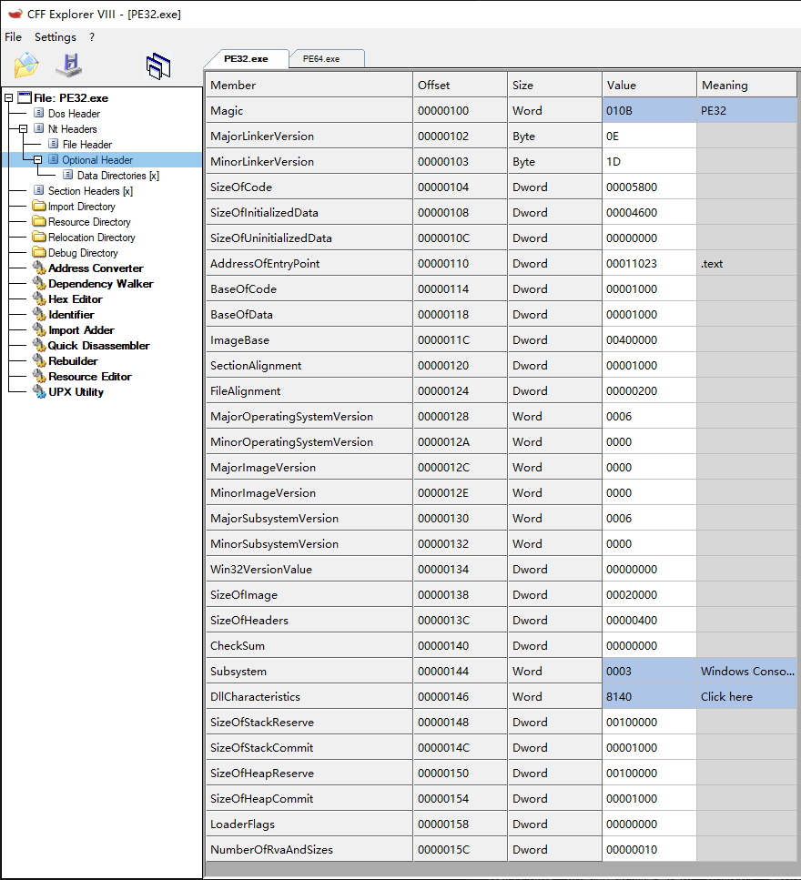

2. 可选头（IMAGE_OPTIONAL_HEADER）：这个命名其实非常具有误导性，其实这是一个历史遗留问题，是相对早期的COFF文件格式的确是可选的，但是在如今的PE文件格式中，可以说是`必选`的，因为**大量重要、关键信息都是保存在这个对象中**，在逆向分析时，经常跟这部分内容打交道，这个对象结构如下所示：

```c
typedef struct _IMAGE_OPTIONAL_HEADER {
    //
    // Standard fields.
    //
    WORD    Magic;				// 决定PE文件位数，PE32（010B）、PE64（020B）
    
    BYTE    MajorLinkerVersion;	// 链接器主、次版本号，可以用来推测VS的版本
    BYTE    MinorLinkerVersion;	// 对逆向分析有什么作用？
                                // 比如判断出来是VC6开发的，就可以判断不存在随机基址
                                // 但是仅供参考，这个数值生成后随便改，不影响运行
                                
    DWORD   SizeOfCode;			// 该PE程序的汇编代码量字节数，存在对齐
                                // 可以实现反调试（反OD调试）
    
    DWORD   SizeOfInitializedData;
    DWORD   SizeOfUninitializedData;
    
    DWORD   AddressOfEntryPoint;	// 程序装载完成后，入口点代码RVA
                                    // 早期病毒会在文件静态Hook这个点
    
    DWORD   BaseOfCode;
    DWORD   BaseOfData;

    //
    // NT additional fields.
    //
    DWORD   ImageBase;			// PE文件装载后，内存基址
    DWORD   SectionAlignment;	// PE文件装载后，在内存中的对齐粒度，一般为0x1000（4KB页面）
    DWORD   FileAlignment;		// PE文件在磁盘中的对齐粒度，一般为0x200（一个扇区大小）
    WORD    MajorOperatingSystemVersion;
    WORD    MinorOperatingSystemVersion;	// 系统的主、次版本号
    WORD    MajorImageVersion;
    WORD    MinorImageVersion;		// PE文件的主、次版本号
    WORD    MajorSubsystemVersion;
    WORD    MinorSubsystemVersion;	// 子系统的主、次版本号
    DWORD   Win32VersionValue;
    DWORD   SizeOfImage;			// PE文件装载后，在内存中的大小
    
    DWORD   SizeOfHeaders;			// 实际的PE文件头大小，但是手动拉伸，一般直接复制4KB
                                    // 更多见本文中的"易错纠正2"
    
    DWORD   CheckSum;				// 校验和
    WORD    Subsystem;				// 子系统：控制台（Cui）、窗口（Gui）
    
    WORD    DllCharacteristics;		// PE文件属性，动态基址（随机基址）就是在这里设置
                                    // 详细内容见#1-2章节笔记
    
    DWORD   SizeOfStackReserve;
    DWORD   SizeOfStackCommit;		// PE文件提前保留、提交的堆栈大小，粒度页为单位
    
    DWORD   SizeOfHeapReserve;
    DWORD   SizeOfHeapCommit;		// PE文件提前保留、提交的堆大小，粒度页为单位
    
    DWORD   LoaderFlags;
    DWORD   NumberOfRvaAndSizes;
    IMAGE_DATA_DIRECTORY DataDirectory[IMAGE_NUMBEROF_DIRECTORY_ENTRIES];
                                    // 数据目录表数组，宏固定大小为16
} IMAGE_OPTIONAL_HEADER32, *PIMAGE_OPTIONAL_HEADER32;
```


#### 数据目录表总览（IMAGE_DATA_DIRECTORY）

1. 使用`CFF`查看一个PE32文件的`IMAGE_DATA_DIRECTORY`

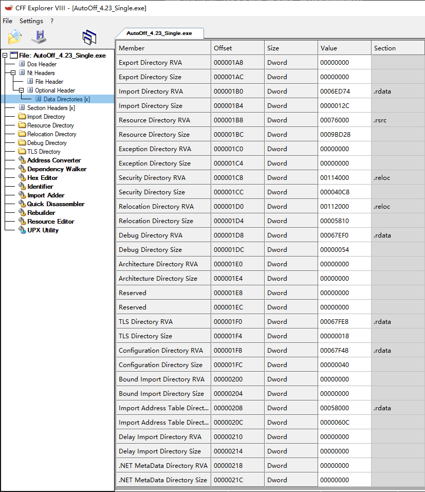

2. 在可选头尾部，存在一个数据目录表数组，通过宏控制数组大小，宏定义如下所示：

```c
#define IMAGE_NUMBEROF_DIRECTORY_ENTRIES    16
```

3. 数据目录表，这个对象结构如下所示：

```c
typedef struct _IMAGE_DATA_DIRECTORY {
    DWORD   VirtualAddress;		// 该表的RVA
    DWORD   Size;				// 表大小
} IMAGE_DATA_DIRECTORY, *PIMAGE_DATA_DIRECTORY;
```

4. 由上可知，数据目录表数组固定大小为16项，分别如下：

| 索引 | 宏 | 含义 |
| ---: | --- | --- |
| 0 | `IMAGE_DIRECTORY_ENTRY_EXPORT` | **导出表** Export |
| 1 | `IMAGE_DIRECTORY_ENTRY_IMPORT` | **导入表** Import |
| 2 | `IMAGE_DIRECTORY_ENTRY_RESOURCE` | **资源表** Resource |
| 3 | `IMAGE_DIRECTORY_ENTRY_EXCEPTION` | **异常处理信息** Exception |
| 4 | `IMAGE_DIRECTORY_ENTRY_SECURITY` | **安全目录 / Authenticode 签名** |
| 5 | `IMAGE_DIRECTORY_ENTRY_BASERELOC` | **基址重定位表** Base Relocation |
| 6 | `IMAGE_DIRECTORY_ENTRY_DEBUG` | **调试信息** Debug |
| 7 | `IMAGE_DIRECTORY_ENTRY_ARCHITECTURE` | **架构相关数据** Architecture |
| 8 | `IMAGE_DIRECTORY_ENTRY_GLOBALPTR` | **全局指针** Global Ptr |
| 9 | `IMAGE_DIRECTORY_ENTRY_TLS` | **TLS** Thread Local Storage |
| 10 | `IMAGE_DIRECTORY_ENTRY_LOAD_CONFIG` | **Load Config** |
| 11 | `IMAGE_DIRECTORY_ENTRY_BOUND_IMPORT` | **Bound Import，弃用** |
| 12 | `IMAGE_DIRECTORY_ENTRY_IAT` | **IAT** Import Address Table |
| 13 | `IMAGE_DIRECTORY_ENTRY_DELAY_IMPORT` | **Delay Import** |
| 14 | `IMAGE_DIRECTORY_ENTRY_COM_DESCRIPTOR` | **.NET 元数据目录，与主线无关** |
| 15 | `IMAGE_DIRECTORY_ENTRY_RESERVED` | **保留项** |

5. 通过解析这个数据目录表，假设我要找到`重定位表reloc`，直接访问数组中下标`5`，`ImageBase + RVA`即可定位到表头位置


##### 绑定导入表（BOUND_IMPORT）

1. 这个表是为了**优化**：在链接阶段，提前把这个`DLL`导入函数地址保存起来（用到的API地址写死），这样在运行时如果`DLL`版本号、时间戳没变，那么就可以节省一些解析导入表的工作
2. 但是这个**优化效果非常脆弱**，一旦`DLL`重新编译、版本、时间戳变动，都会导致绑定导入信息失效，所以这个表在现代编译器中已经逐渐`弃用`了


##### 延迟导入表（DELAY_IMPORT）

1. 当一个`exe`程序加载起来后，正常情况下会将以下用到的`dll`全部载入：

```c
A.dll
B.dll
C.dll
// ...
```

2. 那么在`exe`实际运行中，有可能99%的代码路径都没有使用到`C.dll`中的代码，于是就设计出了`延迟导入表`，这个表的名字就非常通俗易懂
3. 我们可以将`C.dll`的导入信息保存到`延迟导入表`中，这样就可以将`C.dll`的导入时机从程序启动、推迟到了代码真正使用时再加载
4. 但是，如果那1%的代码，恰好是程序刚启动时遇到了，那么这个优化效果就没用了


## 节区表（IMAGE_SECTION_HEADER）

1. 使用`CFF`查看一个PE32文件的`IMAGE_SECTION_HEADER`

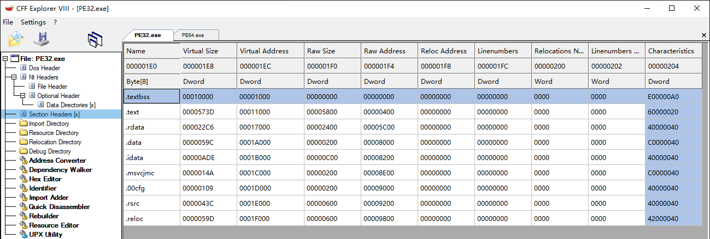

2. 在`NT头`之后，紧跟着的是`节区表`，这个表结构如下所示（**常用字段附上注释**）：

```c
typedef struct _IMAGE_SECTION_HEADER 
{
    BYTE    Name[IMAGE_SIZEOF_SHORT_NAME];	// 节区名，例如".reloc"、".rsrc"、".text"	
                                            // 这里有一个潜规则，有MSVC编译器编译的程序
                                            // 节区名以字符'.'开头
    union 
    {
            DWORD   PhysicalAddress;
            DWORD   VirtualSize;// 一般只按这个方式进行解释，表示节区内存中的大小
    } Misc;
    DWORD   VirtualAddress;		// PE装载到内存后，该节区的RVA
    DWORD   SizeOfRawData;		// 该节区原始大小，系统载入PE是按照这个大小来拷数据
    DWORD   PointerToRawData;	// PE文件在磁盘状态时，该节区在文件中的偏移
    DWORD   PointerToRelocations;
    DWORD   PointerToLinenumbers;
    WORD    NumberOfRelocations;
    WORD    NumberOfLinenumbers;
    DWORD   Characteristics;	// 这个节区的一些属性（RWX、初始化后可以丢弃）
                                // 一些属性如下所示
} IMAGE_SECTION_HEADER, *PIMAGE_SECTION_HEADER;
```

```c
IMAGE_SCN_MEM_DISCARDABLE   0x02000000	// 节区可以丢弃
IMAGE_SCN_MEM_NOT_CACHED    0x04000000	// 不缓存
IMAGE_SCN_MEM_NOT_PAGED     0x08000000	// 不可分页
IMAGE_SCN_MEM_SHARED        0x10000000	// 共享的
IMAGE_SCN_MEM_EXECUTE       0x20000000	// 可执行
IMAGE_SCN_MEM_READ          0x40000000	// 可读
IMAGE_SCN_MEM_WRITE         0x80000000	// 可写
```

3. 在**手动拉伸**PE结构时，这部分内容非常重要，我们可以使用如下宏，快速获取到第一个节区表（快速遍历节区表的伪代码）：

```c
#define IMAGE_FIRST_SECTION( ntheader ) ((PIMAGE_SECTION_HEADER)        \
    ((ULONG_PTR)(ntheader) +                                            \
     FIELD_OFFSET( IMAGE_NT_HEADERS, OptionalHeader ) +                 \
     ((ntheader))->FileHeader.SizeOfOptionalHeader   \
    ))

// 获取第一个节区表指针
IMAGE_SECTION_HEADER* pSectionHeader = IMAGE_FIRST_SECTION(pNtHeader);

// 遍历所有的节区表
for (ULONG i = 0; i < pFileHeader->NumberOfSections; i++, pSectionHeader++)
{
    // ...
}
```


### 易错纠正1

1. 节区是节区，表是表，两者不能搞混了
2. `数据目录表`和`节区表`都包含RVA、Size，但它们描述的对象完全不同：

> 1. 数据目录表：描述PE中某类特殊、典型数据（异常数据、资源数据）的Rva、Size
> 2. 节区表：描述每个节区（text、pdata、reloc）的RVA、Size和属性，每一个节区都会有一个节区表对象来描述它
>

3. 这里以`异常数据`为例：RVA指向的可能是`pdata`节区的**范围内**，不能**误认为**指向的是`pdata`节区的起始地址
4. 如下图所示，导入表指向的是`.rdata`节区内的一小段：

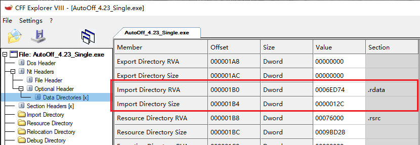


## PE文件磁盘状态、内存状态

1. 一个PE文件在磁盘、装载后运行中的状态是不一样的，存在对齐粒度问题
2. 在磁盘中时，是以`OptHeader.FileAlignment`对齐，默认一般为`0x200`，是因为早期的磁盘一个扇区大小为512字节，是为了**读取效率**最优

> 1. 早期的磁盘，读取的最小粒度为512字节，你哪怕只读1字节，磁盘驱动也是读512字节后，抽取第一个字节返回给你
> 2. 所以在设计PE文件格式时，为了读取效率最优，所以默认设置为0x200
>

3. PE文件装载到内存中，运行起来后，是以`OptHeader.SectionAlignment`对齐的，默认值为`0x1000`，即一个物理页面大小，是为了**内存寻址**最优
4. 形象地展示前后对比，如图所示（红色部分为实际节区数据、绿色部分为对齐补零）：
5. 有下图也可以得出结论：磁盘中的PE文件载入到内存后，其实就很像是被`拉伸`了，因为PE头、节区的原始数据跟在磁盘状态下是一模一样的

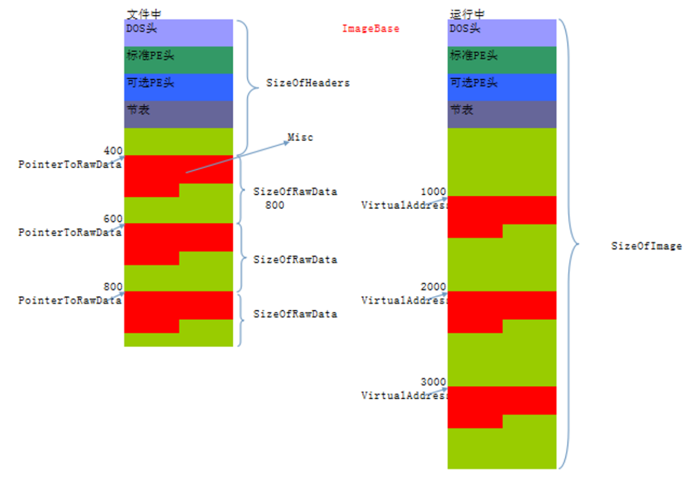


### 易错纠正2

1. 在手动映射注入时，在拉伸PE步骤中，填充PE文件头时，往往直接从`FileBuffer`头部直接拷贝`0x1000`到`MemBuffer`，**这其实是有问题的**：实际上是将PE文件头+第一个节区的部分数据一起拷贝了

```c
memcpy(MemBuffer, FileBuffer, 0x1000);
```

2. 正确的做法应该是解析PE文件头`OptHeaders.SizeOfHeaders`字段，这个字段由编译器填充，是完整PE头的大小（Aligned），按照这个大小来拷贝，可以避免拷贝多余字节

```c
DWORD header_size = pNtHeaders->OptionalHeader.SizeOfHeaders;
memcpy(MemBuffer, FileBuffer, header_size);
```

3. 为什么没有发现这个问题？虽然这是一种偷懒的做法，但是也做到了将PE文件头向上对齐的操作，文件系统在解析时，也只会按照`OptHeaders.SizeOfHeaders`大小来解析实际的PE头，多余的字节集可以认为是`无害垃圾`
