<!--more-->

## 导入表、导出表开始

1. 我们的硬盘里面存放着大量的PE文件，这些一个个独立存放的PE文件，是怎么做到运行时联系到一起的呢？
2. `导出表`：一个PE文件会将所有的导出符号信息（导出函数、变量）保存到`导出表`中
3. `导入表`：一个PE文件会将运行时所需要的函数，保存到导入表中，由系统载入PE时修正导入表中的真正的函数地址
4. 从PE文件格式角度来看，任何PE文件都可以同时拥有导出表、导入表。但是，因为exe往往是一个应用程序的主体部分，所以exe程序往往不会导出函数给其他程序使用


## 导入表（Import Table）

1. 早期编译器将`导入表`放置在`.rdata`节区中，现在编译器将`导入表`放置在`.idata`中，如图所示：
2. 在下图中，框选出来的部分`导入表Size`是可以**置零**的，说明系统在遍历这个表时，使用其他方法确定**表结尾**

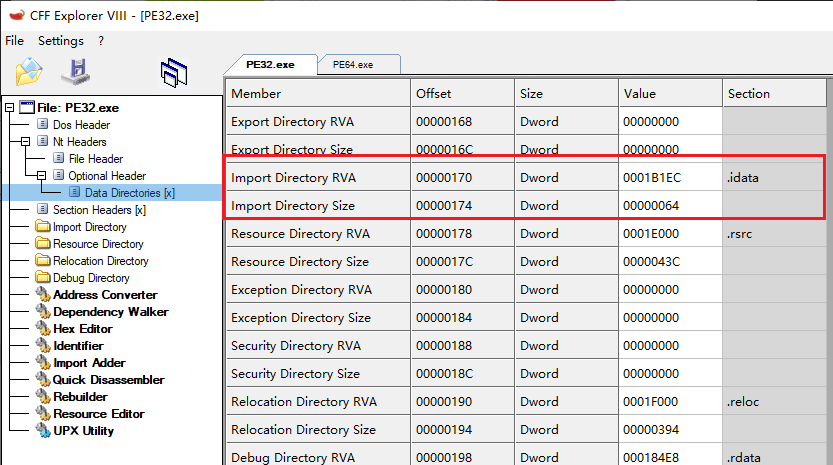


### 导入描述符

1. `数据目录表`下标`1`指向的导入表：指向的是`IMAGE_IMPORT_DESCRIPTOR数组`，其字段定义如下所示：

```c
typedef struct _IMAGE_IMPORT_BY_NAME 
{
    WORD Hint;		// 该函数在目标DLL导出表的序号，用序号直接拿地址肯定更快
                    // 问题是：不用版本DLL导出函数表不一样
                    // 	1. 实际运作中，可能先用序号，看看名称是不是一致的，如果一样说明找对了
                    // 	2. 如果不一样，回到到常规遍历导出表，通过函数名匹配
    
    CHAR Name[1];	// 函数名，系统拿着函数名去DLL导出表搜索
} IMAGE_IMPORT_BY_NAME, * PIMAGE_IMPORT_BY_NAME;

// 一个联合体，有4种不同的解释
typedef struct _IMAGE_THUNK_DATA32 
{
    union 
    {
        DWORD ForwarderString; 
        
        DWORD Function;             // 保存函数VA
        
        DWORD Ordinal;				// 函数在目标DLL导出表中的序号
                                    // 当IMAGE_THUNK_DATA32最高位为1时，使用序号解析
                                    // 否则使用常规的函数名导入
        
        DWORD AddressOfData;        // IMAGE_IMPORT_BY_NAME的RVA
    } u1;
} IMAGE_THUNK_DATA32, *PIMAGE_THUNK_DATA32;

// 0x14 Bytes
typedef struct _IMAGE_IMPORT_DESCRIPTOR 
{
    DWORD OriginalFirstThunk;	// 即INT，导入名称表RVA
                                // 指向IMAGE_THUNK_DATA[]数组的RVA
                                // 由于IMAGE_THUNK_DATA是联合体，实际按照AddressOfData解释
                                // 所以也可以认为是指向IMAGE_IMPORT_BY_NAME[]数组的RVA
                                    
    DWORD TimeDateStamp;
    DWORD ForwarderChain;
    
    DWORD Name;					// 库名称RVA
    
    DWORD FirstThunk;			// 即IAT，导入地址表RVA
                                // 指向IMAGE_THUNK_DATA[]数组的RVA
                                // 由于IMAGE_THUNK_DATA是联合体，实际按照Function解释
                                // 保存运行中函数的VA
} IMAGE_IMPORT_DESCRIPTOR, *PIMAGE_IMPORT_DESCRIPTOR;
```

2. 在下图中，我们将`RVA = 0001B1EC`转为`FOA = 81EC`，并且选中0x64字节的数据区域
3. 可知数组容量为`0x64 / 0x14 = 5`，最后一个`IMAGE_IMPORT_DESCRIPTOR`成员内容全部为0，表示**终止符**，如图所示：
    1. 拓展：在PE文件的设计中，涉及到这样对象数组的，往往最后一个成员内容全部为0表示结束

> 科锐课程实验：将末尾0x00写为其他数值，PE格式系统不识别了
>

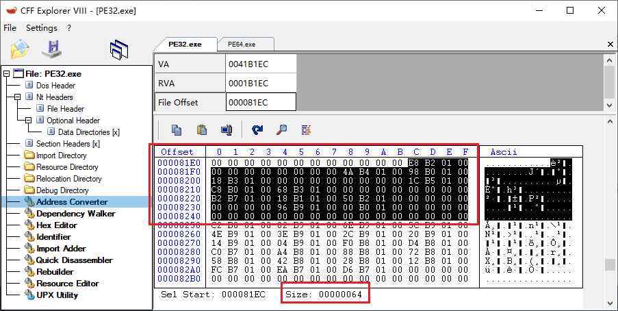

4. 有多少个有效的`IMAGE_IMPORT_DESCRIPTOR`对象，就代表静态导入了几个库：

```c
Kernel32.dll
User32.dll
Ntdll.dll
// 那么有效的IMAGE_IMPORT_DESCRIPTOR对象有3个
```


### 函数名导入、序号导入规则

1. `IMAGE_THUNK_DATA32`这个联合体有多种解释方式，其中`Ordinal`、`AddressOfData`分别表示序号导入、函数名导入
2. 那么系统是如何区分使用哪种导入方式的？

> 答：`IMAGE_THUNK_DATA32`最高位置1（或上0x80000000），此时系统就知道是序号导入，便取低2字节作为序号（x64同理）。否则就是函数名导入
>

3. 使用**函数名导入是更加主流**的开发方式
4. 极少数非主流程序就是序号导入，`MFC`程序就是典型，因为`MFC`程序导入的函数名大多都比较长


### 图表演示

1. 以下2张图形象地展示了导入表`磁盘中`、`内存中`的两种状态：

> 在磁盘状态时：`IMAGE_IMPORT_DESCRIPTOR`中的`INT`、`IAT`内容一模一样，`INT`被清，系统自动从`IAT`取名称，取到地址后再回写到`IAT`
>
> 内存中运行时：由文件系统根据`INT`将实际的函数地址填充到`IAT`中
>

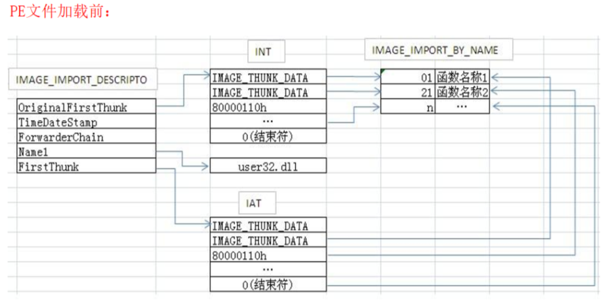

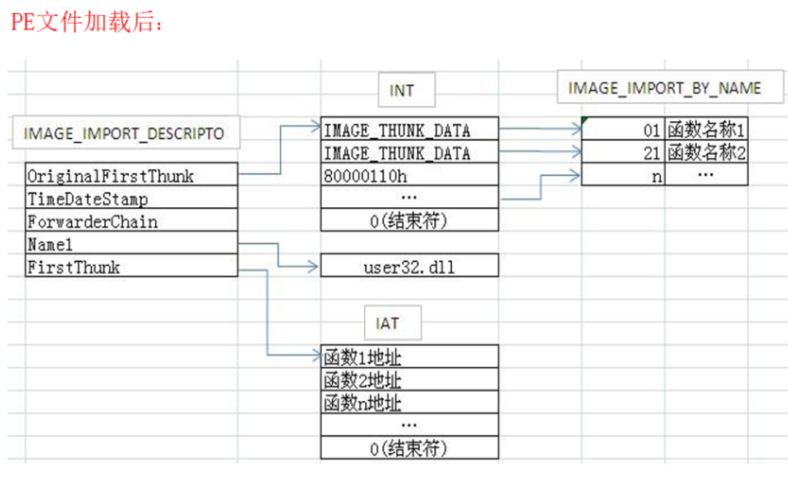


### 导入表强化理解

1. 读者需要明白一个根源：我们的汇编代码在运行时，真正重要、真正使用到的是**导入地址表中的函数地址**，即IAT中的函数地址
2. 至于导入表的其他内容：导入的库名称、导入的函数名称（序号），这些是给PE热加载使用的，系统拿着这些信息才知道要从哪个模块、取哪个函数的地址，取到后回写到IAT
3. 一句话总结，PE文件运行起来后，导入表中除了IAT其他信息都可以直接抹掉，不影响运行
4. 关于手动修复导入表，代码如下所示：

```c
	// 修复导入表
	if (pOptHeader->DataDirectory[IMAGE_DIRECTORY_ENTRY_IMPORT].Size)
	{
		IMAGE_IMPORT_DESCRIPTOR* pImportDescr = (IMAGE_IMPORT_DESCRIPTOR*)(pBase + pOptHeader->DataDirectory[IMAGE_DIRECTORY_ENTRY_IMPORT].VirtualAddress);

		// 遍历导入描述符
		while (pImportDescr->Name)
		{
			// 根据导入描述符中的名称加载DLL
			HMODULE hDll = pData->pLoadLibraryA(pBase + pImportDescr->Name);

			// 指向原始 thunk（INT）
			ULONG_PTR* pInt = (ULONG_PTR*)(pBase + pImportDescr->OriginalFirstThunk);
			// 指向导入地址表（IAT）
			ULONG_PTR* pIat = (ULONG_PTR*)(pBase + pImportDescr->FirstThunk);

			// 如果没有原始 thunk，则直接使用 IAT
			if (!pInt)
			{
				pInt = pIat;
			}

			// 解析每个导入条目
			for (; *pIat; ++pIat, ++pInt)
			{
				if (IMAGE_SNAP_BY_ORDINAL(*pInt))
				{
					// 如果是按序号导入，按序号获取函数
					*pIat = (ULONG_PTR)pData->pGetProcAddress(hDll, (PCHAR)(*pInt & 0xffff));
				}
				else
				{
					// 按名称导入
					IMAGE_IMPORT_BY_NAME* pImport = (IMAGE_IMPORT_BY_NAME*)(pBase + *pInt);
					*pIat = (ULONG_PTR)pData->pGetProcAddress(hDll, pImport->Name);
				}
			}

			// 移动到下一个导入描述符
			pImportDescr++;
		}
	}
```


## 导出表

1. 编译器会将导出表编译进`.rdata`只读数据节区
2. 系统在动态修复`导入地址表`时，会去查模块的导出表

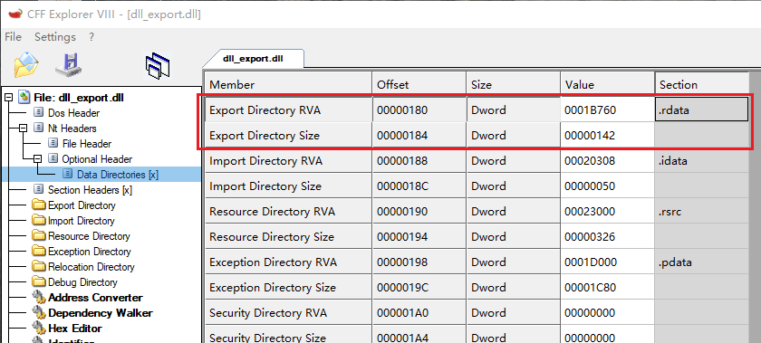


### 导出描述符

1. 关于导出表，其对象定义如下（不重要的字段，不写注释）：

```c
typedef struct _IMAGE_EXPORT_DIRECTORY 
{
    DWORD   Characteristics;
    DWORD   TimeDateStamp;
    WORD    MajorVersion;
    WORD    MinorVersion;
    DWORD   Name;					// 该导出库的名称RVA
    DWORD   Base;					// 序号基准值
    DWORD   NumberOfFunctions;		// 导出函数数量
    DWORD   NumberOfNames;			// 导出符号名称数量
    DWORD   AddressOfFunctions;     // 地址表RVA，指向DWORD数组，每项为Func RVA
    DWORD   AddressOfNames;         // 名称表RVA，指向DWORD数组，每项为Str RVA
    DWORD   AddressOfNameOrdinals;  // 序号表RVA，指向WORD数组，每项就是序号
} IMAGE_EXPORT_DIRECTORY, *PIMAGE_EXPORT_DIRECTORY;
```

> 导出函数、导出变量，本质上都是该PE文件对外导出的一个符号，保存在导出表中的是该符号的RVA，所以会有一个很反直觉的操作，可以使用`GetProcAddress`函数来获取一个导出变量的地址
>

2. `Name`字段实验：其中为`RVA = 01A836`，转为`FOA`后即可得到dll库名称，默认以0字符结尾

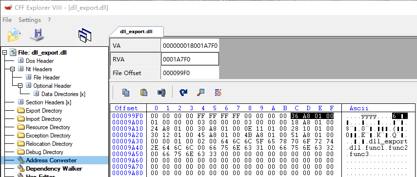

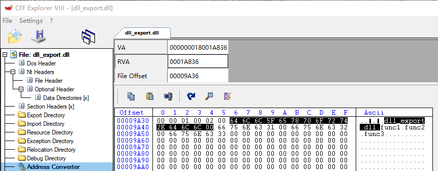

3. `Base`字段：这里直接保存着序号基准值，这个基准值往往是序号导出最小的那一项，如下例子：
4. `Base`字段使用场景如下：
    1. 使用`GetProcAddress("xxx.dll", <序号>)`这种方式取出导出函数时
    2. 将传入的序号值减去`Base`基准得到`Ordinal`序号
    3. 拿着计算得到的序号去`Ordinal`数组查询即可得到该导出符号的RVA

```c
// 这种编译出来，Base = 10
LIBRARY
	EXPORTS
		func1 @10
		func2 @12
		func3 @14

// 这种编译出来，Base = 1
LIBRARY
	EXPORTS
		func1 @1
		func2 @2
		func3 @3
```

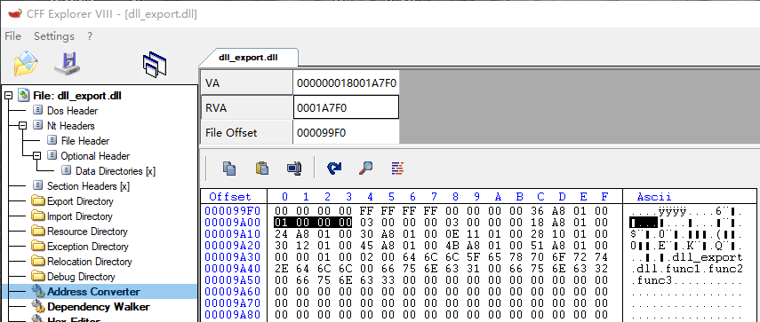

5. `NumberOfFunctions`、`NumberOfNames`导出函数、导出符号的数量，两者不一定相等的
6. `AddressOfFunctions`字段指向函数地址RVA数组，将`RVA`转为`FOA`后，如图所示：
7. 由于我们的导出并不是连续的，如下所示：

```c
LIBRARY
	EXPORTS
		func1 @10
		func2 @12
		func3 @14
```

8. 所以编译出来的中间会使用`0x00000000`填充，如下所示：

```c
RVA：0x01A818
FOA：0x9A18

// 数组中每一项都是RVA
0x9A18 -> 01110E
          000000
          011028
          000000
          011230
```

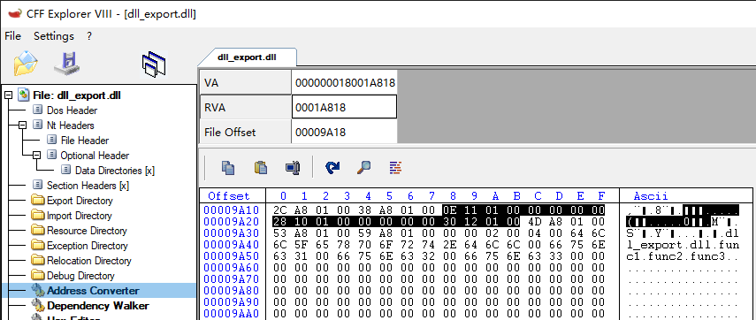

9. `AddressOfNames`字段：指向名称RVA数组，其中每一项都是名称RVA

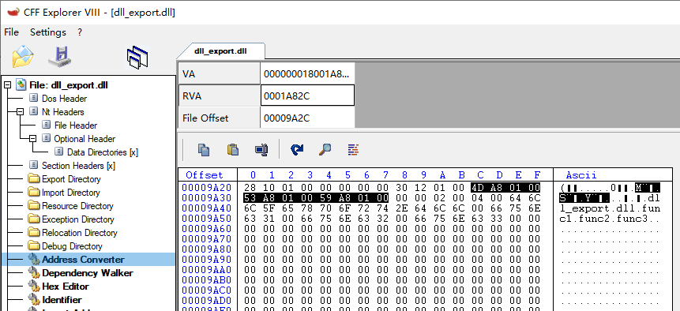

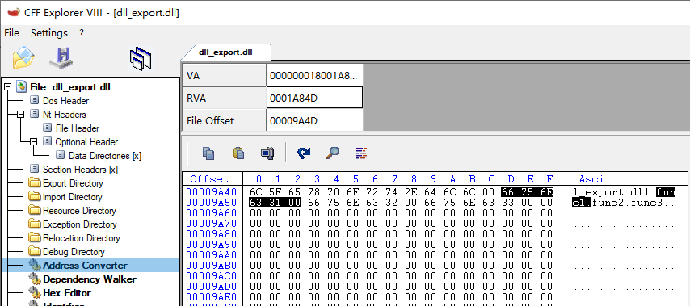

10. `AddressOfNameOrdinals`字段，指向`Ordinal`顺序表，其中的每一项均为2字节大小，如图所示，导出声明如下，这里保存的是0、2、4，都减去了`Base`基准值

```c
LIBRARY
	EXPORTS
		func1 @10
		func2 @12
		func3 @14
```

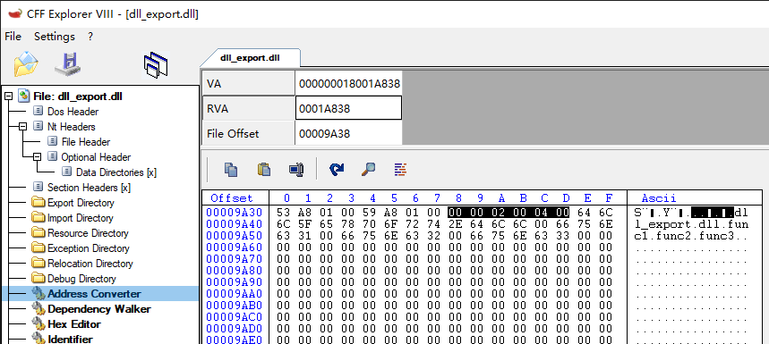


### GetProcAddress工作原理（符号名查找）

1. 根据传入的符号，先到`AddressOfNames`中查找对应的`下标`
2. 根据`下标`到`AddressOfNameOrdinals`数组中查询，取出真正的`Ordinal`
3. 根据`Ordinal`到`AddressOfFunctions`数组中查询，取出该符号的RVA
4. `ModuleBase + RVA`就是该符号的导出地址
5. 这里借用滴水逆向的一图流：

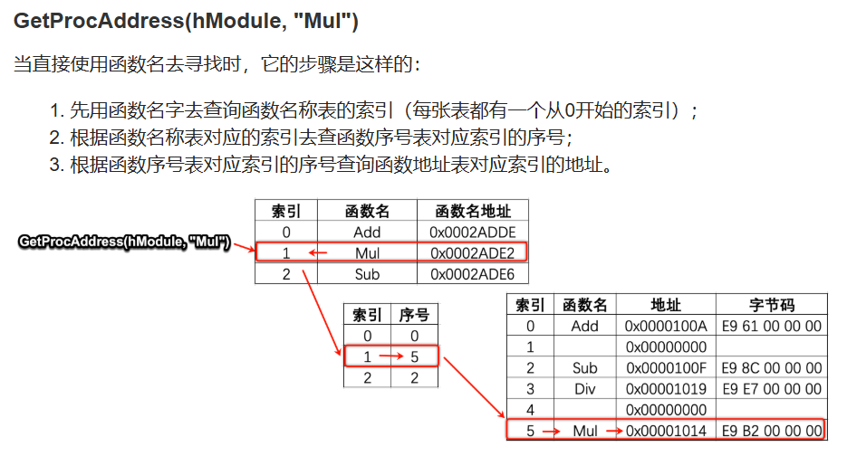


### GetProcAddress工作原理（序号查找）

1. 当传入序号查找符号时，`序号 - Base`得到`Ordinal`
2. 拿着`Ordinal`到`AddressOfFunctions`数组中得到符号`RVA`
3. `ModuleBase + RVA`就是该符号的导出地址
4. 这里借用滴水逆向的一图流：

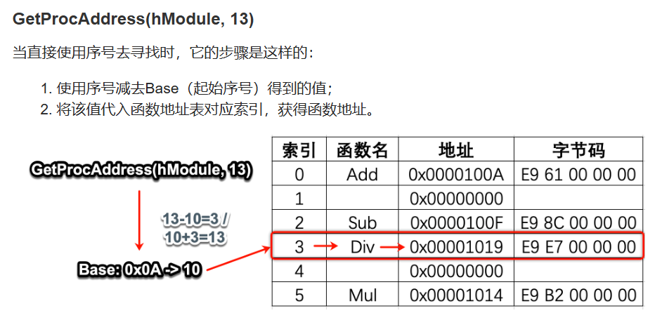


### 编译器优化导出表

1. 在使用符号导出时，编译器会按照`A-Z`、`a-z`的顺序排列导出符号，例子如下：

```c
LIBRARY
	EXPORTS
		func3
		func2
		func1
        func4

// 编译器在导出时，排列顺序如下：
func1
func2
func3
func4
```

2. 使用这种优化方式，使用`GetProcAddress("xxx.dll", <函数名>)`查找函数时，可以使用二分法查找
3. 例子2，假设我导出文件是如下写法，编译器在生成导出表时，还是会排序的

```c
LIBRARY
	EXPORTS
		func3 @1
		func2 @2
		func1 @3
        func4 @4
```


### 调试器开发（地址反查符号名）

1. 现在的调试器都比较智能，一个有效的地址指针会尝试反查出其`模块名`、`函数名`，如何实现的呢？
2. 首先根据拿到一个地址，遍历模块链表，看看其匹配到其中的哪一个模块中
3. 有匹配，那么计算出`RVA`，开始就反查导出表
4. 先查地址数组，拿到其下标
5. 再反查序号数组，拿到序号表下标
6. 再反查名称数组，查询其导出符号名


### 手动实现LoadLibrary

1. 就是内存加载DLL，拉伸PE、修导入表、重定位表、修异常。如果使用了TLS对象，则调用TLS回调


### 手动实现GetProcAddress

1. 科锐PE章节，22课
2. 手动实现该函数，易忘点是判断是符号、序号，文档描述如下：

> 序号查找：高序位部分为0
>


## 重定位表

1. 由于`随机基址`这个机制的存在，涉及到绝对地址访问的代码，就需要进行重定位，简单例子如下：

```c
ULONG g_Var = 0;

void Func()
{
    auto pVar = &g_Var;
    // ...
}
```


### 设计重定位表

1. 假设我们目前是微软的开发者，要设计一个重定位表结构，该如何设计呢？换句话说，系统在加载PE文件的时候，怎么知道哪些代码需要修复重定位？
2. 从实用出发，我们设计的结构，至少要包含2点内容：要修复代码的地址、修复的类型

```c
struct _MY_RELOC_INFO
{
    ULONG_PTR CodeAddr;
    ULONG_PTR FixType;
}MY_RELOC_INFO;
```

3. 细看我们自己设计的对象，从功能性角度考虑，确实可以支撑功能，但是存在内存利用效率的问题
4. 那么该如何优化呢？接下来我们看官方是如何设计的


### PE中的重定位表

1. 已知段页保护机制，每一个物理页面的粒度为4KB，所以微软在设计该结构时，就是一个页面、对应一个重定位对象，如下所示

```c
typedef struct _IMAGE_BASE_RELOCATION 
{
    DWORD VirtualAddress;	// 该页面的RVA
    DWORD SizeOfBlock;		// 保存当前IMAGE_BASE_RELOCATION整个大小
//  WORD    TypeOffset[1];	// 柔性数组
} IMAGE_BASE_RELOCATION;
```

2. 柔性数组，因为每一个页面所需要重定位的代码数量都不是固定的，所以需要设置变长数组，该数组大小计算方式如下：

```c
变长数组大小 =  SizeOfBlock - sizeof(IMAGE_BASE_RELOCATION);
成员格式 = 数组大小 / sizeof(WORD);
```

3. TypeOffset，一个TypeOffset为WORD，因为12位（0xFFF）足够描述一个4KB页面内的任意偏移，所以切出来高4位用来保存属性，属性位如下（看似很多，但是我们只关心其中2个）：

```c
#define IMAGE_REL_BASED_ABSOLUTE              0		
#define IMAGE_REL_BASED_HIGH                  1		
#define IMAGE_REL_BASED_LOW                   2
#define IMAGE_REL_BASED_HIGHLOW               3		// x86汇编，这个属性代表要修复Reloc
#define IMAGE_REL_BASED_HIGHADJ               4
#define IMAGE_REL_BASED_MACHINE_SPECIFIC_5    5
#define IMAGE_REL_BASED_RESERVED              6
#define IMAGE_REL_BASED_MACHINE_SPECIFIC_7    7
#define IMAGE_REL_BASED_MACHINE_SPECIFIC_8    8
#define IMAGE_REL_BASED_MACHINE_SPECIFIC_9    9
#define IMAGE_REL_BASED_DIR64                 10	// x64汇编，这个属性代表要修复Reloc
```


### 强化重定位理解

1. 如图为粗糙草图：

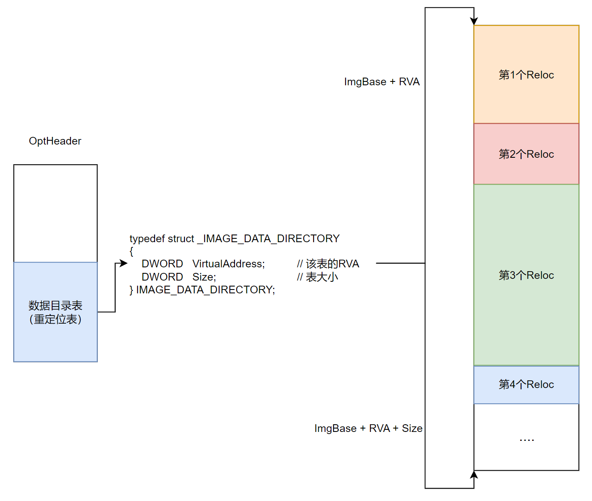

2. 重新计算重定位的格式如下：

```c
新Offset = (原Offset - 原ImgBase) + 新ImgBase

// 该工程变换后如下
新Offset = 原Offset + (新ImgBase - 原ImgBase)

// 再变换
原Offset += (新ImgBase - 原ImgBase)
```

3. 以下代码为手动修复重定位表：

```c
// 计算重定位偏移量
PCHAR LocationDelta = pBase - pOptHeader->ImageBase;
if (LocationDelta)
{
    // 检查基础重定位目录是否存在
    if (pOptHeader->DataDirectory[IMAGE_DIRECTORY_ENTRY_BASERELOC].Size)
    {
        // 获取重定位数据
        IMAGE_BASE_RELOCATION* pRelocData = (IMAGE_BASE_RELOCATION*)(pBase + pOptHeader->DataDirectory[IMAGE_DIRECTORY_ENTRY_BASERELOC].VirtualAddress);
        IMAGE_BASE_RELOCATION* pRelocEnd = (IMAGE_BASE_RELOCATION*)((ULONG64)(pRelocData)+pOptHeader->DataDirectory[IMAGE_DIRECTORY_ENTRY_BASERELOC].Size);
        while (pRelocData < pRelocEnd && pRelocData->SizeOfBlock)
        {
            // 计算重定位块中的条目数量
            UINT64 AmountOfEntries = (pRelocData->SizeOfBlock - sizeof(IMAGE_BASE_RELOCATION)) / sizeof(short);
            // 指向重定位偏移的指针
            unsigned short* pRelativeInfo = (unsigned short*)(pRelocData + 1);

            // 处理每个重定位条目
            for (UINT64 i = 0; i != AmountOfEntries; ++i, ++pRelativeInfo)
            {
                // 检查重定位条目是否为直接寻址
                if (RELOC_FLAG64(*pRelativeInfo))
                {
                    // 计算需要修补的地址
                    ULONG_PTR* pPatch = (ULONG_PTR*)(pBase + pRelocData->VirtualAddress + ((*pRelativeInfo) & 0xFFF));

                    // 更新地址，添加重定位偏移
                    *pPatch += (ULONG_PTR)(LocationDelta);
                }
            }

            // 移动到下一个重定位块
            pRelocData = (IMAGE_BASE_RELOCATION*)((PCHAR)pRelocData + pRelocData->SizeOfBlock);
        }
    }
}
```


## 线程局部存储（TLS）

1. 线程局部存储，其实就是线程级别的私有资源。
2. 常规的多线程操作单一全局资源，需要加锁处理，但是编译器提供了`TLS`关键字，由编译器展开代码，将该变量设置为线程局部存储变量`TLS变量`，每一个线程操作的`TLS变量`都是独立的副本，多线程之间不需要加锁（空间换时间）


### 静态、动态TLS语法

1. 使用`__declspec(thread)`定义线程局部存储对象，静态例子代码如下：

```c
// ---------- 静态 TLS 变量 ----------
// 每个线程都有自己独立的 tls_counter 副本，互不干扰
__declspec(thread) int tls_counter = 0;

// 普通全局变量，用于对比：所有线程共享同一份
int global_counter = 0;

void thread_func(int id) {
    for (int i = 0; i < 3; ++i) {
        tls_counter++;          // 只影响当前线程的副本
        global_counter++;       // 所有线程共享，需要同步（这里仅演示）
    }
}

int main() {
    std::vector<std::thread> threads;
    for (int i = 0; i < 3; ++i) {
        threads.emplace_back(thread_func, i);
    }
    for (auto& t : threads) {
        t.join();
    }

    return 0;
}
```

2. 动态用法：`TlsAlloc`、`TlsGetValue`、`TlsFree`等等函数组合

```cpp
DWORD g_tlsIndex = TLS_OUT_OF_INDEXES;

// 普通全局变量，用于对比：所有线程共享同一份
int global_counter = 0;

void thread_func(int id)
{
    // 为当前线程创建一个动态 TLS 数据
    int* tls_counter = new int(0);

    // 将当前线程自己的数据保存到 TLS 中
    TlsSetValue(g_tlsIndex, tls_counter);

    for (int i = 0; i < 3; ++i)
    {
        // 从 TLS 中取出当前线程自己的数据
        int* counter = static_cast<int*>(TlsGetValue(g_tlsIndex));

        (*counter)++;
        global_counter++;

        std::cout << "Thread " << id
                  << ": tls_counter = " << *counter
                  << ", global_counter = " << global_counter
                  << std::endl;
    }

    // 当前线程结束前清理 TLS 数据
    int* counter = static_cast<int*>(TlsGetValue(g_tlsIndex));
    delete counter;

    TlsSetValue(g_tlsIndex, nullptr);
}

int main()
{
    // 分配一个动态 TLS 索引
    g_tlsIndex = TlsAlloc();

    if (g_tlsIndex == TLS_OUT_OF_INDEXES)
    {
        std::cerr << "TlsAlloc failed!" << std::endl;
        return 1;
    }

    std::vector<std::thread> threads;

    for (int i = 0; i < 3; ++i)
    {
        threads.emplace_back(thread_func, i);
    }

    for (auto& t : threads)
    {
        t.join();
    }

    // 释放 TLS 索引
    TlsFree(g_tlsIndex);

    return 0;
}
```


### TLS机制分析

1. 这些线程独立的资源其实是放在`TEB`中的，有着`TlsSlots`、`TlsExpansionSlots`
2. 动态使用时，`TlsSlots`满了会自动启用`TlsExpansionSlots`拓展槽位

```c
struct _TEB
{
    struct _NT_TIB NtTib;                                                   //0x0
    // ...
    VOID* ThreadLocalStoragePointer;                                        //0x58
    // ...
    VOID* TlsSlots[64];                                                     //0x1480、
    // ...
    VOID** TlsExpansionSlots;                                               //0x1780
}; 
```

3. 关于静态、动态TLS，其关系如下所示：

```c
                         Windows TLS
                              │
                 ┌────────────┴────────────┐
                 │                         │
            Static TLS                Dynamic TLS
                 │                         │
       __declspec(thread)             TlsAlloc()
       IMAGE_TLS_DIRECTORY            TlsSetValue()
                 │                    TlsGetValue()
                 │                         │
            Loader 管理                    │
                 │                         │
                 ↓                         ↓
      TEB.ThreadLocalStoragePointer     TEB.TlsSlots[64]
                 │                         │
                 ↓                         ↓
             TLS Vector             TlsExpansionSlots
                 │
        ┌────────┼────────┐
        ↓        ↓        ↓
   Module A   Module B   Module C
   TLS Block  TLS Block  TLS Block
```

4. 写DLL代码时，优先考虑使用动态TLS


### 编译器、手动加载PE（修复静态TLS）

1. 使用`__declspec(thread)`定义线程局部存储对象，其实是由编译器展开了大量代码，涉及到的对象如下所示：

```c
typedef VOID
(NTAPI *PIMAGE_TLS_CALLBACK) (
    PVOID DllHandle,
    DWORD Reason,
    PVOID Reserved
);

typedef struct _IMAGE_TLS_DIRECTORY32 
{
    DWORD   StartAddressOfRawData;
    DWORD   EndAddressOfRawData;
    DWORD   AddressOfIndex;             // PDWORD
    DWORD   AddressOfCallBacks;         // PIMAGE_TLS_CALLBACK*，注意：是VA
    DWORD   SizeOfZeroFill;
    union 
    {
        DWORD Characteristics;
        struct 
        {
            DWORD Reserved0 : 20;
            DWORD Alignment : 4;
            DWORD Reserved1 : 8;
        } DUMMYSTRUCTNAME;
    } DUMMYUNIONNAME;
} IMAGE_TLS_DIRECTORY32;
```

2. 手动加载PE时，**修复静态TLS**代码如下所示：

```c
// 执行TLS回调
if (pOptHeader->DataDirectory[IMAGE_DIRECTORY_ENTRY_TLS].Size)
{
    auto* pTLS = (IMAGE_TLS_DIRECTORY*)
        (pBase + pOptHeader->DataDirectory[IMAGE_DIRECTORY_ENTRY_TLS].VirtualAddress);

    //注意，这里要先修复重定位
    auto* pCallback = (PIMAGE_TLS_CALLBACK*)pTLS->AddressOfCallBacks;
    if (pCallback)
    {
        for (;*pCallback; ++pCallback)
        {
            (*pCallback)(pBase, DLL_PROCESS_ATTACH, nullptr);
        }
    }
}
```

3. 假设我们的TLS对象只是普通变量`int`、`DWORD`这种TLS对象，其初始化直接写死在PE中即可，默认是不会生成TLS回调的，但是如果TLS对象是一个类对象有构造函数（或者其初始化值来自其他函数的返回值），就会生成TLS回调来调用该构造
4. 那么动态TLS呢？动态TLS本身就是运行时分配TLS的，压根不依赖PE，所以不用修
