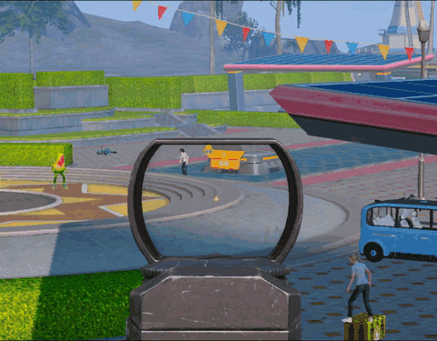
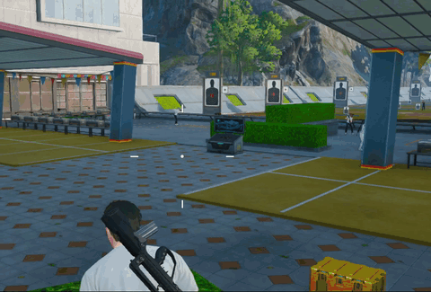

<!--more-->

## 入手点

1. 这个函数`RotateAngleAxis`是UE系列引擎追踪的入手点
2. 这个函数头部下断，腰射开火会命中断点，但是开镜不会，简单腰射追踪直接Hook这里就能实现
3. 不要慌，我们回溯堆栈，多回溯几层、配合断点，就会找到一层，开镜、腰射都会断下的点，如下所示：

```c++
hpjyhd.Dump.exe+2005520 - 0F85 9BEB0C03         - jne hpjyhd.Dump.exe+50D40C1
hpjyhd.Dump.exe+2005526 - 48 8B 07              - mov rax,[rdi]					// 取出虚函数表
hpjyhd.Dump.exe+2005529 - 4C 8B 80 28060000     - mov r8,[rax+00000628]			 // 这里应该是从虚表取出函数指针 
hpjyhd.Dump.exe+2005530 - 48 8D 95 70050000     - lea rdx,[rbp+00000570]		 // rbp+00000570作为参数2传入，其实就是VECTOR3*
hpjyhd.Dump.exe+2005537 - 48 8B CF              - mov rcx,rdi					// rdi是this指针
hpjyhd.Dump.exe+200553A - 41 FF D0              - call r8					    // 调用Call计算子弹向量
hpjyhd.Dump.exe+200553D - F2 0F10 B5 70050000   - movsd xmm6,[rbp+00000570]		 // pitch、yaw保存到xmm6寄存器（偏航角、俯仰角）
hpjyhd.Dump.exe+2005545 - 8B 9D 78050000        - mov ebx,[rbp+00000578]		 // roll保存到ebx（横滚角）
hpjyhd.Dump.exe+200554B - 41 BF 01000000        - mov r15d,00000001
hpjyhd.Dump.exe+2005551 - 44 39 25 94A40914     - cmp [hpjyhd.Dump.exe+1609F9EC],r12d
hpjyhd.Dump.exe+2005558 - 0F8F BDEB0C03         - jg hpjyhd.Dump.exe+50D411B
hpjyhd.Dump.exe+200555E - E8 6D0D0000           - call hpjyhd.Dump.exe+20062D0
hpjyhd.Dump.exe+2005563 - 4C 8D 25 CEB9CD0C     - lea r12,[hpjyhd.Dump.exe+ECE0F38]
hpjyhd.Dump.exe+200556A - 84 C0                 - test al,al
```

4. 要实现Track，有以下2种思路：

```c++
1. Hook返回值，对xmm6寄存器下手，要写Shellcode，有痕Hook
2. Hook虚表，这个实现、后续维护更简单;
```

5. 这里的r8中的函数，在IDA反汇编中如下所示（这个函数非常大，3000多行）：

```c++
if ( a2 == 1 )
{
    ++*(_DWORD *)(a1 + 856);
    sub_142004840(*(_QWORD *)(a1 + 832), 4);
    v15 = *(__m128 *)(sub_1423177B0(*(_QWORD *)(a1 + 832), v712) + 16);
    LODWORD(v412) = v15.m128_i32[0];
    HIDWORD(v412) = _mm_shuffle_ps(v15, v15, 85).m128_u32[0];
    LODWORD(v413) = _mm_shuffle_ps(v15, v15, 170).m128_u32[0];
    sub_142317860(a1);
    if ( !byte_1555C338C || byte_156483D73 )
    {
        v543 = 0;
        v544 = 0.0;
        v64 = *(void (__fastcall **)(__int64, __int64, unsigned __int64 *))(*(_QWORD *)a1 + 744LL);
        v65 = sub_1413F3690(a1, qword_156258108);
        v64(a1, v65, &v543);
        v551 = v543;
        v17 = v544;
        v552 = v544;
        v16 = v543;
    }
    else
    {
        (*(void (__fastcall **)(__int64, unsigned __int64 *))(*(_QWORD *)a1 + 0x628LL))(a1, &v551);	// 这里就是Call r8处代码，在2500行左右
        v16 = v551;
        v17 = v552;
    }
    if ( dword_15609F9EC > 0 )
    {
        v66 = *(_QWORD *)(a1 + 832);
        if ( v66 )
        {
            v67 = *(_QWORD *)(v66 + 8032);
            v68 = v67 ? *(_DWORD *)(v67 + 788) : 0;
            v69 = sub_141AAEB40(v66, qword_155F20C08, 0, v68, 0);
            if ( v69 )
            {
                sub_1414D5C50(&v583, (__int64)L"ShootRot", 1);
                v408 = v16;
                v409 = v17;
                sub_141B3D8A0(v69, &v583, &v408, 1);
            }
        }
    }
```


## 特征码

1. 定位虚表中的函数下标，提取特征码：

```c++
[+] Selection: 0x142005520 - 0x142005551
[+] Bytes + mask:
"\x0F\x85\x9B\xEB\x0C\x03\x48\x8B\x07\x4C\x8B\x80\x28\x06\x00\x00\x48\x8D\x95\x70\x05\x00\x00\x48\x8B\xCF\x41\xFF\xD0\xF2\x0F\x10\xB5\x70\x05\x00\x00\x8B\x9D\x78\x05\x00\x00\x41\xBF\x01\x00\x00\x00" "xx????xxxxxx????xxx????xxxxxxxxxx????xx????xx????"
[+] AOB:
0F 85 ?? ?? ?? ?? 48 8B 07 4C 8B 80 ?? ?? ?? ?? 48 8D 95 ?? ?? ?? ?? 48 8B CF 41 FF D0 F2 0F 10 B5 ?? ?? ?? ?? 8B 9D ?? ?? ?? ?? 41 BF ?? ?? ?? ??
```

2. 其中的字符串特征如下：

```c++
"Pellet TraceShoot Pellet[%d]BulletStart[%s]ShootRot[%s]ShootTargetLoc";
```

3. 定位到函数后，查看xref，会有几处（2处）全局变量引用，本版本中是第一项全局变量，直接Hook虚表即可

```c++
Direction	Type	Address	Text
Down	o	.std:000000014D0CCD70	dq offset sub_141FFB610		// 这个就是
Down	o	.std:000000014D0CD458	dq offset sub_141FFB610
Down	o	.std:0000000153E1DEB4	RUNTIME_FUNCTION <rva sub_141FFB610, rva algn_141FFBF46, \
Down	o	.std:0000000156A58180	RUNTIME_FUNCTION <rva sub_141FFB610, rva algn_141FFBF46, \
```


## Hook子弹朝向

1. 话不多说，直接构造Shellcode干，把子弹初始向量给Hook掉

```c
VOID SetHook_MagicBullet()
{
	const UCHAR ShellCode[] =
	{
		0x50,														// push rax
		0x48, 0xB8, 0x00, 0x00, 0x00, 0x00, 0x00, 0x00, 0x00, 0x00,	// mov rax, TrackSwitch
		0x83, 0x38, 0x00,											// cmp dword ptr [rax],00
		0x58,														// pop rax
		0x74, 0x24,													// je xxx (跳过rax赋值)

		0x50,														// push rax
		0x48, 0xB8, 0x00, 0x00, 0x00, 0x00, 0x00, 0x00, 0x00, 0x00,	// mov rax, TrackVector
		0xF2, 0x0F, 0x10, 0x30,										// movsd xmm6,[rax]
		0x58,														// pop rax
		0x8B, 0x9D, 0x78, 0x05, 0x00, 0x00,							// mov ebx,[rbp+00000578]
		0xFF, 0x25,
		0x00, 0x00, 0x00, 0x00,
		0x90, 0x90, 0x90, 0x90, 0x90, 0x90, 0x90, 0x90,				// jmp JmpBackAddr

		0xF2, 0x0F, 0x10, 0xB5, 0x70, 0x05, 0x00, 0x00,				// movsd xmm6,[rbp + 00000570]
		0x8B, 0x9D, 0x78, 0x05, 0x00, 0x00,							// mov ebx,[rbp+00000578]
		0xFF, 0x25,
		0x00, 0x00, 0x00, 0x00,
		0x90, 0x90, 0x90, 0x90, 0x90, 0x90, 0x90, 0x90				// jmp JmpBackAddr

	};

	// 动态修补ShellClode
	*(ULONG64*)(ShellCode + 3) = Offset::EmptySpace_TrackSwitch;
	*(ULONG64*)(ShellCode + 20) = Offset::EmptySpace_TrackSetVector;
	*(ULONG64*)(ShellCode + 45) = Offset::MagicBulletHookRet;
	*(ULONG64*)(ShellCode + 73) = Offset::MagicBulletHookRet;

	// 设置接管Shellcode
	PVOID EmptySpace = (PVOID)Offset::EmptySpace_MegicBullet;
	Memory::Manager->MemProtect(EmptySpace, 200, PAGE_EXECUTE_READWRITE);

	CopyMem(EmptySpace, ShellCode, sizeof ShellCode);

	// 设置Hook
	PVOID FuncAddr = (PVOID)Offset::MagicBulletHook;
	Memory::Manager->MemProtect(FuncAddr, 200, PAGE_EXECUTE_READWRITE);

	UCHAR JmpCode[] =
	{
		0xFF, 0x25,
		0x00, 0x00, 0x00, 0x00,
		0x90, 0x90, 0x90, 0x90, 0x90, 0x90, 0x90, 0x90				// jmp xxx
	};
	*(PVOID*)(JmpCode + 6) = EmptySpace;

	CopyMem(FuncAddr, JmpCode, sizeof JmpCode);

	Memory::Manager->MemProtect(FuncAddr, 200, PAGE_EXECUTE_READ);
}
```

2. 设置好钩子后，需要自己计算目标向量，这里取得是摄像机坐标作为起点：

```c
VECTOR2 CalcTrackVector(VECTOR3 CameraLocation)
{
    VECTOR3 AimLocation = m_WorldLocation;
    VECTOR3 diff = AimLocation - CameraLocation;

    VECTOR2 AimRotation;
    AimRotation.y = atan2f(diff.y, diff.x) * 180.f / 3.1415926f;
    AimRotation.x = atan2f(diff.z, sqrt(diff.x * diff.x + diff.y * diff.y)) * 180.f / 3.1415926f;

    return AimRotation;
}

VOID Cheat::MagicBullet(APlayerCameraManager* PlayerCameraManager)
{
	SHARE_CONFIG* pConfig = DWM::Manager->GetConfig();
	if (pConfig->Track_On && AimMgr::Manager->CanTrack())
	{
		VECTOR2 TrackVector = AimMgr::Manager->CalcTrackVector(PlayerCameraManager->GetCameraLocation());
		Memory::Manager->Write<VECTOR2>((PUCHAR)Offset::EmptySpace_TrackSetVector, TrackVector);
		Memory::Manager->Write<UCHAR>((PUCHAR)Offset::EmptySpace_TrackSwitch, 1);
	}
	else
	{
		Memory::Manager->Write<UCHAR>((PUCHAR)Offset::EmptySpace_TrackSwitch, 0);
	}
}
```


## 注入代码后开启魔法世界




