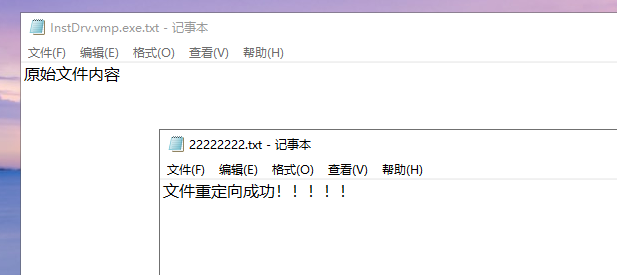
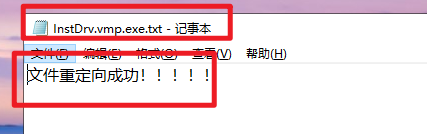

<!--more-->

## SFilter实现文件重定向

1. 要使用`SFilter`实现文件重定向，其实核心操作就是**替换IRP文件对象中的文件路径信息**，乍一看不难，但是隐含了一些坑点：
    1. 我们获取到的原始文件路径，是一个相对路径信息
    2. 笔者在初次替换时，也替换了一个相对路径，会提示找不到文件路径
    3. `wcslen`、`strlen`等函数是计算字符个数，不是字符串长度！
    4. 要设置错误码、返回值均为`STATUS_REPARSE`重新解析，之后该IRP不能继续下发了
    5. 内核中使用的文件路径，要增加`\\??\\`
    6. 关于要不要调用`IoCompleteRequest`，笔者测试了不写，也能实现文件重定向，但是处于规范开发，开始调用该函数，显式完成该IRP请求吧
2. 笔者这里是目的是**快速验证技术点**，所以代码非常粗糙、不规范，禁止在正式工程中编写类似的代码，不规范点：
    1. 内核中不能使用`wcslen`、`strlen`、`wcscmp`这种可能导致内存访问越界的C库函数，如下代码使用`wcscmp`来匹配字符串，导致存在概率性蓝屏问题

```c
NTSTATUS FsFilterDispatchCreate(
    __in PDEVICE_OBJECT DeviceObject,
    __in PIRP           Irp
    )
{
    PFILE_OBJECT pFileObject = IoGetCurrentIrpStackLocation(Irp)->FileObject;

	/*
        \Users\Administrator\Desktop\InstDrv.vmp.exe.txt
		\Users\Administrator\Desktop\22222222.txt
	*/

	if (0 == wcscmp(
        pFileObject->FileName.Buffer, 
        L"\\Users\\Administrator\\Desktop\\InstDrv.vmp.exe.txt")
       )
	{
		DbgPrint("开始替换路径信息------------------%wZ\n", &pFileObject->FileName);

		ExFreePool(pFileObject->FileName.Buffer);

		PVOID pBuf = ExAllocatePoolWithTag(NonPagedPoolNx, PAGE_SIZE, 'path');
		RtlZeroMemory(pBuf, PAGE_SIZE);

		const wchar_t* RedirPath = 
            L"\\??\\C:\\Users\\Administrator\\Desktop\\22222222.txt";
		USHORT RedirPathLen = (USHORT)wcslen(RedirPath) * sizeof(wchar_t);

		RtlCopyMemory(pBuf, RedirPath, RedirPathLen);

		pFileObject->FileName.Buffer = pBuf;
		pFileObject->FileName.Length = RedirPathLen;
		pFileObject->FileName.MaximumLength = PAGE_SIZE;

		Irp->IoStatus.Status = STATUS_REPARSE;
		IoCompleteRequest(Irp, IO_NO_INCREMENT);
		return STATUS_REPARSE;
	}
	
    return FsFilterDispatchPassThrough(DeviceObject, Irp);
}
```


## 实验结果

1. 两个文件原始内容



2. 打开文件1，显示的却是文件2


