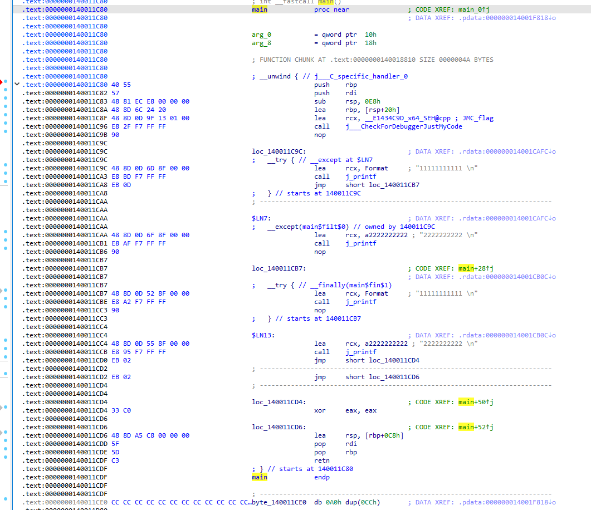
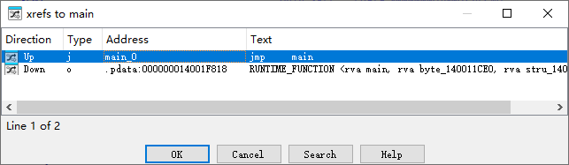
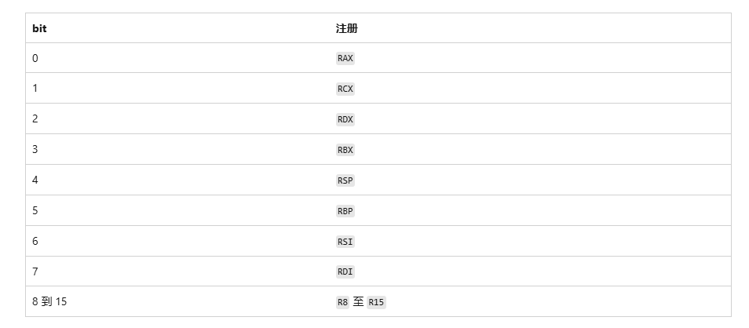

<!--more-->

## x64 SEH原理

1. 相比于x86 SEH变动很大，`x64 SEH`不再将异常信息保存在堆栈中，而是在编译时期，静态保存到`PE文件`中，所以也有些帖子称`x64 SEH`是基于PE文件的


## IMAGE_RUNTIME_FUNCTION_ENTRY

1. x64程序在编译时，会将**几乎所有**的过程函数信息，都保存到`.pdata(过程数据)`节区中，这个`.pdata`节区中保存数据，可以认为是一个数组，其中的每一项都是`IMAGE_RUNTIME_FUNCTION_ENTRY`，该结构是文档化导出的，如下所示：

```c
// x64程序，几乎每个函数都会生成一个如下的RuntimeFunction对象，并保存到pdata section
typedef struct _IMAGE_RUNTIME_FUNCTION_ENTRY 
{
    DWORD BeginAddress;		// 该函数的起始RVA
    DWORD EndAddress;		// 该函数的结束RVA
    union 
	{
        DWORD UnwindInfoAddress;	// 指向UnwindInfo的RVA
        DWORD UnwindData;
    } DUMMYUNIONNAME;
} _IMAGE_RUNTIME_FUNCTION_ENTRY, *_PIMAGE_RUNTIME_FUNCTION_ENTRY;
```

2. `IMAGE_RUNTIME_FUNCTION_ENTRY`这个结构中包含3个`DW`类型的数据，是因为其保存的都是`RVA`，是相对于`ImgBase`的偏移，所以4字节足矣


### 简单例子

1. 我们写一个简单例子，代码如下：

```c
int main()
{
	__try
	{
		printf("11111111111 \n");
	}
	__except (EXCEPTION_EXECUTE_HANDLER)
	{
		printf("2222222222 \n");
	}

	__try
	{
		printf("11111111111 \n");
	}
	__finally
	{
		printf("2222222222 \n");
	}
}
```

2. 编译为x64程序，使用IDA反汇编如下所示：



3. 此时查看`main`函数所对应的`RUNTIME_FUNCTION`结构，IDA交叉引用：



```c
.pdata:000000014001F818 80 1C 01 00 E0 1C 01 00 E4 CA 01 00                 
	RUNTIME_FUNCTION <rva main, rva byte_140011CE0, rva stru_14001CAE4>
```

4. 此时可以发现，IDA还很智能地帮我们解析出了`RUNTIME_FUNCTION`结构，对照原生字节集前8字节，的确指向了`main`函数的起始、终止地址的RVA


## UNWIND_INFO展开信息

1. 我们现在继续学习`RUNTIME_FUNCTION`最后一个成员`UnwindInfo`，该成员指向的是一个`UNWIND_INFO`对象，该对象结构、部分字段成员解析如下：
2. 这里有一点需要专门说明：是由VS编译时（一般是MSVC编译器），那么`UNWIND_INFO.ExceptionHandler`这个对象是由编译器来填充的，一般是`ExceptionHandle =  __C_specific_handler`

```c
// Unwind info flags
#define UNW_FLAG_NHANDLER 0x0		// 该函数体内部，没有使用SEH异常
#define UNW_FLAG_EHANDLER 0x01		// 该函数体内部，至少有一个try except代码块
#define UNW_FLAG_UHANDLER 0x02		// 该函数体内部，至少有一个try finally代码块
#define UNW_FLAG_CHAININFO 0x04		// 这个用得很少，暂时不深入了解

// UNWIND_CODE 3 bytes structure
typedef union _UNWIND_CODE 
{
  struct 
  {
    UBYTE CodeOffset;
    UBYTE UnwindOp : 4;
    UBYTE OpInfo : 4
  };
  USHORT FrameOffset;
} UNWIND_CODE, *PUNWIND_CODE;

typedef struct _UNWIND_INFO 
{
  UBYTE Version : 3;          // + 0x00 - Unwind info structure version
  UBYTE Flags : 5;            // + 0x00 - Flags 见顶部宏
  UBYTE SizeOfProlog;         // + 0x01	序言代码字节数
  UBYTE CountOfCodes;         // + 0x02 - Count of unwind codes 需要展开的代码行数
  UBYTE FrameRegister : 4;    // + 0x03	
							  // 当前基准栈帧使用哪个寄存器保存的？一般是5，即Rbp寄存器
  UBYTE FrameOffset : 4;      // + 0x03 
							  // 表示偏移量的单位，即上一个栈帧的栈顶与Rbp的偏移
							  // 虚拟展开VirtualUnwind时，使用方法如下：
							  // 上一个栈帧栈顶Rsp = Rbp - FrameOffset * 0x10
	
  UNWIND_CODE UnwindCode[1];  // + 0x04 - Unwind code array
  UNWIND_CODE MoreUnwindCode[((CountOfCodes + 1) & ~1) - 1];
							  // 表示是一个变长数组	
							  // 因为函数序言代码的行数是不确定的

  // 这个联合体的解析方式是根据Flags决定的
  union 
  {
    OPTIONAL ULONG ExceptionHandler;    // Exception handler routine
									    // Flags & UNW_FLAG_EHANDLER
									    // 如果是MSVC编译器，那么该函数是由编译器填充为__C_specific_handler
	  
    OPTIONAL ULONG FunctionEntry;		// 这个用得少
										// Flags & UNW_FLAG_CHAININFO
  };
	
  OPTIONAL ULONG ExceptionData[];       // C++ Scope table structure
										// 泛型尾巴，SEH、C++异常时解释不一样
										// 本文档仅讨论常规SEH异常
										// 一般只有一项，保存指向C_SCOPE_TABLE的RVA
										// C_SCOPE_TABLE对象解析在下文
} UNWIND_INFO, *PUNWIND_INFO;
```


## C_SCOPE_TABLE

1. 目前已知`RUNTIME_FUNCTION`中前2个成员可以描述一个函数的起始、终止地址
2. 那么当一个函数内使用了`try`代码块，我们是不是需要一个数据结构来描述每一个`try`代码块的起始、终止地址？`C_SCOPE_TABLE`就是被设计出来解决这个问题的，其结构、字段成员解析如下所示：

```c
// C Scope table entry
typedef struct _C_SCOPE_TABLE_ENTRY 
{
  ULONG Begin;        // +0x00 - Begin of guarded code block，
					  // __try块第一条指令的RVA
	
  ULONG End;          // +0x04 - End of target code block
					  // __try块内最后一条指令之后指令的RVA
	
  ULONG Handler;      // +0x08 - Exception filter function (or “__finally” handler)
					  // 异常过滤器（或__finally）地址RVA
	
  ULONG Target;       // +0x0C - Exception handler pointer (the code inside __except block)
					  // __except代码块地址RVA
					  // 当try finally组合时，Target = NULL
} C_SCOPE_TABLE_ENTRY, *PC_SCOPE_TABLE_ENTRY;

// C Scope table
typedef struct _C_SCOPE_TABLE 
{
  ULONG NumEntries;               // +0x00 - Number of entries
								  // Table对象数组有多少个成员
  C_SCOPE_TABLE_ENTRY Table[1];   // +0x04 - Scope table array
								  // 变长数组
} C_SCOPE_TABLE, *PC_SCOPE_TABLE;
```

3. 由于`C_SCOPE_TABLE`对象中的`Table`为变长数组，那么一个函数中，不管是单个、多个、多重嵌套`try`都可以顺利描述了


### 无嵌套异常

1. 一个函数体内部，平铺写了单个、多个`try`代码块时，此时`MSVC编译器`处理就比较简单了，直接按照其代码顺序保存到`C_SCOPE_TABLE.Table`变长数组中


### 嵌套异常

1. 当一个函数体内部，存在`try`代码块嵌套时，此时就需要额外处理了
2. 由于每个Scope保存的都是`当前try`代码块的[Begin, End)，假设存在一个`3重嵌套try`的代码块，当`#3`触发异常时，`___C_specific_handler`遍历时就会发现3个Scope中的范围都会命中，这时`___C_specific_handler`就懵了，该从哪一个Scope开始处理呢？
3. 按照我们的SEH常识，多重try嵌套，应该从最内层的try开始处理，所以编译器是这样处理的：按照try代码块从里到外的顺序将Scope放置到变长数组中，这样就解决了try嵌套的问题


### 如何区分try except / try finally

1.  `UNWIND_INFO.Flags = 3`时，即UNW_FLAG_EHANDLER | UNW_FLAG_UHANDLER， 表示这个函数体内存在`try except`、`try finally`两种代码块，那么该如何细化标识是哪一种呢？
2. 这里区分的方式很简单，`C_SCOPE_TABLE_ENTRY.Target = NULL`时，表示这是一个`try finally`


## 虚拟展开（VirtualUnwind）

1. 什么是虚拟展开，举一个简单例子，伪代码如下所示：
2. 在如下代码中，`func1`中发生了异常，但是`filter`返回了`ContinueSearch`继续往外搜索，但是`func1`函数内已经没有`try`保护了，就需要往外搜索，此时就需要恢复上一层栈帧（即Caller栈帧），找到调用者Caller的Rip，通过Rip就能继续搜索`RUNTIME_FUNCTION`对象，重复异常处理流程

```c
void func1()
{
	__try
	{
		// 发生异常
	}
	__except(filter())
	{
		
	}
}

int main()
{
	__try
	{
		func1();
	}
	__except(filter())
	{
		
	}
}
```


### 展开流程（清理栈帧）

1. 一些教程也将这个过程称为`清理栈帧`，其实也合理，清理当前栈帧，将状态恢复到上一层的状态
2. 这个过程需要用到`UNWIND_INFO`这个对象中的部分字段成员，如下所示：

```c
// UNWIND_CODE 3 bytes structure
typedef union _UNWIND_CODE 
{
  struct 
  {
    UBYTE CodeOffset;		// 展开代码在函数中的RVA
    UBYTE UnwindOp : 4;		// 展开操作码
    UBYTE OpInfo : 4		// 展开信息
  };
  USHORT FrameOffset;		// 原始代码为分配堆栈空间时用到，FrameOffset*8=分配堆栈空间大小
} UNWIND_CODE, *PUNWIND_CODE;

typedef struct _UNWIND_INFO 
{
  UBYTE Version : 3;          // + 0x00 - Unwind info structure version
  UBYTE Flags : 5;            // + 0x00 - Flags 见顶部宏
  UBYTE SizeOfProlog;         // + 0x01	序言代码字节数
  UBYTE CountOfCodes;         // + 0x02 - Count of unwind codes 需要展开的代码行数
  UBYTE FrameRegister : 4;    // + 0x03	
							  // 当前基准栈帧使用哪个寄存器保存的？一般是5，即Rbp寄存器
  UBYTE FrameOffset : 4;      // + 0x03 
							  // 表示偏移量的单位，即上一个栈帧的栈顶与Rbp的偏移
							  // 虚拟展开VirtualUnwind时，使用方法如下：
							  // 上一个栈帧栈顶Rsp = Rbp - FrameOffset * 0x10
	
  UNWIND_CODE UnwindCode[1];  // + 0x04 - Unwind code array
	
  // 忽略.......
} UNWIND_INFO, *PUNWIND_INFO;
```

3. 在本文文初的例子中，`main`函数的序言代码、以及对应的`UNWIND_CODE`如下所示（IDA解析出来了）：
4. 如下所示的`UNWIND_CODE`，细心观察就会发现，其顺序是反过来的，其实很好理解，跟push、pop保存现场时一样

```c
.text:0000000140011C80 40 55                    push    rbp
.text:0000000140011C82 57                       push    rdi
.text:0000000140011C83 48 81 EC E8 00 00 00     sub     rsp, 0E8h
.text:0000000140011C8A 48 8D 6C 24 20           lea     rbp, [rsp+20h]

.rdata:000000014001CAE8 0F 23   UNWIND_CODE <<0Fh, 3, 2>> ; UWOP_SET_FPREG
.rdata:000000014001CAEA 0A 01   UNWIND_CODE <<0Ah, 1, 0>> ; UWOP_ALLOC_LARGE
.rdata:000000014001CAEC 1D 00   dw 1Dh
.rdata:000000014001CAEE 03 70   UNWIND_CODE <<3, 0, 7>> ; UWOP_PUSH_NONVOL
.rdata:000000014001CAF0 02 50   UNWIND_CODE <<2, 0, 5>> ; UWOP_PUSH_NONVOL
```

5. 我们根据上述的`UNWIND_CODE`一行行解释：

```c
lea rbp, [rsp+20h] <<---->> UNWIND_CODE <<0Fh, 3, 2>>
1. 该代码在函数内偏移为0xF
2. 操作码为3：对应MSDN手册UWOP_SET_FPREG，设置栈帧Rbp寄存器
3. 操作信息为2：表示偏移量，即2 * 16 = 0x20

sub rsp, 0E8h <<---->> UNWIND_CODE <<0Ah, 1, 0>> \ dw 1Dh
这种代码比较特殊，分配堆栈空间，一行汇编对应2行展开代码
1. 该代码在函数内偏移为0xA
2. 操作码为1：UWOP_ALLOC_LARGE，表示分配大空间，第2行的0x1D * 8 = 0xE8计算出分配堆栈空间大小
3. 操作信息为0：说明分配空间大小的区间，具体区间分级看MSDN文档

push rdi <<---->> UNWIND_CODE <<3, 0, 7>> 
1. 该代码在函数内偏移为0x3
2. 操作码为0：表示Push非易失寄存器
3. 操作信息为7：寄存器编号，如下图所示
```



6. 完整、规范的展开操作码、展开信息解释得参考**MSDN手册**：[x64 异常处理](https://learn.microsoft.com/zh-cn/cpp/build/exception-handling-x64?view=msvc-170)

7. 有了以上文档解释，那么虚拟展开（清理堆栈）的方式就很清晰了，编译器代码根据`UNWIND_INFO.CountOfCodes`遍历`UNWIND_CODE UnwindCode[1]`这个变长数组的内容，来模拟还原栈帧到调用者即可
8. 这里有一个很巧妙的点，假设我们的函数很长，在函数中、后部出现了异常，此时可能有很多push操作，Rsp这个栈顶位置可以说是不可控的，所有我们使用Rbp这个当前栈帧的锚定点，那么我们现在来手动模拟清理栈帧：

```c
// main函数序言
.text:0000000140011C80 40 55                    push    rbp
.text:0000000140011C82 57                       push    rdi
.text:0000000140011C83 48 81 EC E8 00 00 00     sub     rsp, 0E8h
.text:0000000140011C8A 48 8D 6C 24 20           lea     rbp, [rsp+20h]

1. Rbp是当前栈帧锚定点
2. 还原0000000140011C8A：Rsp = Rbp - 0x20
3. 还原0000000140011C83：Rsp += 0xE8
4. 还原0000000140011C82：pop rdi
5. 还原0000000140011C80：pop Rbp
6. 至此，栈帧清理完成
7. 此时[Rsp + 0] = 返回地址Rip
```


## x64 SEH派发流程

1. **前置条件**：不考虑内核调试、R3调试、VEH等前置异常处理阶段
2. 有了前面几节的内容铺垫，到了这里我们就可以顺着解释`x64 SEH异常`的派发流程了
3. 这里从`ntdll!RtlDispatchException`开始，伪代码如下所示：

```c
BOOLEAN RtlDispatchException ( 
	PEXCEPTION_RECORD pExceptionRecord, 
	PCONTEXT pContextRecord) 
{
    // 先调用VEH
    if (RtlCallVectoredExceptionHandlers(pExceptionRecord, pContextRecord)) 
	{
        return TRUE; 
    }
    
    // 根据异常Rip找到RUNTIME_FUNCTION对象
    PRUNTIME_FUNCTION pRuntimeFunction = RtlLookupFunctionEntry(
        pContextRecord->Rip,          // 控制点
        &ImageBase,                   // 输出：模块基址
        NULL                          // 历史表
    );

	// 没找到RUNTIME_FUNCTION对象对象
    if (pRuntimeFunction == NULL) {
        // 没有函数表，通常是 JIT 代码，无法展开
        return FALSE;
    }
    
    // 获取UNWIND_INFO
    PUNWIND_INFO pUnwindInfo =
		(PUNWIND_INFO)(ImageBase + pRuntimeFunction->UnwindInfoAddress);
    
    // 检查Flags，检查当前函数内有try except或者try finally代码块
    if (pUnwindInfo->Flags & (UNW_FLAG_EHANDLER | UNW_FLAG_UHANDLER)) {
        // 取出C_SCOPE_TABLE对象
        PVOID pHandlerData = RtlpGetHandlerData(pUnwindInfo);
        
        // 这个函数是MSVC运行时提供的，负责解析C_SCOPE_TABLE
        EXCEPTION_DISPOSITION disposition = __C_specific_handler(
            pExceptionRecord,
            (PVOID)pContextRecord->Rip,
            pContextRecord,
            pHandlerData
        );
        
        if (disposition == ExceptionExecuteHandler) {
            return TRUE;
        }
    }
    
    // 走到这里了，说当前函数体内没有try保护，尝试虚拟展开堆栈，寻找上一层有没有try保护
    RtlUnwindEx(...);
    return FALSE;
}
```

4. `__C_specific_handler`伪代码如下所示：

```c
EXCEPTION_DISPOSITION __C_specific_handler (
    PEXCEPTION_RECORD pExceptionRecord,
    PVOID EstablisherFrame,  // 实际上是发生异常的函数栈帧指针
    PCONTEXT pContextRecord,
    PEXCEPTION_REGISTRATION_RECORD pDispatcherContext
) 
{
    // 从C_SCOPE_TABLE中提取Table
    PSCOPE_RECORD pScopeRecords = (PSCOPE_RECORD)pDispatcherContext;
    DWORD scopeCount = pScopeRecords->Count;
    pScopeRecords++; // 指向第一个 SCOPE_RECORD
    
    // 计算异常在函数内的偏移
    DWORD_PTR ImageBase = ...;
    PRUNTIME_FUNCTION pRF = ...;
    DWORD offsetInFunction = (DWORD)(pContextRecord->Rip - ImageBase - pRF->BeginAddress);
    
    // 遍历所有Table
    for (DWORD i = 0; i < scopeCount; i++) 
	{
        if (offsetInFunction >= pScopeRecords[i].BeginAddress && 
            offsetInFunction < pScopeRecords[i].EndAddress)
		{
            // 找到范围匹配的try块，调用Filter
            if (pScopeRecords[i].HandlerAddress)
			{
                int filterResult = ((FILTER_FUNC)pScopeRecords[i].HandlerAddress)();
                if (filterResult == EXCEPTION_EXECUTE_HANDLER)
				{
                    // 设置要跳转的目标地址
                    pDispatcherContext->TargetIp = 
							ImageBase + pRF->BeginAddress + pScopeRecords[i].JumpTarget;
                    return ExceptionExecuteHandler;
                }
            }
        }
    }
    return ExceptionContinueSearch;
}
```


## 手动映射注入修复异常

### 为什么不支持SEH？

1. x64：本质是因为反射式注入DLL，不存在正常的模块链表中的，在派发SEH异常时`RtlDispatchException`函数会调用`RtlLookupFunctionEntry`就返回NULL，导致这个异常我们的`Shellcode DLL`压根没有处理的机会
2. x86：32位下的SEH异常，明明都是代码手动注册、卸载的，为什么也不支持？是因为`RtlDispatchException`-->`RtlIsValidHandler`-->`RtlLookupFunctionTable`中校验失败了，其伪代码如下：

```c
BOOLEAN
RtlIsValidHandler (
    IN PEXCEPTION_ROUTINE Handler
    )
{
    PULONG FunctionTable;
    ULONG FunctionTableLength;
    PVOID Base;

    FunctionTable = RtlLookupFunctionTable(Handler, &Base, &FunctionTableLength);

    if (FunctionTable && FunctionTableLength) {
        PEXCEPTION_ROUTINE FunctionEntry;
        LONG High, Middle, Low;

        if ((FunctionTable == LongToPtr(-1)) && (FunctionTableLength == (ULONG)-1)) {
            // Address is in an image that shouldn't have any handlers (like a resource only dll).
            RtlInvalidHandlerDetected((PVOID)((ULONG)Handler+(ULONG)Base), LongToPtr(-1), -1);
            return FALSE;
        }
    
        // Bias the handler value down by the image base and see if the result
        // is in the table

        (ULONG)Handler -= (ULONG)Base;
        Low = 0;
        High = FunctionTableLength;
        while (High >= Low) {
            Middle = (Low + High) >> 1;
            FunctionEntry = (PEXCEPTION_ROUTINE)FunctionTable[Middle];
            if (Handler < FunctionEntry) {
                High = Middle - 1;
            } else if (Handler > FunctionEntry) {
                Low = Middle + 1;
            } else {
                // found it
                return TRUE;
            }
        }
        // Didn't find it
        RtlInvalidHandlerDetected((PVOID)((ULONG)Handler+(ULONG)Base), FunctionTable, FunctionTableLength);

        return FALSE;
    }

    // Can't verify
    return TRUE;
}
```


### x64修复手法

1. 已知通过反射式注入的DLL，是不支持SEH异常的，此时由2种解决思路：
    1. 相当于写Shellcode：纯C语言写，手动导入用到的API，不使用任何C_Runtime函数、C++ STL库，但是这种方法很麻烦，一是手动导入的API内部可能使用了SEH，二是啥库都不能用，开发、调试过程会极其痛苦
    2. 动态注册函数：因为`RtlLookupFunctionEntry`首先会搜索所有PE，搜索不到，再搜索`RtlpDynamicFunctionTableTree`这个表中的FuncEntry，将我们的函数动态注册到`RtlpDynamicFunctionTableTree`中即可解决问题
2. 更多的时候是优先方法2，修复异常的代码如下（这份代码同时包含32、64）：

```c
static VOID
InsertExceptionTable(PMEMORYMODULE module)
{
#if defined(_WIN64)

	PIMAGE_DATA_DIRECTORY		pDataTable = \
		&module->headers->OptionalHeader.DataDirectory[IMAGE_DIRECTORY_ENTRY_EXCEPTION];

	PIMAGE_RUNTIME_FUNCTION_ENTRY pFuncTable = \
		(PIMAGE_RUNTIME_FUNCTION_ENTRY)((ULONG_PTR)module->codeBase + pDataTable->VirtualAddress);

	if (pfnRtlAddFunctionTable64 != NULL)
	{
		pfnRtlAddFunctionTable64(pFuncTable, pDataTable->Size / sizeof(IMAGE_RUNTIME_FUNCTION_ENTRY), (DWORD64)module->codeBase);
	}

#else
	if (dwMajorVersion == 6 && dwMinorVersion == 1) //WIM7
	{
		if (pfnRtlInsertInvertedFunctionTable_Win7 != NULL);
		{
			pfnRtlInsertInvertedFunctionTable_Win7(LdrpInvertedFunctionTable, module->codeBase, module->headers->OptionalHeader.SizeOfImage);
		}
	}
	else if (dwMajorVersion == 6 && dwMinorVersion == 3) //WIN8
	{
		if (pfnRtlInsertInvertedFunctionTable_Win8_Win10 != NULL);
		{
			pfnRtlInsertInvertedFunctionTable_Win8_Win10(module->codeBase, module->headers->OptionalHeader.SizeOfImage);
		}
	}
	else if (dwMajorVersion == 10 && dwMinorVersion == 0) //WIN10
	{
		if (pfnRtlInsertInvertedFunctionTable_Win8_Win10 != NULL);
		{
			pfnRtlInsertInvertedFunctionTable_Win8_Win10(module->codeBase, module->headers->OptionalHeader.SizeOfImage);
		}
	}
	else
	{
		// not support
	}
#endif
}
```

3. 规范、文档化的动态注册方式，微软提供了2个函数，如下所示（**这2个函数似乎都是x64下使用的**）：

```c
typedef
_Function_class_(GET_RUNTIME_FUNCTION_CALLBACK)
PRUNTIME_FUNCTION
GET_RUNTIME_FUNCTION_CALLBACK (
    _In_ DWORD64 ControlPc,
    _In_opt_ PVOID Context
    );
typedef GET_RUNTIME_FUNCTION_CALLBACK *PGET_RUNTIME_FUNCTION_CALLBACK;

// 火哥修x64 SEH演示了这个，105课30分钟处
// 这个函数就是向系统注册一个回调，传入起始地址、长度
// 当这块区域出现异常，就回调你注册的函数
NTSYSAPI BOOLEAN RtlInstallFunctionTableCallback(
  [in] DWORD64                        TableIdentifier,
  [in] DWORD64                        BaseAddress,
  [in] DWORD                          Length,
  [in] PGET_RUNTIME_FUNCTION_CALLBACK Callback,
  [in] PVOID                          Context,
  [in] PCWSTR                         OutOfProcessCallbackDll
);

// 动态注册
NTSYSAPI BOOLEAN RtlAddFunctionTable(
  [in] PRUNTIME_FUNCTION FunctionTable,
  [in] DWORD             EntryCount,
  [in] DWORD64           BaseAddress
);
```

4. `RtlInstallFunctionTableCallback`用法简答讲解：将某一段区域注册一个异常回调，一般就是传入我们自己`Shellcode DLL`的区域，当这个区域内出现异常，系统回调我们的处理函数，我们在处理函数中，自己模拟查找过程，返回一个`PRUNTIME_FUNCTION`


### x86修复手法

1. 既然是`RtlIsValidHandler`中会调用`RtlLookupFunctionTable`导致我们校验失败，那么就将我们的代码注册到这个表中，让其校验通过，32位的Win7~Win10都是调用`RtlInsertInvertedFunctionTable`来插入，**但是参数列表不一样**
