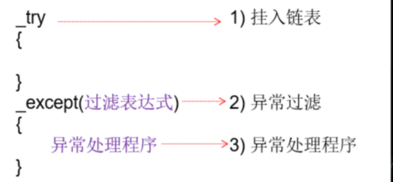
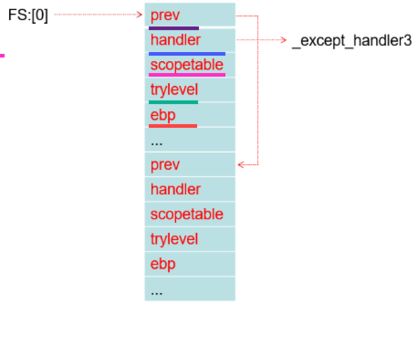
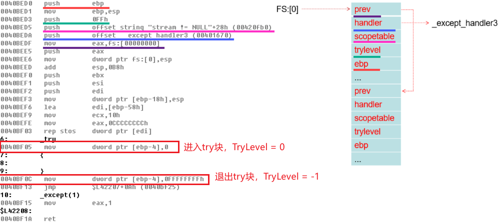
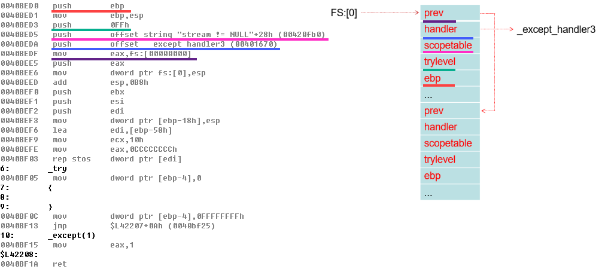
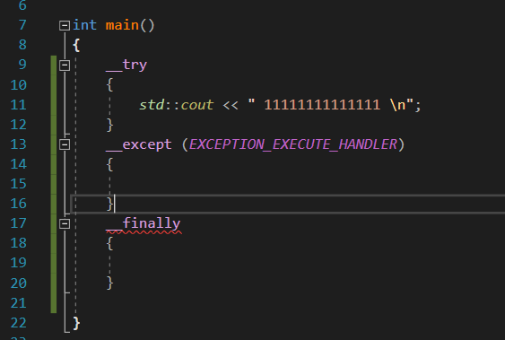

<!--more-->

## x86下的SEH机制

1. 在x86系统下，SEH机制是基于堆栈实现的
2. SEH的作用范围限制在当前线程上下文，SEH是线程运行中，动态注册的（运行到try哪里就临时注册）
3. 在R3时，SEH异常链表头保存在`TEB.NT_TIB.ExceptionList`
4. 在R0时，SEH异常链表头保存在`KPCR.NT_TIB.ExceptionList`
5. 当发生系统调用、异常、中断需要进入到R0处理时，会将最后的现场保存到`TrapFrame`中，这里的保存就 包括了`TEB.NT_TIB.ExceptionList`，保存好了之后会将当前线程的`ExceptionList`清空（`ExceptionList.Next = -1`），给之后的内核SEH使用
6. SEH异常链表的每一个节点，结构如下所示：

```c
//0x8 bytes (sizeof)
struct _EXCEPTION_REGISTRATION_RECORD
{
    struct _EXCEPTION_REGISTRATION_RECORD* Next;                            //0x0
    enum _EXCEPTION_DISPOSITION (Handler)(struct _EXCEPTION_RECORD arg1, VOID* arg2, struct _CONTEXT* arg3, VOID* arg4); //0x4
};
```


### 手动注册SEH回调

1. 既然我们知道了FS:[0]保存的是SEH链表的头节点，那么我们就可以往其中插入我们自己构造的SEH节点
2. 如下所示，我们自己注册了一个SEH异常回调函数`MyEexceptionHandler`，在一个函数中实现`异常过滤`、`异常处理`

```c
#include <stdio.h>
#include <windows.h>

struct _MY_EXCEPTION  
{
    struct _MY_EXCEPTION *Next;
    DWORD Handler;
};

EXCEPTION_DISPOSITION _cdecl MyEexceptionHandler (
    struct _EXCEPTION_RECORD *ExceptionRecord, 	// 异常记录结构体
    PVOID EstablisherFrame, 					// 堆栈中SEH节点的指针
    struct _CONTEXT *ContextRecord, 			// 存储异常发生时的上下文环境
    PVOID DispatcherContext)
{
	// 异常过滤
	if (ExceptionRecord->ExceptionCode == 0xC0000094)
    {
		// 异常处理
        // ContextRecord->Eip = ContextRecord->Eip + 2;
		ContextRecord->Ecx = 1;
		
		return ExceptionContinueExecution;
    }
    return ExceptionContinueSearch;
}

int main()
{
    DWORD tmpData;
	
    // 必须在当前线程栈中
    _MY_EXCEPTION Exception;
	
    _asm
    {
        mov eax, fs:[0]
        mov tmpData, eax // 保存原FS:[0]
        lea ecx, Exception
        mov fs:[0], ecx
    }
	
	// 成员赋值
    Exception.Next = ( _MY_EXCEPTION *)tmpData;
    Exception.Handler = (DWORD)&MyEexceptionHandler;
	
	// 构造除0异常
    _asm
    {
        xor edx, edx
        xor ecx, ecx
        mov eax, 1
        idiv ecx
    }
	
	// 摘除刚插入的SEH，还原FS:[0]
    _asm
    {
        mov eax, tmpData
        mov fs:[0], eax
    }
	
	getchar();
    return 0;
}
```


### 编译器拓展SEH

1. 有上一小节可知，手动挂载SEH节点比较繁琐，我们这里可以借助编译器提供的`__try / __except`关键字实现SEH，如图所示：



2. 在过滤表达式中，我们可以写`常量`、`异常过滤表达式`，但是其结果必须是以下3个宏定义：

3. 只有在过滤表达式ExFilter中才可以修改寄存器环境（ExceptionContext），异常处理函数中只能做一些Log、**资源释放工作**

```c
// 这几个宏定义其实跟VEH的返回值一样，用到的时候查文档
#define EXCEPTION_EXECUTE_HANDLER 1 		// 执行except内的代码
#define EXCEPTION_CONTINUE_SEARCH 0 		// 寻找下一个异常处理函数
#define EXCEPTION_CONTINUE_EXECUTION -1 	// 返回至出错位置重新执行
```

4. 在SEH处理回调中，我们可以调用这些函数来获取异常状态信息`GetExceptionCode`、`GetExceptionInformation`，一般用法如下（伪代码）

```c
int ExFilter(xxx)
{
	if (xxx->ErrorCode = 0xC0000094)
	{
		xxx->eip += 2;
		return EXCEPTION_CONTINUE_EXECUTION;
	}
	return EXCEPTION_EXECUTE_HANDLER;
}

__try
{
	int x = 0;
	x /= 0;
}
__except(EXCEPTION_EXECUTE_HANDLER == ExFilter(GetExceprtionInfomation()))
{
	printf("Exception. \n");
	return 0;
}
```


## SEH异常嵌套问题

1. 但是`MSVC编译器`为了支持这个SEH异常，设计了**编译器拓展**，这一部分其实不难，理清思路即可
2. 这一部分是针对编译器进行逆向，跟系统没啥关系


## 基于堆栈的异常处理

1. `SEH机制`是基于堆栈设计的异常处理，是因为每一个异常处理的`节点对象`，都是在**堆栈上构造**的，节点原型如下所示（系统提供的最小、无编译器拓展）：
2. `Ntdll.dll`在派发SEH前，会做如下校验：
    1. 检查该**节点对象**是否是当前堆栈上的
    2. 检查节点对象中的**SEH回调地址是否不在栈上**，这样是防止将Shellcode放置在栈上

```c
//0x10 bytes (sizeof)
struct _EXCEPTION_REGISTRATION_RECORD
{
    struct _EXCEPTION_REGISTRATION_RECORD* Next;                            //0x0
    enum _EXCEPTION_DISPOSITION (*Handler)(struct _EXCEPTION_RECORD* arg1, VOID* arg2, struct _CONTEXT* arg3, VOID* arg4); //0x8
}; 
```


### 无SEH嵌套

1. 当SEH异常不存在嵌套时，异常发生时会从SEH链表头开始遍历，自然而然地就做到了一层层"往外展开"


### SEH嵌套（编译器拓展）

1. 系统提供的SEH机制，默认情况下时不支持SEH嵌套异常的，所以MSVC对`_EXCEPTION_REGISTRATION_RECORD`进行了结构拓展（在对象尾部拓展）

```c
struct scopetable_entry
{
    DWORD previousTryLevel 	// 上一个_try_except程序块编号 
    PDWRD lpfnFilter 		// 过滤函数的起始地址
    PDWRD lpfnHandler 		// 异常处理程序的地址
}

struct _EXCEPTION_REGISTRATION {
    struct _EXCEPTION_REGISTRATION *next;
    void (*handler)(PEXCEPTION_RECORD, PEXCEPTION_REGISTRATION, PCONTEXT, PEXCEPTION_RECORD);
    struct scopetable_entry *scopetable;
    int trylevel;	// 初始为-1，表示不在try中，从0开始计数
    int _ebp;
 };
```

2. 那么内存中的SEH链表变为如下所示：




#### 尾部新增成员

1. scopetable：这个对象是一个指针，其指向的其实是一个**数组的首地址**，那么这个对象中的成员如何定义内容？

> 1. 第一个try块对应的scopetable
> scopetable.previousTryLevel = -1	// 表示外面就是正常代码块
> scopetable.lpfnFilter = "0- Filter"	// 如下伪代码中标签所在的汇编地址
> scopetablelpfnHandler = "0 - Handler"	// 如下伪代码中标签所在的汇编地址
>
> 2. 第二个try块对应的scopetable
> scopetable.previousTryLevel = 0	// 表示外面try块的序号
> scopetable.lpfnFilter = "1- Filter"	// 如下伪代码中标签所在的汇编地址
> scopetablelpfnHandler = "1 - Handler"	// 如下伪代码中标签所在的汇编地址


2. trylevel：当前处于第几个try块中，**就是序号**，这个序号由编译器自动维护，图例、伪代码如下所示：



```c
// 每一层的try序号如下所示
// trylevel序号由编译器自动维护，进入、退出try块会自动赋值
void xxx()
{
	try		// 0
	{
		try		// 1
		{
				try		// 2
				{
					
				}
				except(1)		// 2 - Filter
				{
					// 2- Handler
				}
		}
		except(1)		// 1- Filter
		{
			// 1- Handler
		}
	}
	except(1)	// 0 - Filter
	{
		// 0 - Handler
	}

	try		// 3
	{
		try		// 4
		{ 
		}
		except(1)
		{ 
		}
	}
	except(1)
	{
	}
}
```

3. ebp：保存栈底：保存这个值，暂时没看到有实际用途（海哥的课上没讲到这个值的用途）


#### SEH异常派发

1. 需要明确一个概念，使用`try`关键字后，此时使用的是编译器提供的SEH异常，那么在当前函数中不论有多少个`try块`、是否嵌套，一个函数内部**只会向ExceptList新增一个节点**。如果存在函数递归的情况，那么每递归一次，就新增一个ExceptList节点。汇编如下所示：



2. 当异常发生时，默认SEH机制首先会调用`Handler3`，该函数会做一下工作：

> 1. 在`Handler3`中会将`tryLevel`直接视为数组的下标，取出目标try块的`scopetable_entry`对象
> 2. 调用其中的`scopetable_entry.lpfnFilter`，根据返回值由以下分支：
>     1. 返回ContinueExecution：回到原代码继续执行
>     2. ExceptionHandler：根据其返回值再决定是否继续调用`scopetable_entry.lpfnHandler`
>     3. 返回ContinueSearch：继续搜索，会将`scopetable_entry.previousTryLevel`作为下标，那么此时有以下2种情况：
>         1. `scopetable_entry.previousTryLevel != -1`，将previousTryLevel作为下标继续取出一个外层的`scopetable_entry`对象，此时相当于回到"步骤1"继续执行
>         2. `scopetable_entry.previousTryLevel == -1`，说明当前函数内的try块外没有try了，那就把异常往外抛，即尝试使用ExceptList下一个节点进行处理，此时相当于回到"步骤1"继续执行（**这里笔者理解可能有问题**：有些帖子说会重新触发一套完整的异常派发流程，即R3->R0、R0->R3，这里暂时先这么理解）
>


#### SEH局部展开、全局展开

1. `展开Unwind`比较正式的定义如下：

> 异常发生后，系统从当前执行位置开始逐层向外退出作用域/栈帧，并执行沿途必须执行的清理代码（如 __finally），直到到达最终的异常处理位置。
>

2. 前提知识：当控制流正常离开`__try`，或者系统正在执行异常展开时，关联的`__finally`通常会执行。所以会将一些Log日志、资源清理放在其中。但是内层`__finally`调用ExitProcess这类的函数后，整个进程就退出了，那么外层的`__finally`是没机会调用的
3. 局部展开的：**限定在应该函数内部**，最内层的try触发异常后，会从最里边、一层层往外调用`__finally`块，如下代码：

```c
void xxx()
{
	try
	{
		try
		{
			try
			{
				try
				{
					
				}
				finally
				{
					// 1
				}
			}
			finally
			{
				// 2
			}
		}
		finally
		{
			// 3
		}
	}
	finally
	{
		// 4
	}
		
}
```

4. 全局展开：当一个异常处理跨越多个栈帧，直到函数外层才找到了`__except`、`__finally`，如下代码：

```c
void xxx()
{
	try
	{
		try
		{
			try
			{
				try
				{
					
				}
				finally
				{
					// 1
				}
			}
			finally
			{
				// 2
			}
		}
		finally
		{
			// 3
		}
	}
	finally
	{
		// 4
	}
		
}

void func1()
{
	try
	{
		xxx();
	}
	finally
	{
		// 5
	}
}
```


## SEH语法问题

1. `try`代码块只能跟一个`except`或`finally`，如下写法是错误的：


