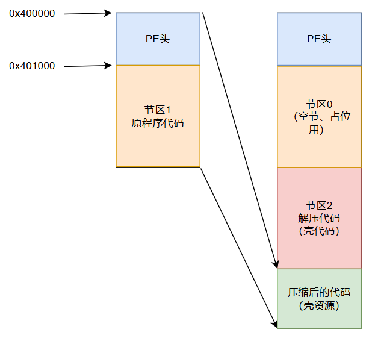

<!--more-->

## 0 设计压缩后文件结构




## 1 载入原始文件

1. 第一步没啥好说的，将待加壳的PE文件载入到内存

```c
PBYTE LoadFile(std::string FileName, DWORD& FileSize)
{
	HANDLE hFile = CreateFileA(FileName.c_str(), GENERIC_READ, FILE_SHARE_READ,
		NULL, OPEN_EXISTING, FILE_ATTRIBUTE_NORMAL, NULL);

	FileSize = GetFileSize(hFile, NULL);

	PBYTE pBuffer = (PBYTE)malloc(FileSize);

	DWORD dwRead = 0;
	ReadFile(hFile, pBuffer, FileSize, &dwRead, NULL);

	CloseHandle(hFile);

	return pBuffer;
}
```

```c
// 
// 载入文件
// 
g_FileData = LoadFile("E:\\老文件（工具）\\A_RAR类\\upx-5.2.1-win64\\PE32.exe", g_FileSize);
if (NULL == g_FileData)
{
    ErrCode = 1;
    goto __ExitFail;
}
```


## 2 识别PE文件基础信息

1. 这一部分，后续考虑弄成一个专门解析PE文件格式的类，后续直接复用

```c
// 
// 1. 识别文件PE信息
// 
g_DosHdr = (PIMAGE_DOS_HEADER)g_FileData;
g_NtHdr = (PIMAGE_NT_HEADERS)(g_FileData + g_DosHdr->e_lfanew);
g_FileHdr = &g_NtHdr->FileHeader;
g_OptHdr = &g_NtHdr->OptionalHeader;
g_dwNumOfSections = g_FileHdr->NumberOfSections;
g_SecHdrs = IMAGE_FIRST_SECTION(g_NtHdr);
```


## 3 压缩原始PE

1. 我们这里，将**整个PE文件**作为资源，进行压缩
2. 这里使用的是Win32自带的压缩、解压缩库

```c
PBYTE CompressFileData(PBYTE FileData, DWORD RawDataSize, DWORD& ComDataSize)
{
	COMPRESSOR_HANDLE hCompressor = NULL;
	CreateCompressor(COMPRESS_ALGORITHM_MSZIP, NULL, &hCompressor);

	SIZE_T ComSize = 0;
	Compress(hCompressor, FileData, RawDataSize, NULL, 0, &ComSize);

	PBYTE pBuffer = (PBYTE)malloc(ComSize);
	Compress(hCompressor, FileData, RawDataSize, pBuffer, ComSize, &ComSize);

	CloseCompressor(hCompressor);

	ComDataSize = (DWORD)ComSize;

	return pBuffer;
}
```

```c
g_ComFileData = CompressFileData(g_FileData, g_FileSize, g_ComFileDataSize);
```


## 4 构造壳代码

1. 这部分涉及到`地址无关Shellcode`的编写，会放到下一小节

```c
PBYTE GetPackCode(DWORD& dwPackCodeSize)
{
	dwPackCodeSize = sizeof g_Shellcode;
	PBYTE pBuffer = (PBYTE)malloc(dwPackCodeSize);
	RtlFillMemory(pBuffer, dwPackCodeSize, 0xCC);
	RtlCopyMemory(pBuffer, g_Shellcode, dwPackCodeSize);
	return pBuffer;
}
```

```c
g_PackCode = GetPackCode(g_PackCodeSize);
```


## 5 构造压缩数据节区（.packdata）

1. 这里要将压缩好的数据，作为资源，打包进新PE文件中
2. 这里主要做的是内存向上对齐

```c
PBYTE BuildSection(PBYTE SectionData, DWORD SectionDataSize, DWORD& AlignedSize)
{
	AlignedSize = CalcAlign(SectionDataSize);
	PBYTE pBuffer = (PBYTE)malloc(AlignedSize);
	RtlZeroMemory(pBuffer, AlignedSize);
	RtlCopyMemory(pBuffer, SectionData, SectionDataSize);
	return pBuffer;
}
```

```c
g_DataSection = BuildSection(g_ComFileData, g_ComFileDataSize, g_DataSectionSize);
```


## 6 构造壳代码节区

1. 这里跟`步骤5`差不多，调用的是同一个函数

```c
g_CodeSection = BuildSection(g_PackCode, g_PackCodeSize, g_CodeSectionSize);
```


## 7 构造新节表

1. 这里我们仿照`UPX壳`的行为，将第一个节区设置为空节区，仅仅作为占位使用
2. 第一个空节区的`VirtualSize`大小设置为原始PE文件的`SizeOfImage`，是存在一定内存浪费的，但是出于教学目的，能快速跑通、实现压缩壳效果即可
3. **错点**记录：**静态文件**时，PE文件头包含了各种乱七八糟的**头对象**、**节区表**，如果文件比较简单，那么PE头对齐后就是`0x200`字节，常见的PE头大小一般为`0x400`字节。PE头之后紧挨着的是第一个节区的内容，所以第一个节区的`PointerToRawData`就等于`OptHdr->SizeOfHeaders`

```c
PIMAGE_SECTION_HEADER BuildSectionHeaders()
{
	PIMAGE_SECTION_HEADER SecHdrs = new IMAGE_SECTION_HEADER[3];

	// 
	// 1. 构造空节区
	// 
	strcpy((char*)SecHdrs[0].Name, ".Shinn");

	// 
	// 这里大小偷懒一下，直接以原PE文件的SizeOfImage作为大小，存在内存浪费，但是跑肯定没问题
	// 
	SecHdrs[0].Misc.VirtualSize = g_OptHdr->SizeOfImage;

	// 
	// 我们是第一个节区，位置跟原PE文件的第一个节区保持一致
	// 
	SecHdrs[0].VirtualAddress = g_SecHdrs[0].VirtualAddress;

	// 
	// TODO - PointerToRawData这里搞错过
	// 
	SecHdrs[0].PointerToRawData = g_OptHdr->SizeOfHeaders;
	SecHdrs[0].SizeOfRawData = 0;
	SecHdrs[0].Characteristics = IMAGE_SCN_MEM_EXECUTE | IMAGE_SCN_MEM_READ | IMAGE_SCN_MEM_WRITE;

	// 
	// 2. 构造代码节区
	// 
	strcpy((char*)SecHdrs[1].Name, ".text");
	SecHdrs[1].Misc.VirtualSize = g_CodeSectionSize;
	SecHdrs[1].VirtualAddress = SecHdrs[0].VirtualAddress + SecHdrs[0].Misc.VirtualSize;
	SecHdrs[1].PointerToRawData = SecHdrs[0].PointerToRawData + SecHdrs[0].SizeOfRawData;
	SecHdrs[1].SizeOfRawData = g_CodeSectionSize;
	SecHdrs[1].Characteristics = IMAGE_SCN_MEM_EXECUTE | IMAGE_SCN_MEM_READ;

	// 
	// 3. 构造数据节区
	// 
	strcpy((char*)SecHdrs[2].Name, ".data");
	SecHdrs[2].Misc.VirtualSize = g_DataSectionSize;
	SecHdrs[2].VirtualAddress = SecHdrs[1].VirtualAddress + SecHdrs[1].Misc.VirtualSize;
	SecHdrs[2].PointerToRawData = SecHdrs[1].PointerToRawData + SecHdrs[1].SizeOfRawData;
	SecHdrs[2].SizeOfRawData = g_DataSectionSize;
	SecHdrs[2].Characteristics = IMAGE_SCN_MEM_READ;

	return SecHdrs;
}
```


## 8 构造新PE头

1. 这里构造新PE头，并不是要我们手动一个个填写每一项PE头成员信息，大部分字段是无关紧要、可复用的
2. 所以我们直接复制原始PE头，手动修改受影响的成员即可
    1. 由于在Shellcode解压代码中，需要用到原始文件大小、压缩后数据大小（由于数据节区向上对齐，会在尾部补零，所以数据节区大小不能作为参数进行解压，会解压错的）
    2. 节区数量：不管原始PE文件节区数量有多少个，我们统一修改为3个节区，即空节、Shellcode节区、资源节区（压缩数据）
    3. 修改EP：将文件EP直接修改为第2个节区的首地址，**所以后续我们要注意**！确保Shellcode编译出来，入口函数是在Shellcode头部
    4. 由于我们的解压Shellcode不依赖任何导入函数、重定位、异常、TLS等等，所以将数据目录数量设置为零
    5. 将我们之前构造好的节区表，覆盖原始节区表

```c
PBYTE BuildPeHeader(DWORD RawDataSize, DWORD ComDataSize)
{
	PBYTE pBuffer = (PBYTE)malloc(g_OptHdr->SizeOfHeaders);
	RtlZeroMemory(pBuffer, g_OptHdr->SizeOfHeaders);

	// 
	// 完整复制原PE头
	// 
	RtlCopyMemory(pBuffer, g_DosHdr, g_OptHdr->SizeOfHeaders);

	// 
	// 把原始数据大小、压缩后数据大小写进dosstub空余位置，供壳代码读取
	// 
	*(DWORD*)(pBuffer + STUB_OFFSET_RAW_DATA_SIZE) = RawDataSize;
	*(DWORD*)(pBuffer + STUB_OFFSET_COM_DATA_SIZE) = ComDataSize;

	PIMAGE_DOS_HEADER DosHdr = (PIMAGE_DOS_HEADER)pBuffer;
	PIMAGE_NT_HEADERS NtHdr = (PIMAGE_NT_HEADERS)(pBuffer + g_DosHdr->e_lfanew);
	PIMAGE_FILE_HEADER FileHdr = &NtHdr->FileHeader;
	PIMAGE_OPTIONAL_HEADER OptHdr = &NtHdr->OptionalHeader;

	FileHdr->NumberOfSections = 3;
	OptHdr->SizeOfImage = g_NewSecHdrs[2].VirtualAddress + g_NewSecHdrs[2].Misc.VirtualSize;
	OptHdr->AddressOfEntryPoint = g_NewSecHdrs[1].VirtualAddress;
	OptHdr->NumberOfRvaAndSizes = 0;

	PIMAGE_SECTION_HEADER FirstSection = IMAGE_FIRST_SECTION(NtHdr);
	RtlCopyMemory(FirstSection, g_NewSecHdrs, 3 * sizeof(IMAGE_SECTION_HEADER));

	return pBuffer;
}
```


## 9 写出加壳后PE文件

1. 这部分没啥好说的了，我们需要按照顺序写入如下内容：
    1. 新PE头
    2. 空节区：空节区没内容，可跳过不写
    3. Shellcode节区
    4. 资源节区，压缩后的数据

```c
BOOLEAN WriteNewPeFile(std::string FileName)
{
	HANDLE hFile = CreateFileA(FileName.c_str(), GENERIC_WRITE, 0, NULL,
		CREATE_ALWAYS, FILE_ATTRIBUTE_NORMAL, NULL);

	DWORD dwWritten = 0;
	WriteFile(hFile, g_NewPeHdr, g_OptHdr->SizeOfHeaders, &dwWritten, NULL);
	WriteFile(hFile, g_CodeSection, g_CodeSectionSize, &dwWritten, NULL);
	WriteFile(hFile, g_DataSection, g_DataSectionSize, &dwWritten, NULL);

	CloseHandle(hFile);

	return TRUE;
}
```


## 10 小结

1. 到了这里，我们外部的压缩壳已经构造好了，Shellcode部分请看下半部分
