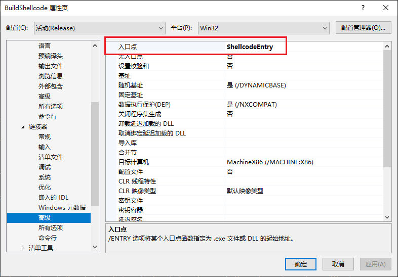
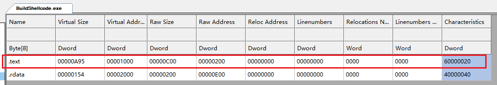
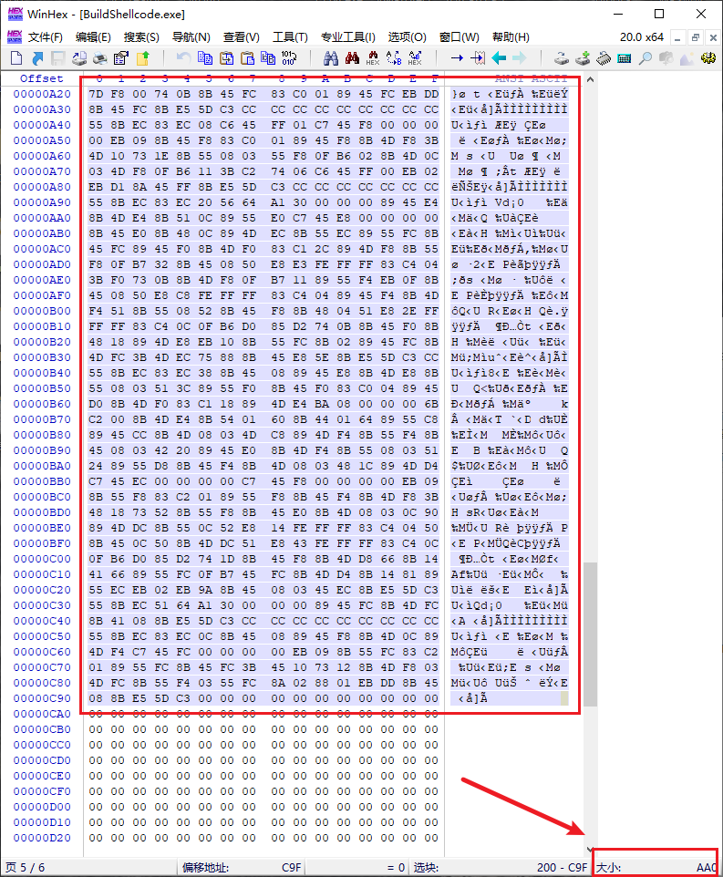
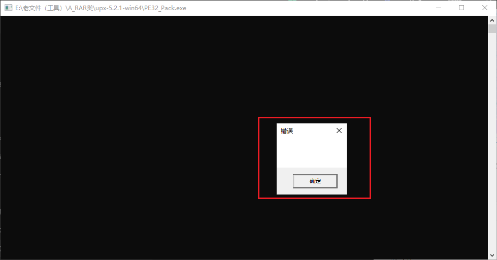

<!--more-->

## 1 位置无关代码

1. 所谓的`位置无关代码`，其实就是Shellcode，只要内存保护属性可执行，那么就能在跑代码
2. Shellcode代码也可以理解为纯算法行为的代码，不涉及到**全局变量引用**、**静态函数导入**等等
3. 要使用VS编写位置无关Shellcode，要做到一下几点：
    1. 不能引用全局变量
    2. 不能静态导入函数调用，即运行时动态获取函数指针调用
    3. 禁用`GS`安全检查
    4. 禁用`CFG`控制流防护
    5. 禁用代码优化`Od`，关于这点，似乎不是必选项，因为在x64反射注入的Loader代码中，就是启用优化的
    6. 自定义入口点，不能使用编译器默认的main，这是C入口点，会调用大量的函数来初始化C库、库中的一些全局变量，所以我们往往会自定义一个非常干净的入口函数，如下所示：



```c
int ShellcodeEntry()
{
    // ...
    
	return 0;
}
```


## 2 确保自定义入口函数位于代码节区头部

1. 笔者这里最早遇到一个坑，即编译出来的函数，默认都是存放在`.text`节区中，后续直接使用`WinHex`将整个`.text`节区复制到外壳工程中使用
2. 动态一跑，发现该节区头部第一个函数，是一个子功能函数，并不是我们自定义的`ShellcodeEntry`
3. 该如何解决这个问题呢？操作如下所示：
    1. 确保在`main.cpp`中，`ShellcodeEntry`函数是一个定义函数实体的函数即可
    2. `ShellcodeEntry`中使用的子功能函数，函数实体只能放在他下面、声明放他上面

```c
#include "runtime_import.h"

BOOL InitApi(PRT_API pApi);

BOOL DecompressData(PRT_API pApi, PBYTE pComData, ULONG ComDataSize, PBYTE* ppRawData, ULONG RawDataSize, PULONG pOutSize);

PBYTE GetCompressData(ULONG* ComDataSize);

VOID FixReloc(PRT_API pApi, PBYTE pImageBase, PIMAGE_OPTIONAL_HEADER pOptHdr);

VOID FixImport(PRT_API pApi, PBYTE pImageBase, PIMAGE_OPTIONAL_HEADER pOptHdr);

PBYTE LoadPE(PRT_API pApi, PBYTE pRawData, ULONG RawDataSize);

int ShellcodeEntry()
{
	// 调用各种子函数

	return 0;
}

// 各种子功能函数实体...
```


## 3 动态导入函数问题

1. 这个其实是一个很常用的功能，各种免杀、远控中非常常用的技术，如果是实际工程中，直接使用`LazyImport`这个工程即可，非常完善
2. 我们这个工程，出于学习目的，所以采用的是手动导入函数的方式，如下所示：
    1. 通过Fs段寄存器，取到`TEB`
    2. 取出`Teb->Peb`，Peb中有进程基址（主模块基址）、Ldr
    3. 解析`Ldr`，遍历双向链表，通过匹配名称，取到`KERNEL32.DLL`模块基址，**这个模块名全大写**
    4. 从`Kernel32.dll`中，我们手动写一个简陋的`MyGetProcAddress`（为什么说简陋？是因为处理不完善、不支持函数转发），手动解析导出表取到`LoadLibraryA`、`GetProcAddress`

> 这里有一个小技巧，从Win7到现在的Win11，InLoadOrderLinks前三个分别为exe主模块、Ntdll.dll、Kernel32.dll
>

    5. 有了`LoadLibraryA`、`GetProcAddress`，就可以自由地调用其他函数了


## 4 代码中字符串放置问题

1. 代码中的字符串，默认下是编译到PE文件的`.rdata`节区的，代码引用是访问全局变量
2. 该如何修改为局部变量访问呢？如下所示

```c
wchar_t szKernel32[] = { L'K', L'E', L'R', L'N', L'E', L'L', L'3', L'2', L'.', L'D', 'L', 'L', 'L', '\0' };
char szLoadLibraryA[] = { 'L', 'o', 'a', 'd', 'L', 'i', 'b', 'r', 'a', 'r', 'y', 'A', '\0' };
ULONG hKernel32 = rt_GetModuleByPeb(szKernel32);
pApi->pLoadLibraryA = (HMODULE(WINAPI*)(LPCSTR))rt_GetProcAddress(hKernel32, szLoadLibraryA);
```


## 5 动态导入使用到的API

1. 这里定义一个结构体，将Shellcode使用到的全部函数指针保存起来

```c
typedef struct _RT_API
{
	HMODULE(WINAPI* pLoadLibraryA)(LPCSTR);
	FARPROC(WINAPI* pGetProcAddress)(HMODULE, LPCSTR);

	PfnVirtualAlloc pVirtualAlloc;
	PfnVirtualProtect pVirtualProtect;
	PfnCreateDecompressor pCreateDecompressor;
	PfnDecompress pDecompress;
	PfnCloseDecompressor pCloseDecompressor;
}RT_API, *PRT_API;
```

2. 我们定义一个局部对象`RT_API`，这里子函数要调API，把这个结构传进去即可

```c
int ShellcodeEntry()
{
	RT_API Api = { 0 };
	InitApi(&Api);

	// ...

	return 0;
}

BOOL InitApi(PRT_API pApi)
{
	wchar_t szKernel32[] = { L'K', L'E', L'R', L'N', L'E', L'L', L'3', L'2', L'.', L'D', 'L', 'L', 'L', '\0' };
	char szLoadLibraryA[] = { 'L', 'o', 'a', 'd', 'L', 'i', 'b', 'r', 'a', 'r', 'y', 'A', '\0' };
	ULONG hKernel32 = rt_GetModuleByPeb(szKernel32);
	pApi->pLoadLibraryA = (HMODULE(WINAPI*)(LPCSTR))rt_GetProcAddress(hKernel32, szLoadLibraryA);

	char szGetProcAddress[] = { 'G', 'e', 't', 'P', 'r', 'o', 'c', 'A', 'd', 'd', 'r', 'e', 's', 's', '\0'};
	pApi->pGetProcAddress = (FARPROC(WINAPI*)(HMODULE, LPCSTR))rt_GetProcAddress(hKernel32, szGetProcAddress);

	char szVirtualAlloc[] = { 'V', 'i', 'r', 't', 'u', 'a', 'l', 'A', 'l', 'l', 'o', 'c', '\0' };
	pApi->pVirtualAlloc = (PfnVirtualAlloc)rt_GetProcAddress(hKernel32, szVirtualAlloc);

	char szVirtualProtect[] = { 'V', 'i', 'r', 't', 'u', 'a', 'l', 'P', 'r', 'o', 't', 'e', 'c', 't', '\0' };
	pApi->pVirtualProtect = (PfnVirtualProtect)rt_GetProcAddress(hKernel32, szVirtualProtect);

	char szCabinet[] = { 'C', 'a', 'b', 'i', 'n', 'e', 't', '.', 'd', 'l', 'l', '\0' };
	HMODULE hCabinet = pApi->pLoadLibraryA(szCabinet);

	char szCreateDecompressor[] = { 'C', 'r', 'e', 'a', 't', 'e', 'D', 'e', 'c', 'o', 'm', 'p', 'r', 'e', 's', 's', 'o', 'r', '\0' };
	pApi->pCreateDecompressor = (PfnCreateDecompressor)pApi->pGetProcAddress(hCabinet, szCreateDecompressor);

	char szDecompress[] = { 'D', 'e', 'c', 'o', 'm', 'p', 'r', 'e', 's', 's', '\0' };
	pApi->pDecompress = (PfnDecompress)pApi->pGetProcAddress(hCabinet, szDecompress);

	char szCloseDecompressor[] = { 'C', 'l', 'o', 's', 'e', 'D', 'e', 'c', 'o', 'm', 'p', 'r', 'e', 's', 's', 'o', 'r', '\0' };
	pApi->pCloseDecompressor = (PfnCloseDecompressor)pApi->pGetProcAddress(hCabinet, szCloseDecompressor);

	return TRUE;
}
```


## 6 获取资源节区

1. 这里要理清一个条件，我们编写的Shellcode，最后执行的主体是外壳，虽然我们的工程文件是独立的，但是最后运行时是一体的
2. 在外壳中，我们把压缩数据放置在第3个节区中，那么我们就自己解析得到资源节区的地址、大小
3. 另外**从PE头取出压缩后数据大小**

```c
PBYTE GetCompressData(ULONG* ComDataSize)
{
	ULONG ImageBase = rt_GetProcImageBase();
	PIMAGE_DOS_HEADER DosHdr = (PIMAGE_DOS_HEADER)ImageBase;
	PIMAGE_NT_HEADERS NtHdr = (PIMAGE_NT_HEADERS)(ImageBase + DosHdr->e_lfanew);
	PIMAGE_FILE_HEADER FileHdr = &NtHdr->FileHeader;
	PIMAGE_OPTIONAL_HEADER OptHdr = &NtHdr->OptionalHeader;

	PIMAGE_SECTION_HEADER SrcHdrs = IMAGE_FIRST_SECTION(NtHdr);
	*ComDataSize = *(PULONG)(ImageBase + STUB_OFFSET_COM_DATA_SIZE);
	return (PBYTE)(ImageBase + SrcHdrs[2].VirtualAddress);
}
```


## 7 解压数据

1. 取到资源节区信息后，继续获取PE头中原始数据大小

```c
ULONG RawDataSize = *(PULONG)(rt_GetProcImageBase() + STUB_OFFSET_RAW_DATA_SIZE);
```

2. 再调用解压函数

```c
BOOL DecompressData(PRT_API pApi, PBYTE pComData, ULONG ComDataSize, PBYTE* ppRawData, ULONG RawDataSize, PULONG pOutSize)
{
	PBYTE pRawData = (PBYTE)pApi->pVirtualAlloc(NULL, RawDataSize, MEM_COMMIT | MEM_RESERVE, PAGE_EXECUTE_READWRITE);

	PVOID hDecompressor = NULL;
	if (!pApi->pCreateDecompressor(COMPRESS_ALGORITHM_MSZIP, NULL, &hDecompressor))
	{
		return FALSE;
	}

	SIZE_T OutSize = 0;
	BOOL Ret = pApi->pDecompress(hDecompressor, pComData, ComDataSize, pRawData, RawDataSize, &OutSize);
	pApi->pCloseDecompressor(hDecompressor);

	*ppRawData = pRawData;
	*pOutSize = (ULONG)OutSize;
	return Ret;
}
```


## 8 拉伸PE（覆盖当前PE头）

1. 接下来的操作，其实就是模拟加载PE文件
2. 不过比较特殊的是，在本实验中，会将自身4KB的PE头也覆盖掉

```c
// 覆盖原PE头
rt_memcpy(pImageBase, pRawData, pOptHdr->SizeOfHeaders);

// 拉伸原始节区数据
for (ULONG i = 0; i < pFileHdr->NumberOfSections; i++, pSecHdr++)
{
	if (0 == pSecHdr->SizeOfRawData)
	{
		continue;
	}

	if (pSecHdr->PointerToRawData + pSecHdr->SizeOfRawData > RawDataSize)
	{
		continue;
	}

	if (pSecHdr->VirtualAddress + pSecHdr->SizeOfRawData > pOptHdr->SizeOfImage)
	{
		continue;
	}

	rt_memcpy(pImageBase + pSecHdr->VirtualAddress, pRawData + pSecHdr->PointerToRawData, pSecHdr->SizeOfRawData);
}
```


## 9 修复重定位表

1. 没啥好说的，代码其实都是固定的

```c
VOID FixReloc(PRT_API pApi, PBYTE pImageBase, PIMAGE_OPTIONAL_HEADER pOptHdr)
{
	IMAGE_DATA_DIRECTORY RelocDir = pOptHdr->DataDirectory[IMAGE_DIRECTORY_ENTRY_BASERELOC];
	if (0 == RelocDir.Size)
	{
		return;
	}

	PIMAGE_BASE_RELOCATION pReloc = (PIMAGE_BASE_RELOCATION)(pImageBase + RelocDir.VirtualAddress);
	PIMAGE_BASE_RELOCATION pRelocEnd = (PIMAGE_BASE_RELOCATION)((PBYTE)pReloc + RelocDir.Size);

	while (pReloc < pRelocEnd && pReloc->SizeOfBlock)
	{
		ULONG AmountOfEntries = (pReloc->SizeOfBlock - sizeof(IMAGE_BASE_RELOCATION)) / sizeof(USHORT);
		PUSHORT pRelocItem = (PUSHORT)(pReloc + 1);

		for (ULONG i = 0; i < AmountOfEntries; i++, pRelocItem++)
		{
			if (IMAGE_REL_BASED_HIGHLOW == (*pRelocItem >> 12))
			{
				PULONG pPatch = (PULONG)(pImageBase + pReloc->VirtualAddress + (*pRelocItem & 0xFFF));
				*pPatch += (ULONG)(pImageBase - pOptHdr->ImageBase);
			}
		}

		pReloc = (PIMAGE_BASE_RELOCATION)((PBYTE)pReloc + pReloc->SizeOfBlock);
	}
}
```


## 10 修复导入表

1. 这里修复导入表遇到坑（视频课同样的坑）
2. 修复导入表时，要按照如下写法：
    1. 要使用`pImportDescr->FirstThunk`才能正确解析出导入函数名的字符串
    2. 笔者最早使用的是`pImportDescr->OriginalFirstThunk`，调用`GetProcAddress`会崩溃，下断发现参数2的字符串怎么是可以无效的字符串指针

```c
VOID FixImport(PRT_API pApi, PBYTE pImageBase, PIMAGE_OPTIONAL_HEADER pOptHdr)
{
	IMAGE_DATA_DIRECTORY ImportDir = pOptHdr->DataDirectory[IMAGE_DIRECTORY_ENTRY_IMPORT];
	if (0 == ImportDir.Size)
	{
		return;
	}

	PIMAGE_IMPORT_DESCRIPTOR pImportDescr = (PIMAGE_IMPORT_DESCRIPTOR)(pImageBase + ImportDir.VirtualAddress);

	while (pImportDescr->Name)
	{
		HMODULE hDll = pApi->pLoadLibraryA((PCHAR)(pImageBase + pImportDescr->Name));
		PULONG pIat = (PULONG)(pImageBase + pImportDescr->FirstThunk);

		do 
		{
			PIMAGE_IMPORT_BY_NAME pImport = (PIMAGE_IMPORT_BY_NAME)(pImageBase + *pIat);
			*pIat = (ULONG)pApi->pGetProcAddress(hDll, pImport->Name);

			pIat++;
		} while (*pIat);

		pImportDescr++;
	}
}
```


## 11 调用OEP

1. 最后直接`Jmp OEP`

```c
ULONG EntryPoint = (ULONG)pImageBase + pOptHdr->AddressOfEntryPoint;

__asm
{
    jmp EntryPoint
}
```


## 12 编译、复制Shellcode到外壳工程

1. 直接编译工程，使用`CFF`工具查看，会发现Shellcode代码编译到了`.text`节区，我们直接拷贝整个节区内容到外壳工程来使用



2. 这里的`.rdata`节区存放的是PDB路径等无关信息
3. 使用`WinHex`拷贝节区数据，从`RawAddr = 0x200`开始，拷贝`VirtualSize = 0xA95`字节，当然节区后面对齐会补零，多复制一些没事




## 13 测试加壳

1. 运行加壳程序，可以发现压缩后文件体积为原始程序的`43.58%`


2. 我们双击运行`PE32_Pack.exe`，正常运行（弹框）




## 14 注意事项

1. 到了这里，我们仅仅是完成了压缩壳的基础功能而已，本身兼容性是很差的
2. 但是作为一份学习、实验的PoC来说是合格的，代码比较简单，可以帮助快速理解压缩壳的实现方式、工作原理


## 15 小结

1. 其实笔者写到这里，有一个想法：
    1. 我直接将整个目标PE文件作为资源导入、压缩，使用char数组之类的方式进行保存，跟随工程一起编译
    2. 在正常main入口点，解压数据、模拟加载PE、运行OEP
    3. 当前实验费劲巴拉的搞了这么多步骤（拆分工程写Shellcode、构造新节区、构造新PE头等等），本意是想强化对于PE文件结构的理解
    4. 其实这个过程，不就是**类似Dump PE**吗？解析**PE头大小**、解析**节表头**、将**每个节区**转储到磁盘！
