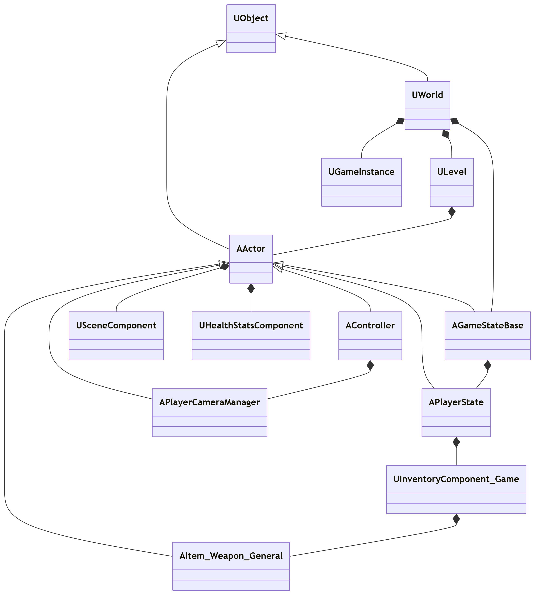
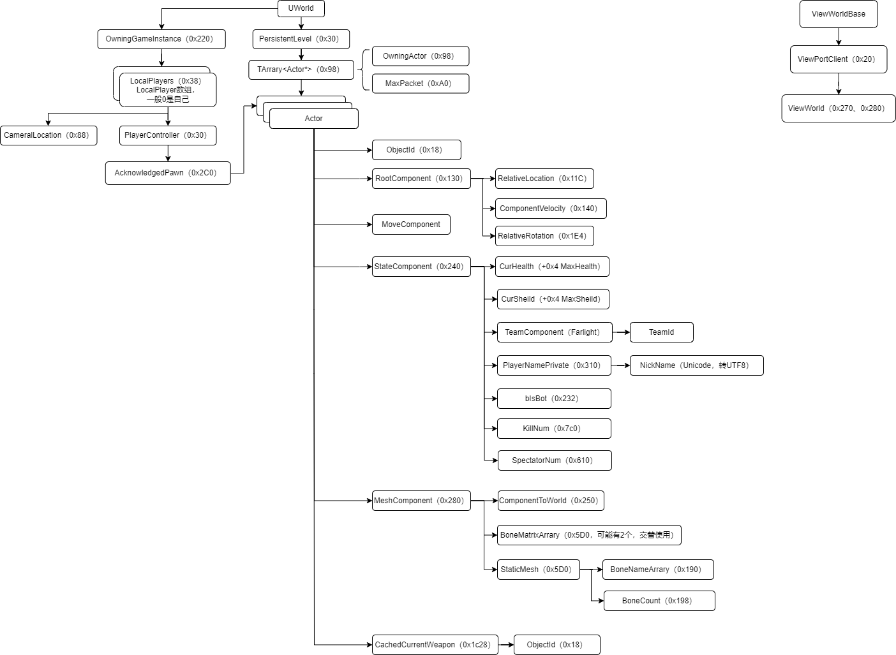

<!--more-->

## UE变量命名规范（前缀）

- 所有代码和注释都应采用美式标准英语的拼写和语法。
- 命名（如类型或变量）中的每个单词需大写首字母，单词间通常无下划线。例如：`Health` 和 `UPrimitiveComponent`，而非 `lastMouseCoordinates` 或 `delta_coordinates`。
- 类型名前缀需使用额外的大写字母，用于区分其和变量命名。例如：`FSkin`为类型名，而`Skin`则是`FSkin`的实例。
- 模板类的前缀为T。
- 继承自 `UObject` 的类前缀为U。
- 继承自 `AActor` 的类前缀为A。
- 继承自 `SWidget` 的类前缀为S。

## UE引擎继承关系

## 引擎结构

