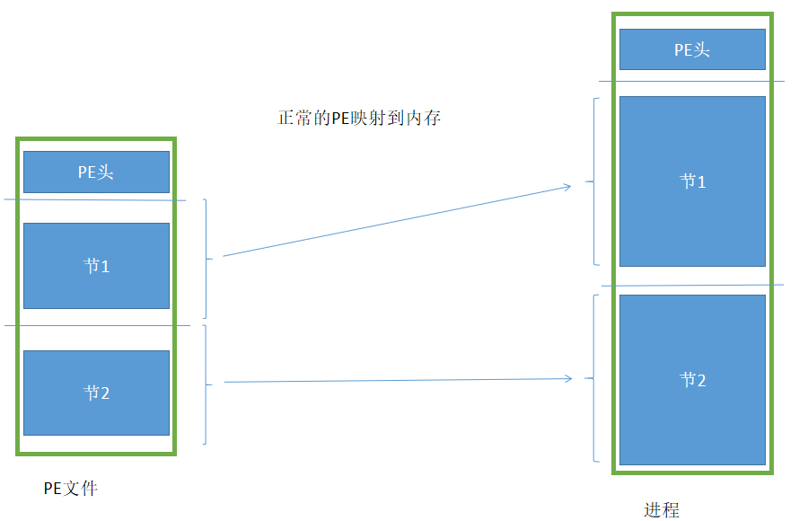
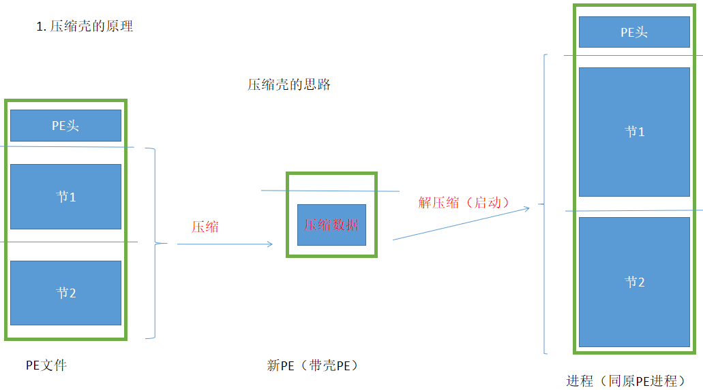
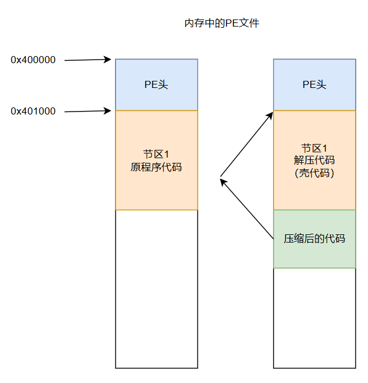
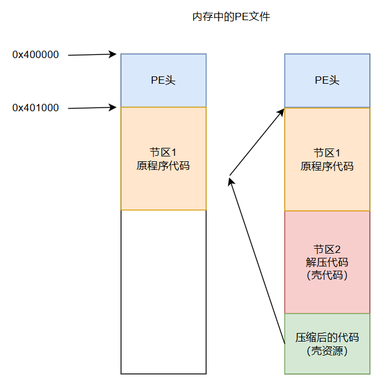
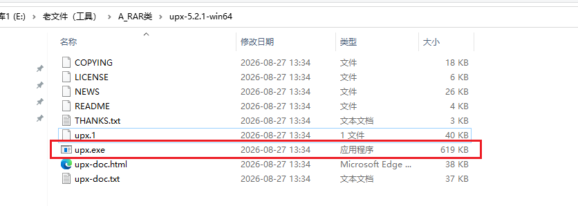
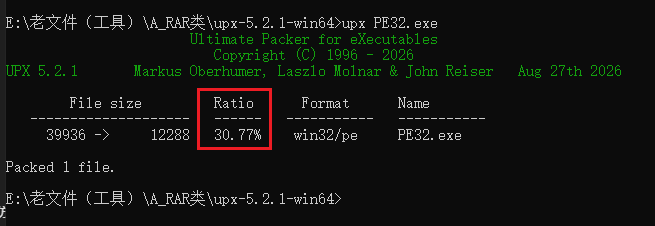
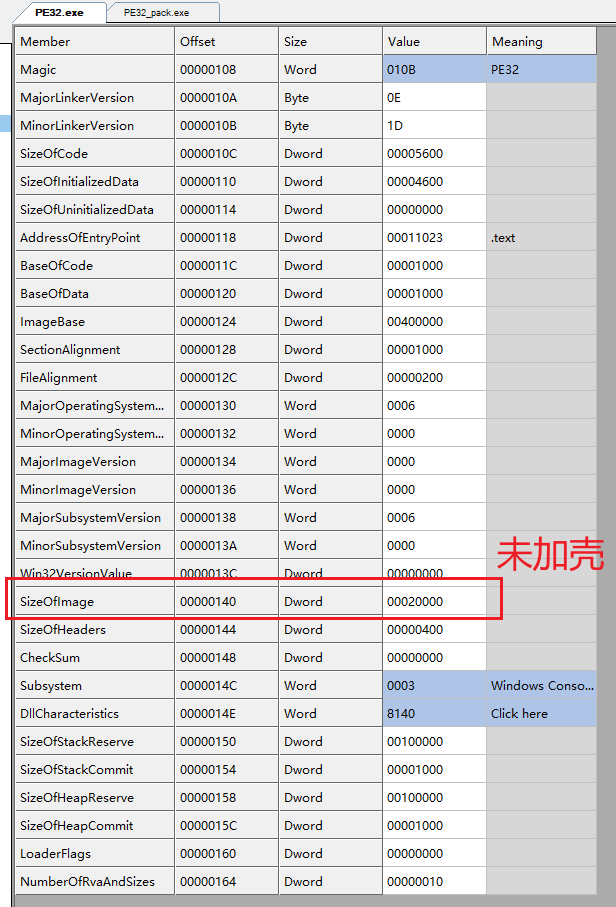
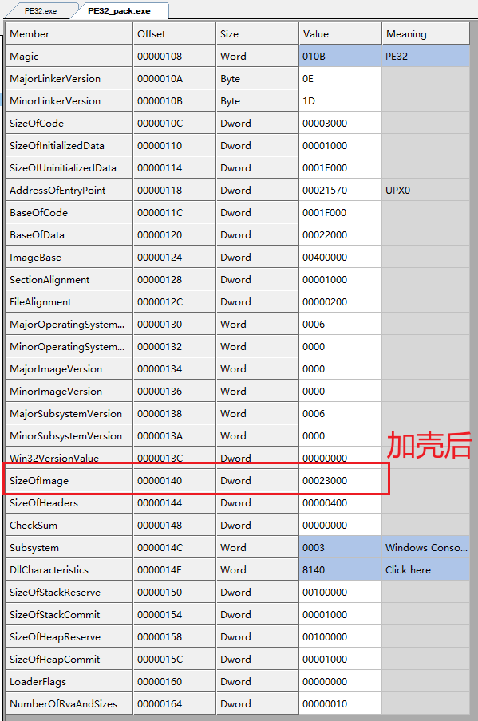
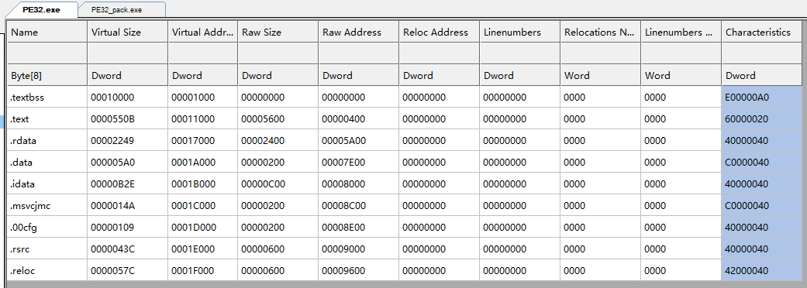
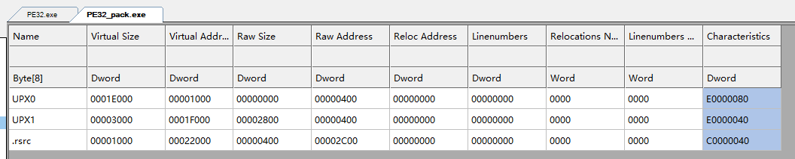

<!--more-->

## 装载PE文件原理

1. 这里简单复习一下PE文件的装载原理：头映射头、节映射节
2. 整个过程也叫`拉伸PE`




## 压缩壳出现的原因

1. 在早期拨号上网的年代，那时网络传输资源非常紧张，传输一个`1MB`的文件都是很耗费时间的
2. 所以就有开发者想：能不能设计一种压缩机制，可以将磁盘中的PE文件进行压缩，在运行中自解压、不影响原程序的正常运行？
3. 于是压缩壳就出现了，比较经典的压缩壳有`Upx`、`AsPack`等压缩壳
4. 注意误区：**压缩壳**的出现，初衷是为了压缩静态文件体积。加密壳才是为了保护程序源代码


## 压缩壳思路1

这是一种最简单粗暴的压缩壳实现方式：

1. 直接将目标PE文件资源，作为资源文件进行压缩，内嵌到一个新的PE文件中
2. 在外部代码（也就是壳代码）运行起来后，内存中自解压、手动模拟PE加载（拉伸PE、修导入表、重定位表、修异常、调用TLS回调），执行入口点函数


## 压缩壳思路2（更加常规化用法）

## 理想化压缩结果

1. 我们保留原始PE头的绝大部分内容
2. 将原PE的所有节区进行压缩
3. 如下图所示（中间部分），就是压缩后、设想中的PE文件




## 壳代码放置问题

1. 由于我们设计的是一个`压缩壳`，那么我们的壳代码就是负责解压缩的
2. 比较容易联想到的方法，是增加一个节区在前面，将我们的壳代码放置在那里
3. 但是此时引入一个新的问题，我们的壳代码将源程序的代码，直接往后挤了，如图所示：



4. 我们现在就会遇到一个非常现实的问题：解压后的代码，正常应该放置在`0x401000`的位置，但是此处线性地址已经被我们的壳代码占用了
5. 此时就会有大聪明说了，运行中动态覆盖壳代码的`0x401000`的位置？想啥呢，实际运行起来会有乱七八糟的崩溃问题


### UPX壳的预留空节区操作

1. `UPX`壳的做法就很聪明了，我修改原有`节区表`，将第一个节区，设置为一个空节区不就行了？
    1. `RawSize = 0`，该节区在文件中大小为0
    2. `VirtualSize = `，该节区在内存中大小为xxx
    3. 那么PE装载以后，就会自动将节区1的线性地址空间**预留出来**！
    4. 这样运行起来后，我们就能将解压后的原程序代码，放置到它原本应该放在的位置上
    5. 如下所示：




## 使用UPX进行加壳

1. `UPX`压缩壳是一款**跨平台**、**开源**的压缩壳工具，其仓库链接如下：

[GitHub - upx/upx: UPX - the Ultimate Packer for eXecutables](https://github.com/upx/upx)

2. 下载后，解压得到如图所示内容：



3. 使用如下命令即可加壳、脱壳（这种方式会**覆盖源程序**，注意备份）

```c
// 加壳，压缩目标程序
upx xxx.exe

// 脱壳，解压缩目标程序
upx -d xxx.exe
```


### 加壳前后文件大小

1. 压缩一个简单的exe，压缩后的可执行文件大小为原始文件大小的`30.77%`




### 加壳前后SizeOfImage区别

1. 我们使用`CFF`查看PE文件，验证上一小节我们的猜想
2. 首先查看`OptHeader.SizeOfImage`部分：





3. 可以发现，加壳会导致`SizeOfImage`变大，测试案例是增加了3个页面内容，其实这样的现象非常正常，因为**壳代码肯定占内存**的
4. 这也就解释了为什么大多数程序脱壳后，文件提及会比原始程序体积大一些，因为脱壳后还保留着壳代码（作为垃圾数据、不会执行）
5. 加壳省的是磁盘空间，却占用了更多的内存空间


### 加壳前后节区变化

1. 如下图所示：加壳后，节区数量大大减少



2. 下图`UPX0`的`VirtualSize = 1E000`，这个数值非常巧妙，就是原始PE文件，所有**节区大小向上内存对齐后总和**！
3. 下图`UPX0`的`RawSize = 0`，说明该节区不占用任何文件空间
4. 下图的资源节区`.rsrc`，这是因为加壳后的程序在文件夹中还是要显示图标信息的，不能一并压缩、整合。这里的`VirtualSize = 1000`，也是向上对齐后的结果


