<!--more-->

## 脱壳流程总结

1. 查壳：识别是什么壳子
2. 定位`OEP`
    1. 堆栈法：因为壳解压后，最终会直接`Jmp`到原`OEP`处执行，那么必然要保证执行`OEP`时的寄存器环境跟执行`EP`时的一模一样，所以压缩壳的第一行代码往往就是`pushad`，将所有寄存器压栈
        1. 我们可以搜索程序中`popad`的机器码，看看哪里有调用，跳过去看，疑似代码的地方下断点
        2. 在开头`pushad`下断，看看此时操作`Esp`，下`1字节`的内存访问断点
    2. 单步跟踪法：这个没什么好说的，在`EP`处下断，单步走，最后一定会走到`Jmp xxx`，大跳到一个目标地址处

> 当然，现代化的壳作者聪明了，不会傻到直接写`Jmp xxx`让你看出来是跳转`OEP`
>
> AsPack使用push、ret实现控制流跳转
>
> 这里的手法跟构造一个假跳板类似，可以向堆栈中压入一个加密后的Eip、xor堆栈Eip，再ret
>
> 腾讯游戏安全竞赛用过一个手法，先向堆栈压入Eip的高2字节（低2字节也行），再手动补齐剩下的2字节
>

    3. API调用定位：使用VS编译的程序，`OEP`往往会调用一些API，获取环境变量啥的，之后再调用`main`，我们可以自己编译一个未加壳程序，看看`OEP`会调哪些API，之后针对加壳程序，在目标函数下断、栈回溯即可
3. 定位到`OEP`后，Dump程序
4. 修复导入表


## 32位程序脱压缩壳（单步跟踪定位）

1. 经过以上理论后，我们现在来说实战手脱压缩壳，将`PE32_Pack.exe`直接拖到`x32Dbg`中，在入口点处断下

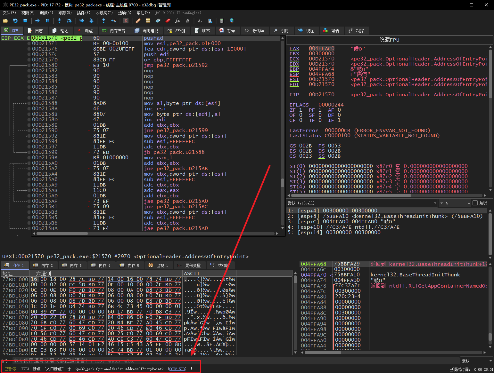

2. 此时我们来分析`EP`处的汇编：

```c
pushad 								// 保存寄存器环境
mov esi,pe32_pack.D1F000     		// 将UPX1节区首地址保存到esi
lea edi,dword ptr ds:[esi-1E000]    // 计算出UPX0节区首地址，保存到edi
push edi                                       
or ebp,FFFFFFFF                                   
jmp pe32_pack.D21592                           
```

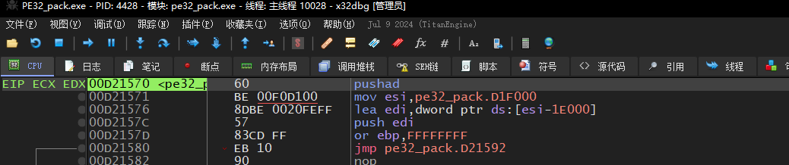

3. 我们继续单步往下走，会遇到大量的向上跳转指令，也就是循环操作，这里会调用解压算法：

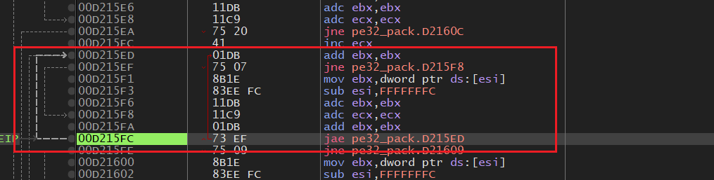

4. 继续单步，壳会加载DLL：

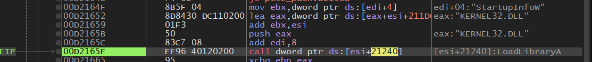

5. 调用`GetProcAddress`取导出函数，修复导入表
6. `or eax, eax`判断返回值是否为空，不为空则写入到`ebx`，这里的`ebx`就是导入表地址
7. 这里会经历很多循环，引入导入多个DLL、多个函数

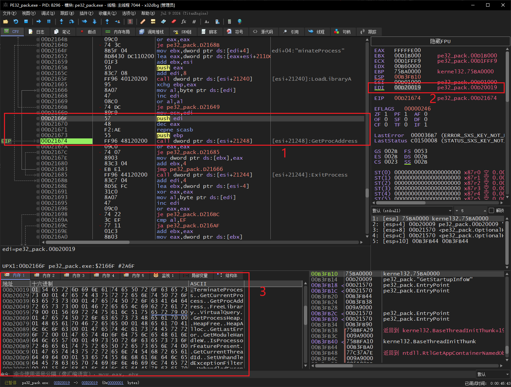

8. 继续往下跟，就会发现`popad`，紧跟着的`Jmp xxx`就是跳转到`OEP`

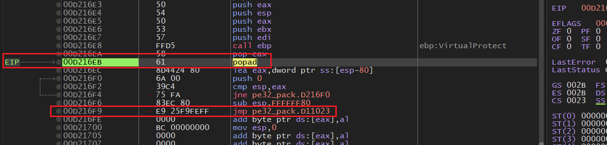

9. 如图所示，就是使用`VS2019`编译出来程序的`OEP`

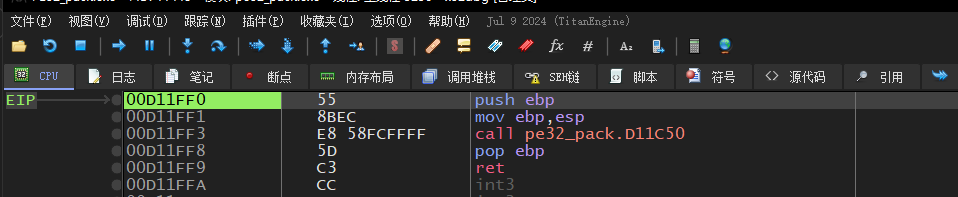

10. 断在此处后，我们打开`Scylla`，直接点击`Dump`按钮，转储内存

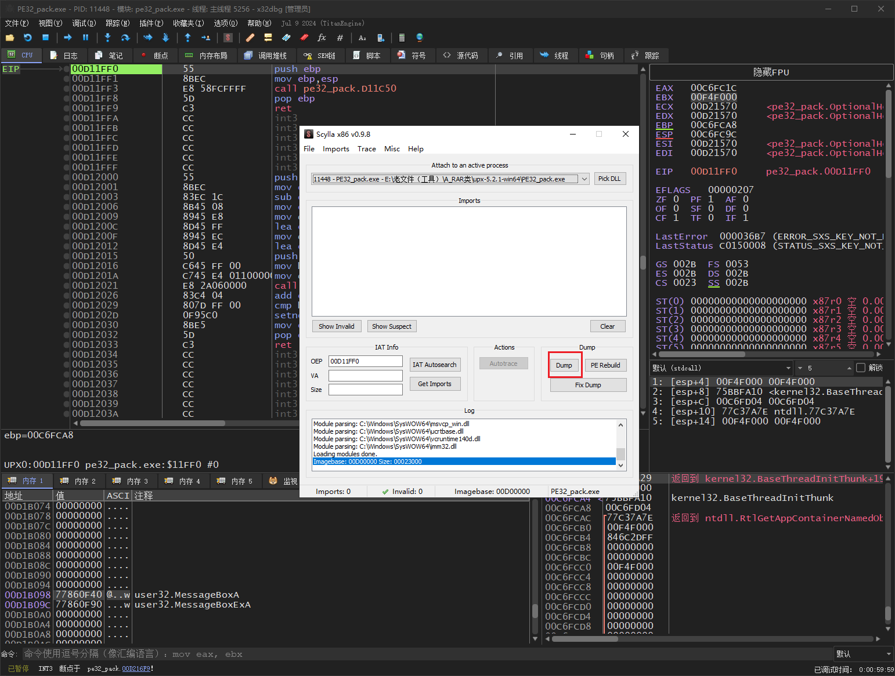

11. 接下来是修复导入表：
    1. 点击`IAT AutoSearch`按钮，自动搜索导入表特征
    2. 点击`Get Imports`按钮，解析导入表信息
    3. `Fix Dump`按钮，选择`步骤10`的Dmp文件进行修复

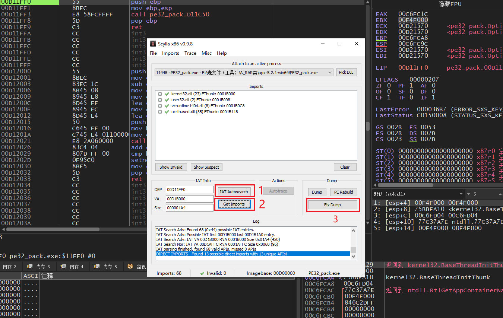

12. 到了这一步，手动脱一个压缩壳就完成了，正常来说此时的程序是可以直接双击运行的，但是笔者这里的测试程序会报错，暂不深究问题
13. 在Dump、修复IAT之后，此时我们的程序拖到`IDA`中，就可以比较舒服地进行静态分析了


## 32位程序脱压缩壳（堆栈法）

1. 我们继续使用堆栈法脱壳，把`PE32_Pack.exe`拖到`x32Dbg`中：

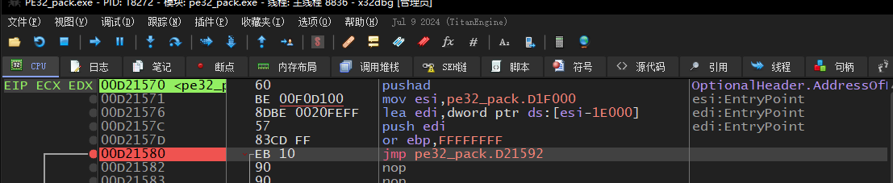

2. 这里的`pushad`会将寄存器环境压入堆栈，我们单步走一步，查看堆栈变化：

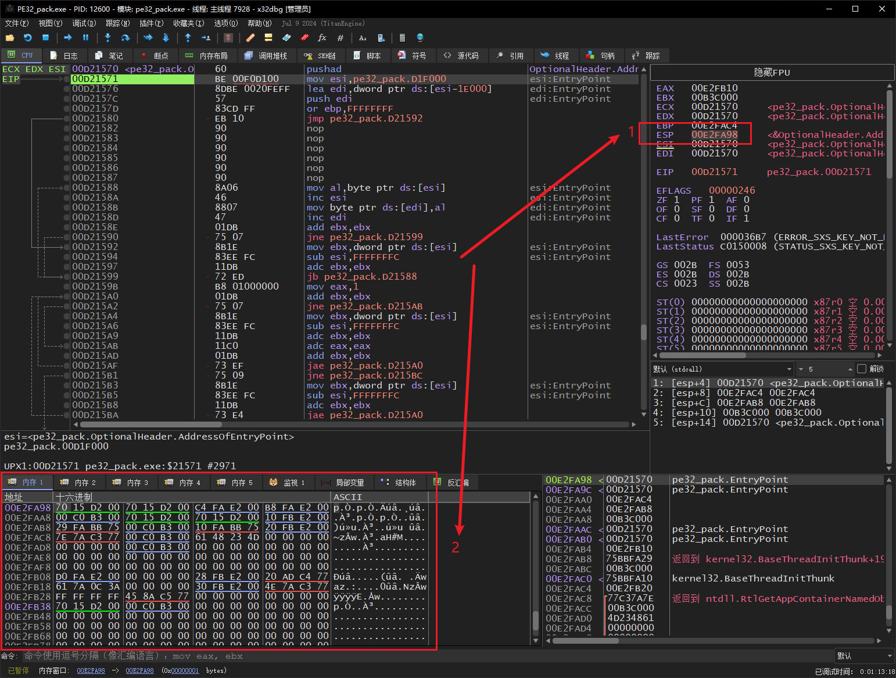

3. 我们对着堆栈下一个`单字节访问`断点

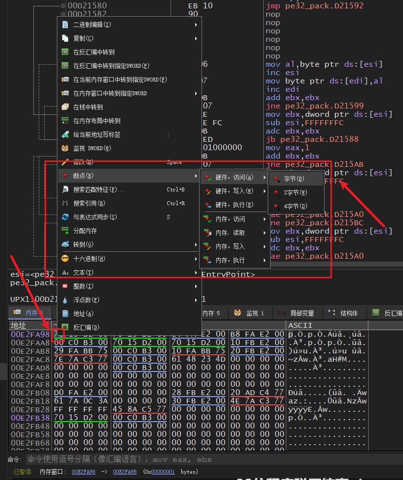

4. 之后大胆放行，会直接断在如图所示位置：

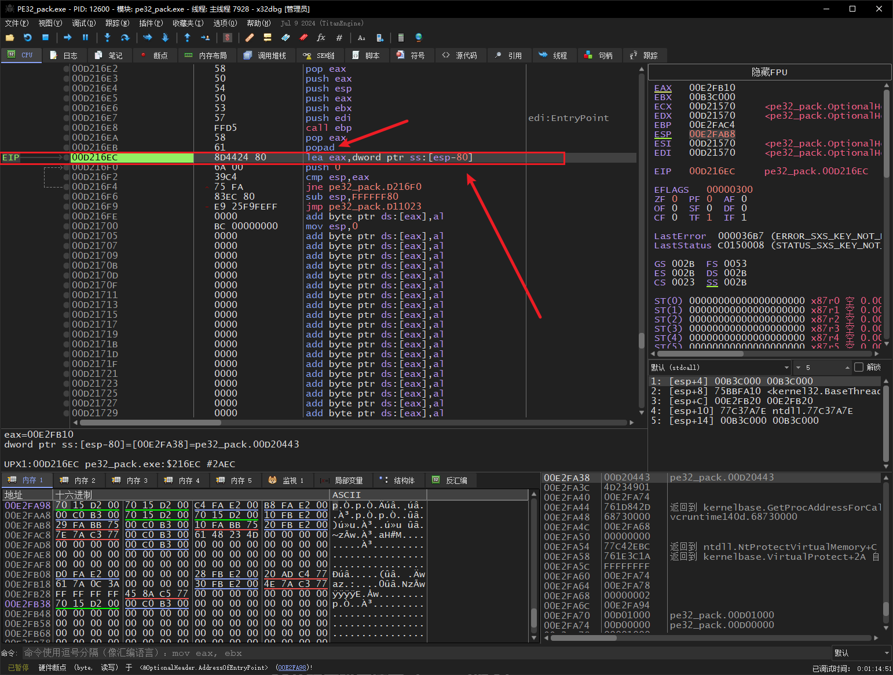

5. 此时我们发现，上一行就是`popad`指令，下方不远处就是`jmp xxx`
6. 之后的流程保持一样，不重复赘述


## 32位程序脱压缩壳（popad指令）

1. 这个手法没什么好说，直接硬搜`popad`的机器码

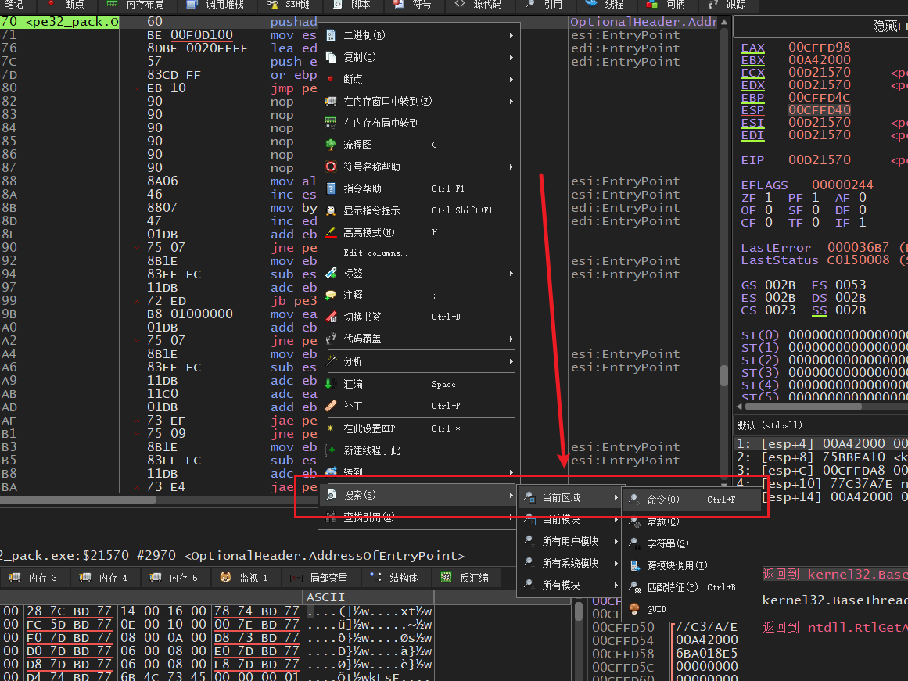

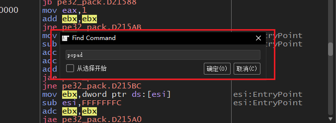


## 脱壳后程序大小

1. 不管是压缩壳、加密壳，脱壳后得到的PE文件往往都会比原始文件大（甚至大得多）
2. 这是因为Dump时，会将壳代码同时Dump出来，正常脱壳流程中，并不会将壳代码剥离
3. 后续再修导入表，这一哪怕壳代码残留，也不影响我们分析主要代码
