<!--more-->

## 添加、删除VEH回调

### AddVectoredExceptionHandler

1. 该函数签名如下所示，摘自MSDN：

```c
// 函数原型
PVOID AddVectoredExceptionHandler(
  ULONG                       First,
  PVECTORED_EXCEPTION_HANDLER Handler
);

// 回调类型
typedef LONG (CALLBACK *PVECTORED_EXCEPTION_HANDLER)(
    PEXCEPTION_POINTERS ExceptionInfo
);

// 异常信息：异常记录、上下文记录
typedef struct _EXCEPTION_POINTERS {
    PEXCEPTION_RECORD ExceptionRecord;
    PCONTEXT         ContextRecord;
} EXCEPTION_POINTERS;
```

2. 该函数是由`KernelBase.dll`导出，真实来源其实是`NTDLL.RtlAddVectoredExceptionHandler`，其导出信息如下:

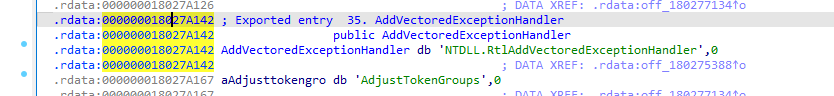

3. `NTDLL.RtlAddVectoredExceptionHandler`反汇编如下，其功能只是将`参数3`清空后，直接跳转到`RtlpAddVectoredHandler`

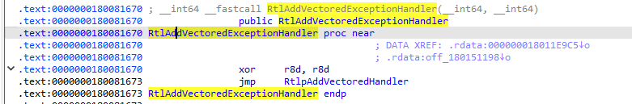


### RtlpAddVectoredHandler

1. 提前剧透一下，`RtlpAddVectoredHandler`函数原型其实如下所示：

```c
RtlAddVectoredExceptionHandler(ULONG First, PVOID Handler)
{
    return RtlpAddVectoredHandler(First, Handler, 0);
}

// 函数原型
RtlpAddVectoredHandler(
    int First,                 // RCX
    PVOID Handler,              // RDX
    ULONG Type                  // R8D: 0=VEH, 1=VCH
);
```

2. 核心汇编流程如下：

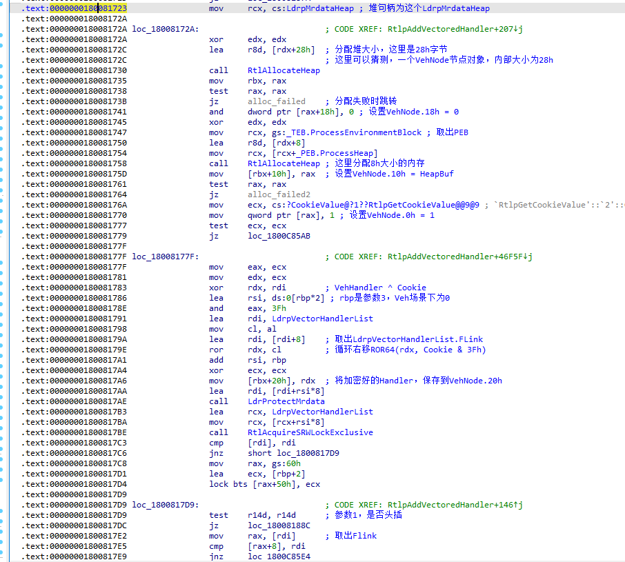

3. 做了哪些事？可以总结如下：

> 1. 分配一个0x28字节大小的VehNode，这个Node中大部分字段意义未知，唯一可以确定的是VehNode.20h处保存的是加密后的Veh回调指针
> 2. 这个加密使用到了ntdll中的一个进程级的Cookie，使用它来加密回调指针，加密公式为EncPtr = ROR64(VehHandler ^ Cookie, Cookie & 3Fh)
>


#### 全局对象LdrpVectorHandlerList

1. 关于`LdrpVectorHandlerList`这个对象，不能简单认为其就是链表头，这是一个对象，有哪些字段内容，开始分析
2. 在构造好一个VehNode后，必当要将其加入到全局链表中，要操作一个全局链表，必定需要`加锁`，所以我们找到一处加锁的代码进行分析（如下图所示）：
3. 首先取出了`LdrpVectorHandlerList`对象指针，之后访问其中字段内容，这里的`rsi`寄存器内容，在Veh路径下`rsi = 0`，Vch路径下`rsi = 3`
4. 这里很明显，`180081804`处代码就是取出一个`锁对象`，之后调用`RtlAcquireSRWLockExclusive`进行加锁

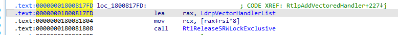

5. 那么到了这里，我们就可以初步推测`LdrpVectorHandlerList`这个对象结构如下：

```c
LdrpVectorHandlerList:
	0x0  VehLockObject
	0x8	 Unknown1
	0x10 Unknown2
	0x16 VchLockObject
	0x20 Unknown3
	0x28 Unknown4
```


#### 继续分析插入链表操作

1. 我们目前顺利分析出了如何初始化一个`VehNode`、`LdrpVectorHandlerList`对象部分字段，那么接下来分析如何插入到全局链表，如图所示就是`头插法`汇编代码：
2. 已知这里的`rbx`是构造好的`VehNode`，下面的汇编，很明显就是`InsertHeadList`的汇编

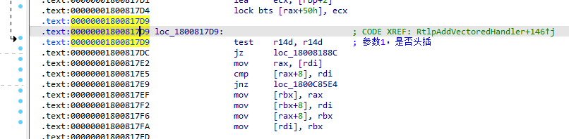

3. 所以我们可以合理推测`LdrpVectorHandlerList`结构如下：

```c
LdrpVectorHandlerList:
	0x0  VehLockObject
	0x8	 ListEntry1
	0x16 VchLockObject
	0x20 ListEntry2
```

4. 继续分析得到`VehNode`的部分结构如下：

```c
VehNode:
	0x0  ListEntry
	// ...
	0x20 EncryptHandler
```


## KiUserExceptionDispatcher

1. 该函数是`R3异常`分发的起始落脚点，该函数的特点就是没有返回值，如果成功处理异常调用`NtContinue`继续执行代码，否则调用`NtRaiseException`进行二次派发异常。不管是何种路径，该函数都不会执行到`Ret`
2. 这里需要注意一下，`1800A0C23`处的代码，**是不会执行的**

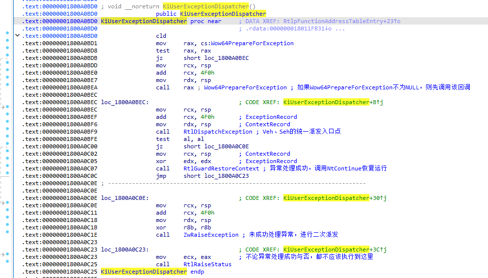


### RtlDispatchException

1. 这个函数是R3下`VEH`、`SEH`异常派发的总入口点
2. 首先调用`VEH异常回调`

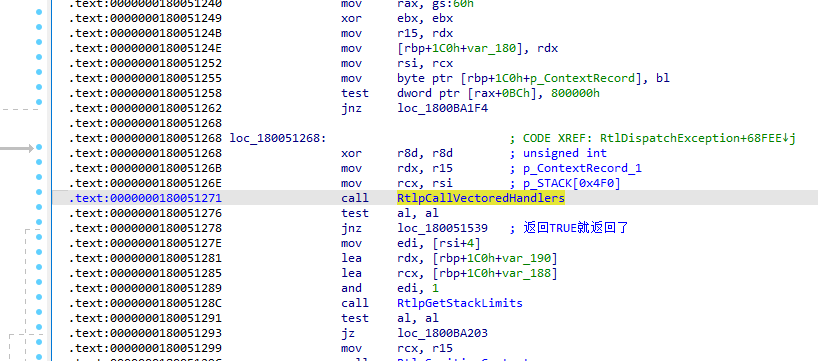

3. `RtlpCallVectoredHandlers`如果返回成功，那么直接跳走，继续执行`VCH回调`

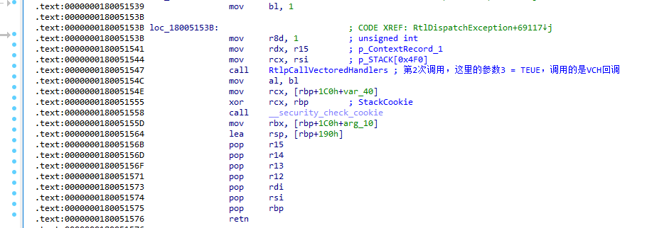


### RtlpCallVectoredHandlers

1. 取出Veh链表头

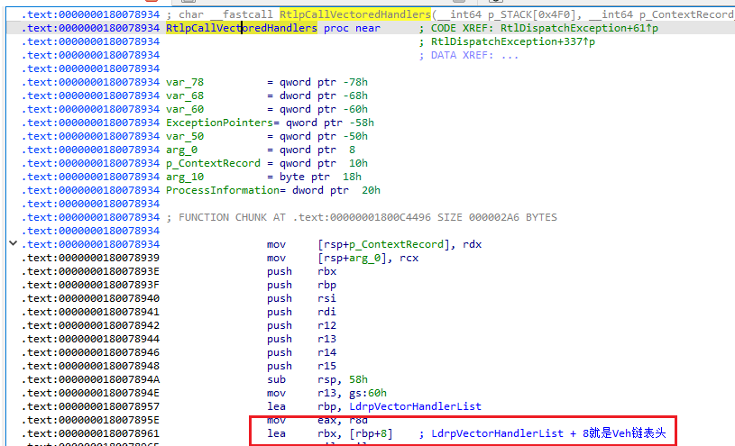

2. 该函数会在栈上构造局部变量`ExceptionPointers`

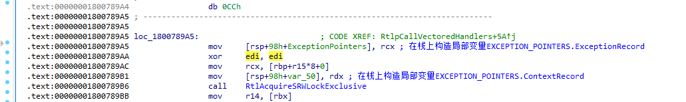

3. 遍历Veh链表

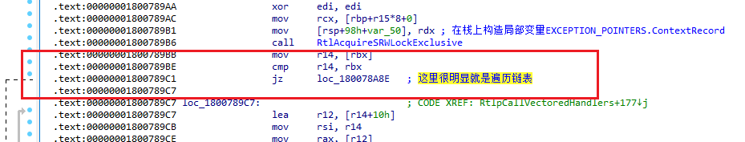

4. 解密`Veh Handler`

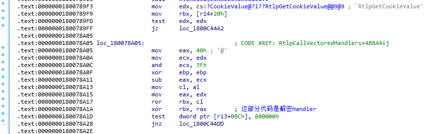

5. 通过CFG调用`Veh回调`

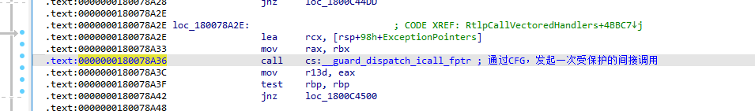


## 拓展

1. 在加入、删除VEH回调时，涉及到了加密、解密函数指针，我们其实不用管算法是啥，有提供`RtlEncodePointer`、`RtlDecodePointer`函数，直接调用即可
