<!--more-->

## Exeinfo PE

1. 这个工具是目前查壳效果最好的（很多以前更好用的查壳工具，已经停更了，新壳识别不准、或识别不出来）

[GitHub - ExeinfoASL/Exeinfo: exeinfo PE for Windows by A.S.L](https://github.com/ExeinfoASL/Exeinfo)


## 识别编译器入口点

1. **32位**：使用VS2019编译一个控制台程序，其入口点如下，`call xxx jmp xxx`组合

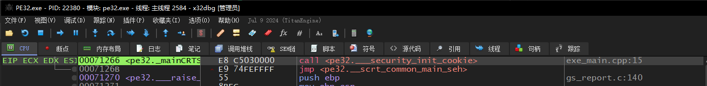

2. **64位**：使用VS2019编译一个控制台程序，其入口点如下，其实也是`call xxx jmp xxx`组合，只是多了抬栈操作

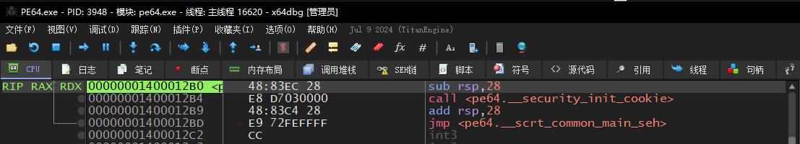


## 识别VMP加壳后的OEP（3.5.x ~ 3.9.x）

1. 我们知道`VMP`是基于栈的虚拟机，那么在进入、退出VM时必定会操作栈，那么我们这里分析的入手点就是对栈下访问断点
2. 这种方法支持32、64位的`3.5.x ~ 3.9.x`等已知版本的VMP，这里使用`3.9.4`进行测试，加壳参数如下（未对OEP添加额外保护）：

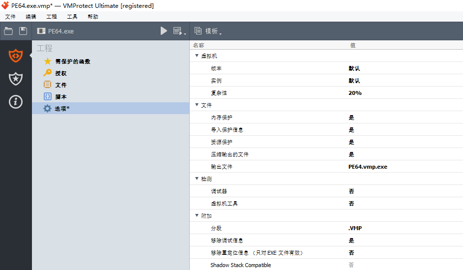

3. 拖入一个加壳后的程序，在EP处断下

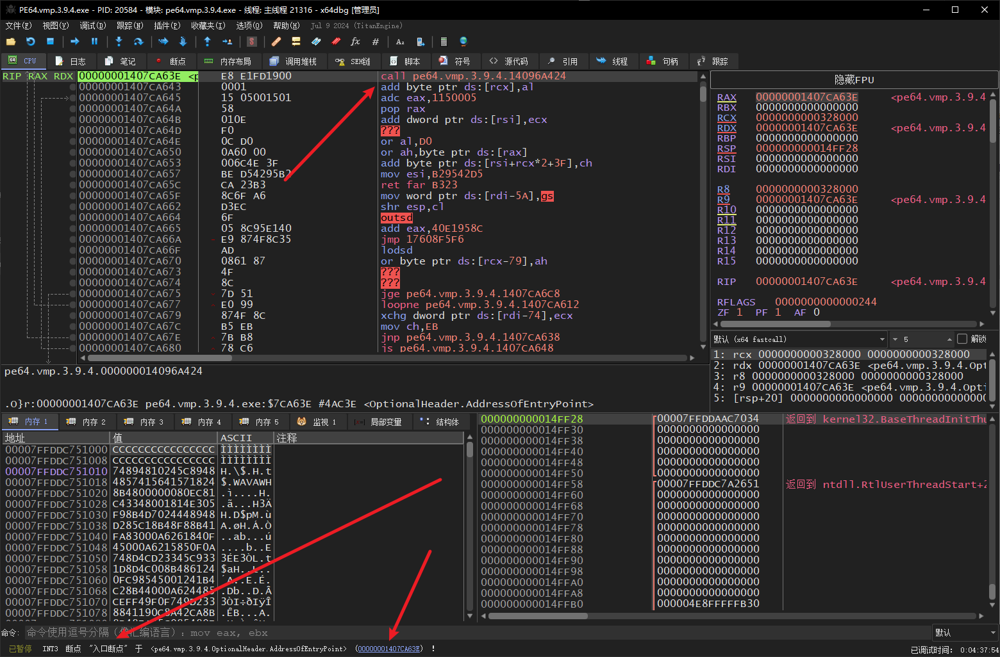

4. 在`RSP - 8`处下访问断点（32位同理`ESP - 4`）

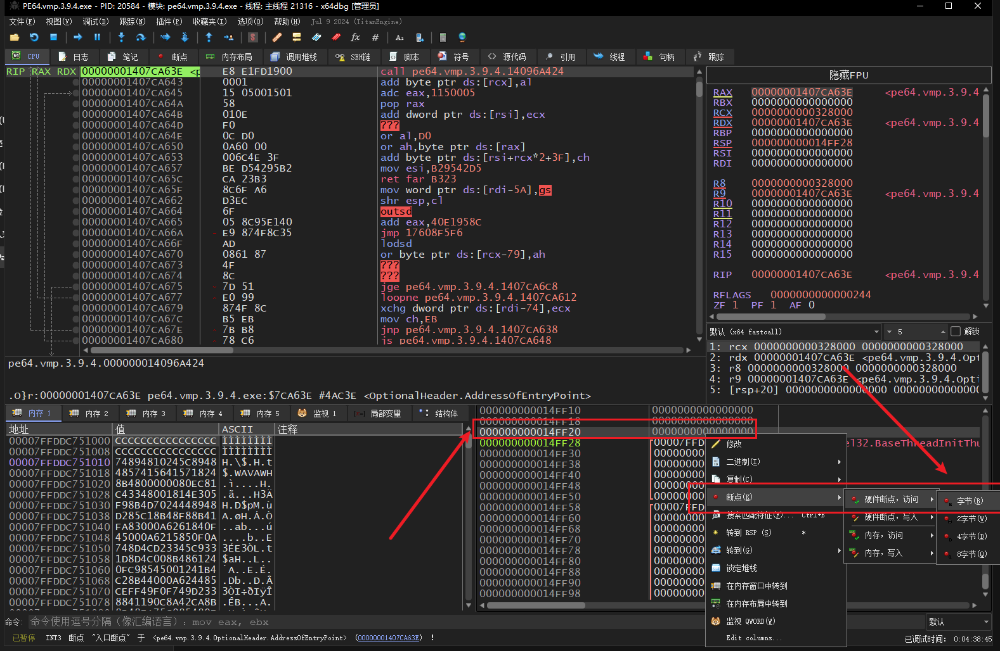

5. 之后一路`F9`放行，直到看到`call xxx jmp xxx`组合即可，如图所示


## VMP代码变异

1. 要明确一点，OEP正常样子如下：


2. 我们选择OEP函数，添加`变异`保护

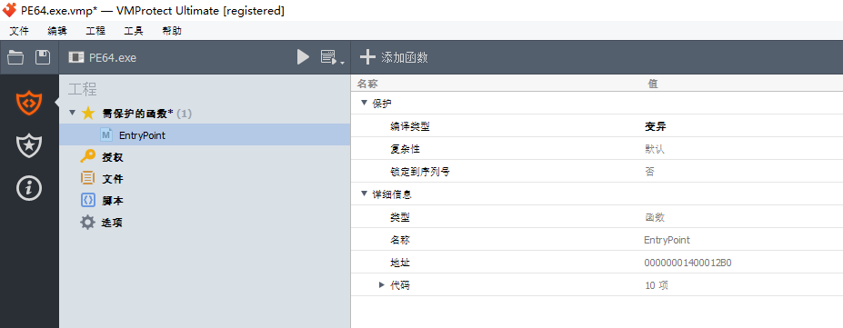

3. 此时再次使用`堆栈法`定位OEP，可以发现多多少少还是有原函数样子的，能依稀分辨出`call xxx jmp xxx`这个经典组合

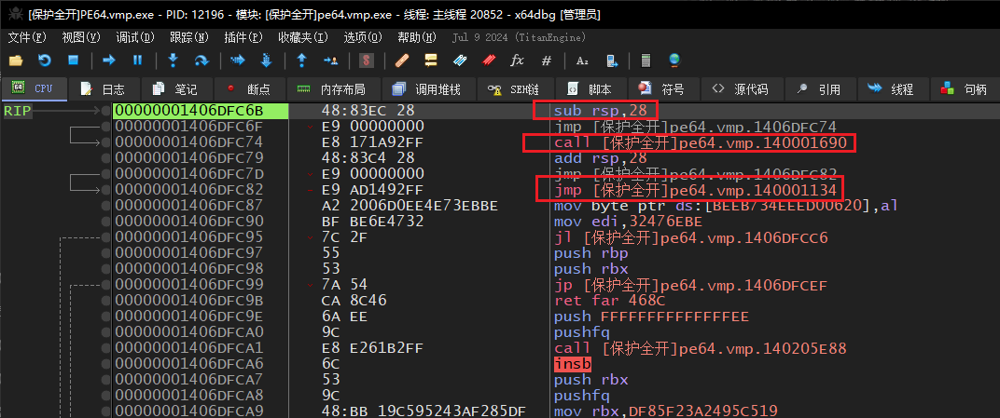


## VMP代码虚拟化

1. 我们还是选中OEP函数，添加`虚拟`保护

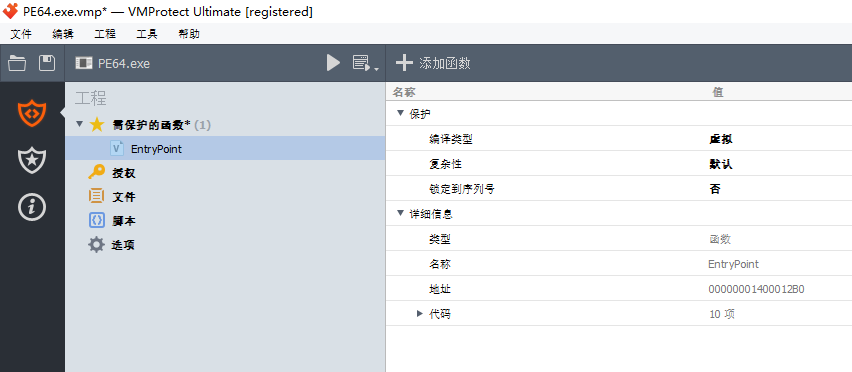

2. 此时沿用`堆栈法`，已经找不到常规OEP函数特征了


## VMP导入表保护

1. 笔者这里测试了`3.5.1`、`3.9.4`版本的导入表保护
2. 正常的PE程序调用导入表函数，是`FF 15 xxxx`，即`call [IatSlot]`这种间接调用函数

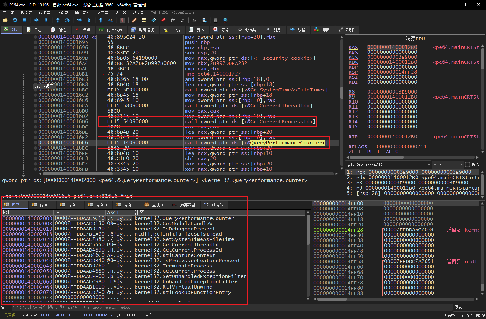

3. VMP加壳后，调用导入表方式直接修改为

```c
// 原始调用
FF15 xxxx		---> call [IatSlot]

// VMP导入表加密
E8 xxxx			---> call VmpStubFunc
```

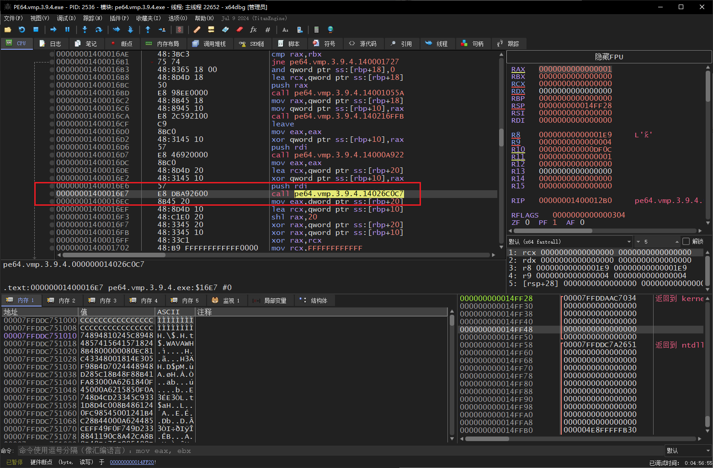

4. 但是由于`E8 xxx`这种call方式只占5字节，还剩下1字节，在上图中，VMP在call指令上一行放置一个`push rdi`的单字节指令


## 调试器模拟解密IAT

1. 这种方式支持`VMP 3.x`版本，VMP的解密Stub，执行到ret时，此时栈顶就是原始函数的地址
2. 我们来到`call xxx jmp xxx`入口点处，对着第一个call进去
3. 内部会看到4个call，我们选择最后一个`16E7`的call

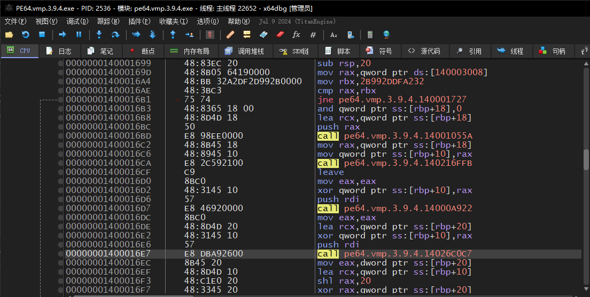

4. 双击进去后，转到内存布局，会发现这个VmpStub函数是处于VMP区段的

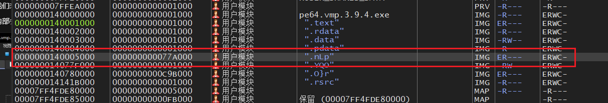

5. 我们回到函数，直接将Rip设置到函数头部，如下所示

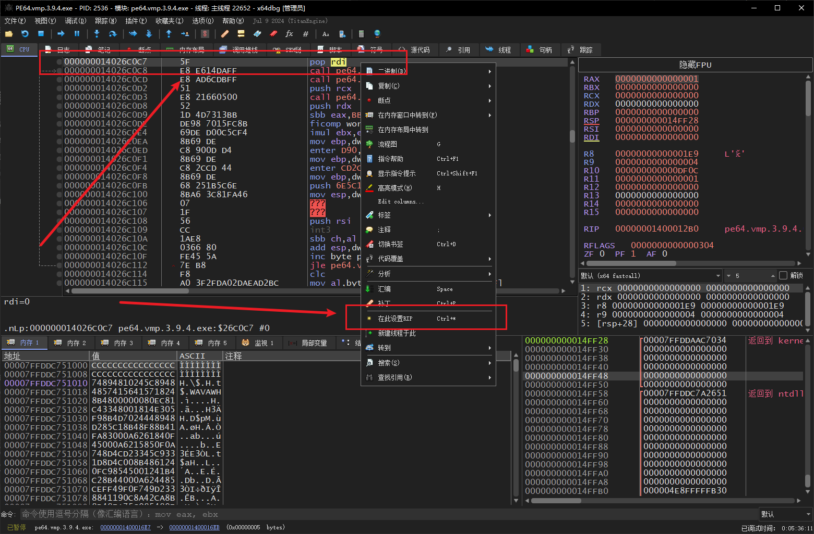

6. 这里利用`x64Dbg`的追踪功能，让其自动跑Trace，停止条件是遇到`ret`指令

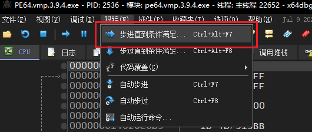

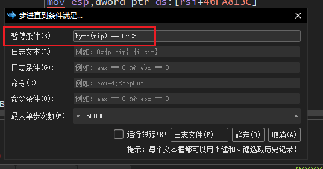

7. 点击确定后，就会一直跑，直到满足断下条件，顺利得到解密函数

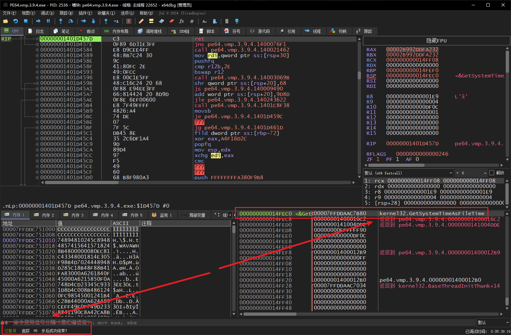
