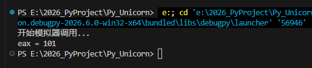

<!--more-->

## 配置Unicorn环境

1. 这里使用`Python`来配置环境，首先确保Py环境正常
2. 使用如下命令安装`Unicorn`，笔者这里安装时大概下载了`15MB`的内容

```c
pip install unicorn
```

3. 为什么不配置`C/C++`环境的Unicorn？
    1. 配置C/C++的各种开发环境，哪个简单得过Python一行命令全自动安装？
    2. 常规配环境：下载环境压缩包、解压到目标目录、配置全局环境变量、配置工程属性


## Python基础语法

由于笔者之前主要是在C/C++环境下开发、调试，对Python不熟悉，所以这里记录一些基础语法

1. Python中是通过代码缩进控制函数层级的
2. Python代码文件中，默认是从第一行开始向下执行代码的
3. `def xxx()`是定义一个函数体，本身只能被其他函数调用（额，这不废话嘛）
4. `if __name__ == "__main__"`这种定义main入口函数的方式，是当前`.py`文件作为**主程序启动时**才会执行


## 测试Unicorn环境

1. 在VS Code中新建一个Py文件，编写一个简单的Demo，如下所示：

```c
from unicorn import *
from unicorn.x86_const import *

def TestUnicorn():
    print("开始模拟器调用...")

    try:
        # inc eax
        x86_Code = b"\x40"

        ImageBase = 0x400000
        SizeOfImage = 2 * 1024 * 1024

        # 实例化Unicorn模拟器
        emu = Uc(UC_ARCH_X86, UC_MODE_32)

        # 映射内存
        emu.mem_map(ImageBase, SizeOfImage)

        # 设置Shellcode
        emu.mem_write(ImageBase, x86_Code)

        # 初始化寄存器环境
        emu.reg_write(UC_X86_REG_EAX, 100)

        # 启动模拟器
        emu.emu_start(ImageBase, ImageBase + len(x86_Code))

        # 读出eax寄存器内容，验证模拟执行结果
        EaxValue = emu.reg_read(UC_X86_REG_EAX)
        print(f"Eax寄存器值{EaxValue}")

    except UcError as Ex:
        print(f"Unicorn模拟器抛出异常{Ex}")

if __name__ == "__main__":
    TestUnicorn()
```

2. 输出以下内容，说明环境配置成功




## 配置Keystone、Capstone

1. 这是`三剑客`的另外2部分，三者关系如下所示：

| **Unicorn（CPU）** | 模拟执行代码 |
| --- | --- |
| **Capstone（眼睛）** | 机器码 ---> 汇编，让我们看懂 |
| **KeyStone（手）** | 汇编 ---> 机器码，模拟执行中我们可能需要Hook代码，修改流程 |


2. Python中一键配置

```c
python -m pip install capstone keystone-engine
```

3. 测试`Keystone`，**现阶段来说，用的其实比较少**

```c
from keystone import *

if __name__ == "__main__":
    ks = Ks(KS_ARCH_X86, KS_MODE_32)
    Encoding, Count = ks.asm("inc eax;")
    print(Encoding[0])
    print(Count)
```

4. 测试`Capstone`

```c
from capstone import *

if __name__ == "__main__":
    cs = Cs(CS_ARCH_X86, CS_MODE_32)
    x86_Code = b"\x40\x90\xC3"
    for Insn in cs.disasm(x86_Code, 0x400000):
        print(f"0x{Insn.address:x}:  {Insn.mnemonic} {Insn.op_str}")
    print("End")
```
