<!--more-->

## 定位到OEP、Dump PE

1. 这步没啥好说的，如果OEP没有被虚拟化，其实还是好找的

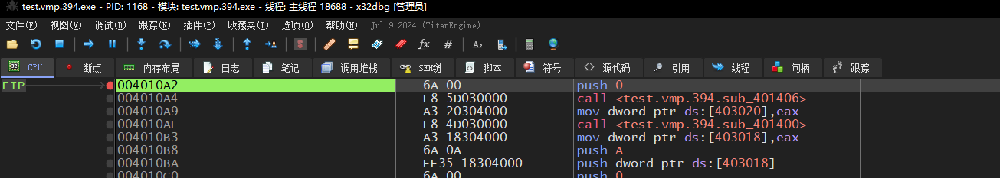

2. 这里Dump PE，即可


## 识别被破坏的IAT Stub

1. 下图是原始、未加壳的OEP代码，可以看到有2个正常的函数调用

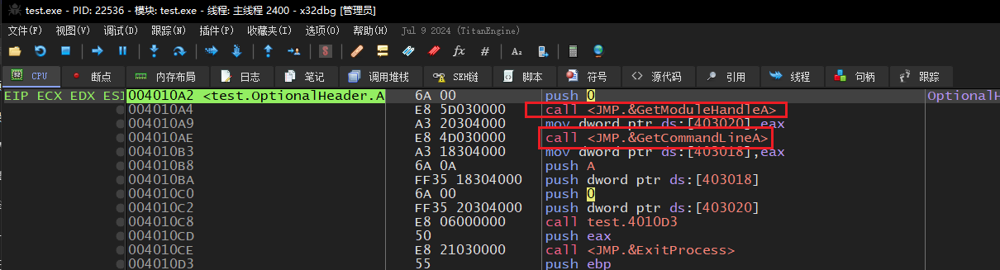

2. 我们点进去看看原始IAT Stub长什么样
    1. 可以发现是非常典型的`FF 25 xxxx`，即`call [IatSlot]`
    2. 我们找到导入表VA，确实保存了大量导入函数的VA

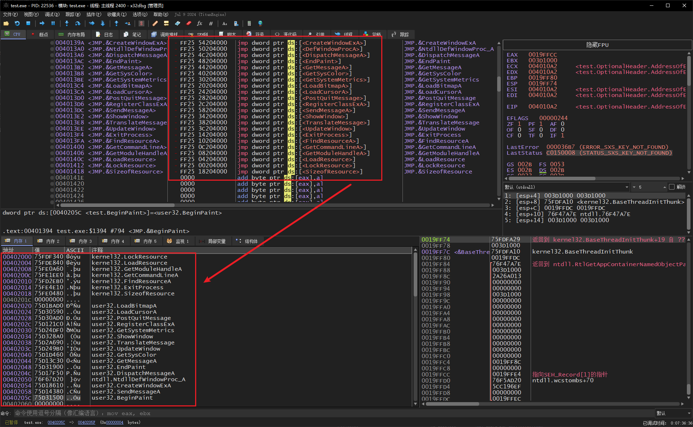

3. 我们来对比加壳后，设置了导入表保护后的代码

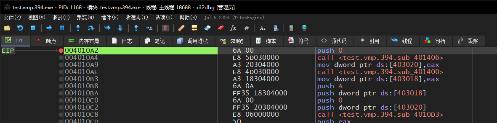

4. 选择一个双击跳进去看

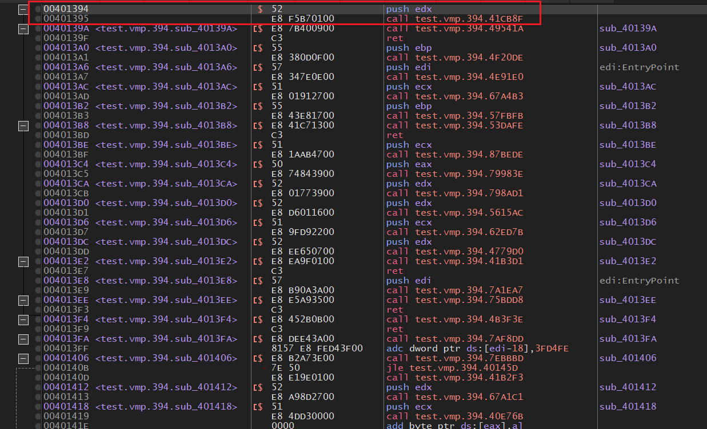

5. 会发现原本的`FF 25 xxxx`是6字节，被修改为**E8 call**的调用方式，但是E8调用只有5字节，所以会在E8调用的前、后设置一个单字节的占位机器码


## 找出VMP解密方式

1. 这些被VMP修改后的调用Stub，指向的是VmpStubEntry，这些StubEntry解密原始的导入函数非常简单，我们双击选一个StubEntry，如图所示：

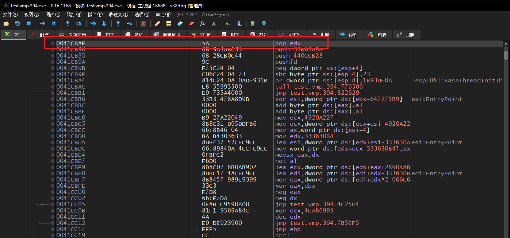

2. 将`EIP`设置到函数头部，之后一直`F7`步进运行代码，这里需要耐心，此时注意看堆栈，直到出现敏感函数，如图所示

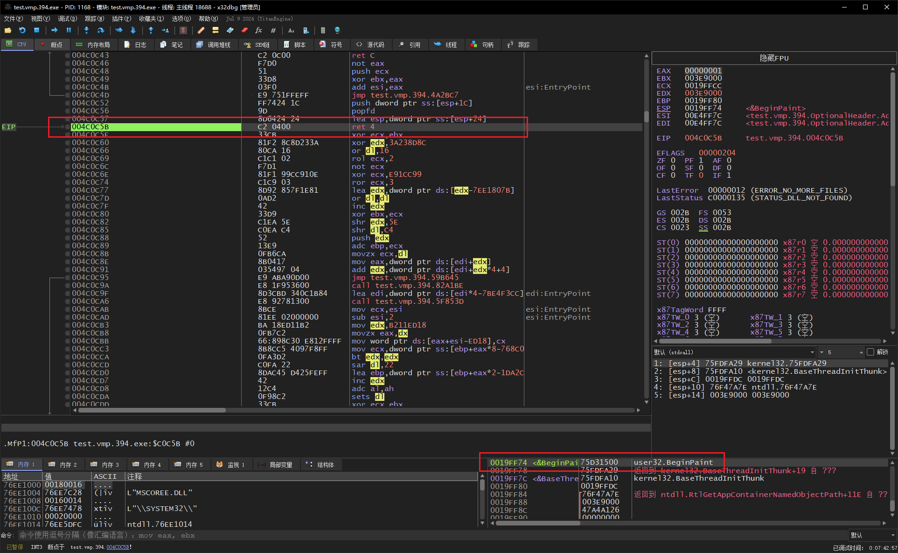

3. 这里可以发现规则，一个StubEntry最后的`retn 4`时，栈顶会保存真实的返回地址
4. 我们利用这个规则，选择另一个StubEntry，在头部设置EIP，并且利用x64Dbg的自动Trace功能：

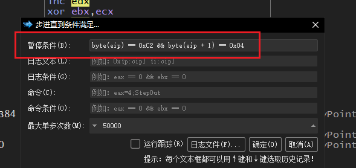

5. 成功解密出另外的导入函数

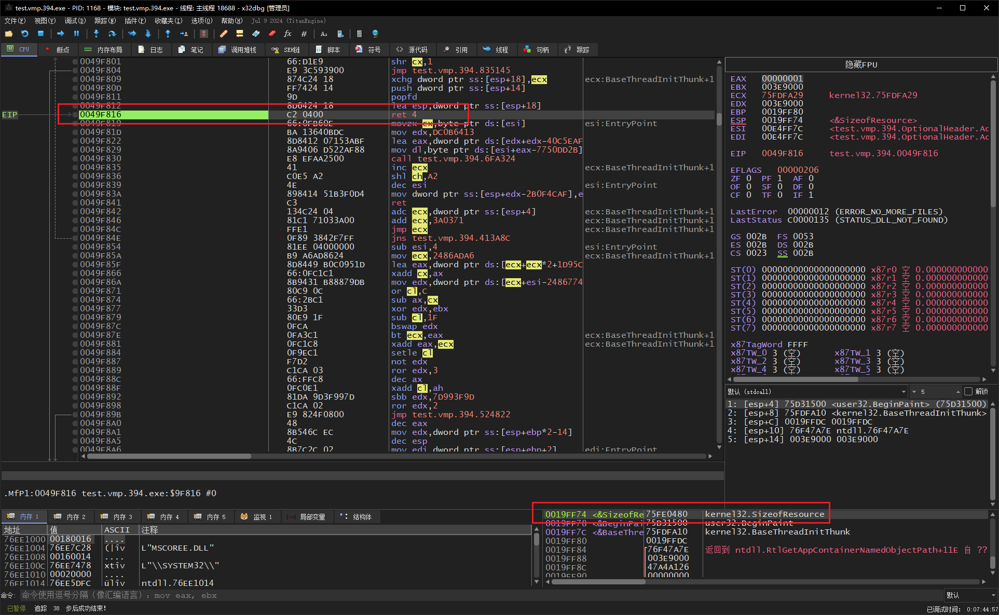


## 使用Unicorn模拟执行解密

1. 我们将加壳程序断在OEP处，这里为了快速试验、演示效果，所以用的是手动保存主模块内存快照，正常自动化流程应该写脚本自动Dump快照
2. 我们选中主模块的全局节区内存，右键创建转储文件

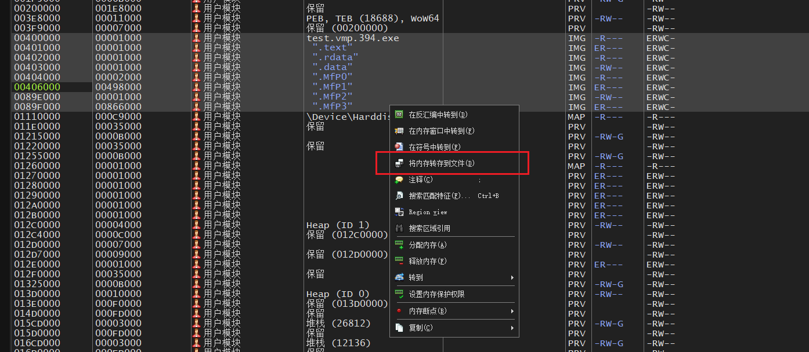

3. 保存到文件后，就可以到Py_Unicorn中手动载入模块快照，进行模拟执行了
4. 接下来我们需要提取出所有的VmpStubEntry函数地址，即从下图中，解析出所有的解密函数入口地址


5. 这里使用C/C++来实现，如下所示：

```c
struct _IAT_STUB
{
	UCHAR Bytes[6];

	ULONG GetRel32()
	{
		if (!Bytes[0])
		{
			return 0;
		}

		ULONG LocalOffset = Bytes[0] == 0xE8 ? 1 : 2;

		return *(PULONG)(Bytes + LocalOffset);
	}

	ULONG GetNextInsn()
	{
		if (!Bytes[0])
		{
			return 0;
		}

		ULONG LocalOffset = Bytes[0] == 0xE8 ? 5 : 6;

		return LocalOffset;
	}
};

int main()
{
	cReadWriteMem ProcRw("test.vmp.394.exe");

	ULONG Addr = 0x00401394;
	ULONG Begin = Addr;

	while (true)
	{
		_IAT_STUB Stub = ProcRw.Read<_IAT_STUB>(Begin);
		if (Stub.Bytes[0] == 0)
		{
			break;
		}

		ULONG StubEntry = Begin + Stub.GetNextInsn() + Stub.GetRel32();

		printf("0x%X, \n", StubEntry);
		//printf("VmpStub:0x%X -> 0x%X \n", Begin, StubEntry);

		Begin += sizeof _IAT_STUB;
	}

	getchar();
	return 0;
}
```

6. 运行上面的代码，输出结果如下，顺利得到所有StubEntry，将这些地址复制到Py中

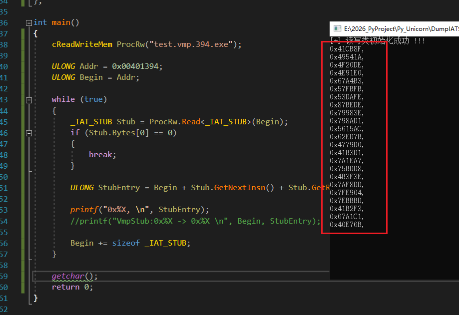

```c
StubEntryList = [
    0x41CB8F, 0x49541A, 0x4F20DE, 0x4E91E0,
    0x67A4B3, 0x57FBFB, 0x53DAFE, 0x87BEDE,
    0x79983E, 0x798AD1, 0x5615AC, 0x62ED7B,
    0x4779D0, 0x41B3D1, 0x7A1EA7, 0x75BDD8,
    0x4B3F3E, 0x7AF8DD, 0x7FE904, 0x7EBBBD,
    0x41B2F3, 0x67A1C1, 0x40E76B,
]
```

7. 接下来要做的是初始化Unicorn环境、载入内存快照、设置内存映射、循环模拟执行所有的StubEntry，代码如下所示：

```c
from unicorn import *
from unicorn.x86_const import *
from capstone import *
import sys

DumpFile = "test.vmp.394_00400000.bin"

Data = open(DumpFile, "rb").read()

ImageBase = 0x400000

StackBase = 0x10000000
StackSize = 0x100000
Esp = StackBase + StackSize - 8

StepLimit = 200

StubEntryList = [
    0x41CB8F, 0x49541A, 0x4F20DE, 0x4E91E0,
    0x67A4B3, 0x57FBFB, 0x53DAFE, 0x87BEDE,
    0x79983E, 0x798AD1, 0x5615AC, 0x62ED7B,
    0x4779D0, 0x41B3D1, 0x7A1EA7, 0x75BDD8,
    0x4B3F3E, 0x7AF8DD, 0x7FE904, 0x7EBBBD,
    0x41B2F3, 0x67A1C1, 0x40E76B,
]

Count = 0
RetFound = None
LimitHit = False


def hook_code(emu, address, size, user_data):
    global Count, RetFound, LimitHit
    Count += 1

    if RetFound is not None:
        return

    if Count >= StepLimit:
        LimitHit = True
        print(f"[Limit] 达到步数上限 {StepLimit}，EIP=0x{address:08X}")
        emu.emu_stop()
        return

    Code = bytes(emu.mem_read(address, size))
    IsRet = (Code[0] == 0xC3) or (Code[0] == 0xC2 and size >= 3)
    if not IsRet:
        return

    EspNow = emu.reg_read(UC_X86_REG_ESP)
    RetAddr = int.from_bytes(emu.mem_read(EspNow, 4), "little")
    RetFound = (address, EspNow, RetAddr)
    print(f"0x{RetAddr:08X}")
    # print(f"[Ret] EIP=0x{address:08X}  ESP=0x{EspNow:08X}  RetAddr=0x{RetAddr:08X}")
    emu.emu_stop()


if __name__ == "__main__":
    sys.stdout.reconfigure(encoding="utf-8")
    Cs = Cs(CS_ARCH_X86, CS_MODE_32)

    emu = Uc(UC_ARCH_X86, UC_MODE_32)
    emu.mem_map(0, 0x100000000, UC_PROT_ALL)
    emu.mem_write(ImageBase, Data)

    emu.hook_add(UC_HOOK_CODE, hook_code)

    print(f"ImageBase : 0x{ImageBase:08X}")
    print(f"DumpSize  : 0x{len(Data):08X}")
    print(f"Stack     : 0x{StackBase:08X} - 0x{StackBase + StackSize:08X}  ESP=0x{Esp:08X}")
    print(f"StepLimit : {StepLimit}")

    for Entry in StubEntryList:
        Count = 0
        RetFound = None
        LimitHit = False
        emu.mem_write(StackBase, b"\x00" * StackSize)
        emu.reg_write(UC_X86_REG_ESP, Esp)

        # print("-" * 60)
        # print(f"CurStub:0x{Entry:08X}")

        try:
            emu.emu_start(Entry, 0)
        except UcError as Ex:
            print(f"[UcError] {Ex}")
            continue

        # if RetFound is not None:
            print(f"[Done] ret after {Count} steps")
        # elif LimitHit:
            print(f"[Done] limit after {Count} steps")
```

8. 运行Py模拟执行代码，输出结果如下所示，顺利得到原始函数地址
    1. 这里**解密不完美**：由于在VMP加壳设置中，我们勾选了**资源保护**，所以VMP对`LoadResource`、`LockResource`等资源相关函数有更深层保护，所以模拟执行出来得到的函数地址，仍然是VMP加密节区中的函数

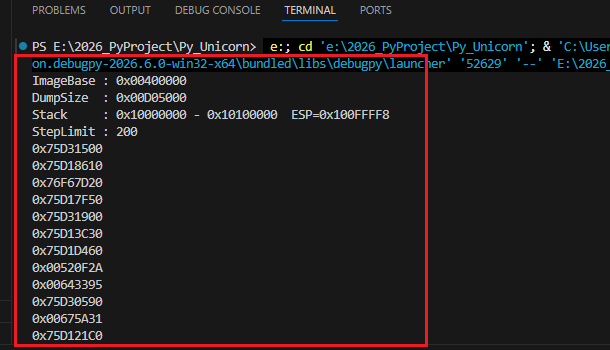

9. 我们随便选一个正常的函数地址`0x75D17F50`，到调试器中查看，顺利解析出导入函数

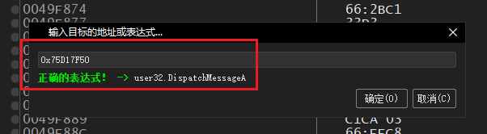


## 将解密函数地址回写IAT Slot

1. 上一小节中，我们得到了所有的原始函数地址，我们要将这些原始函数地址回写到IAT Slot中，正常步骤如下
    1. 解析加壳程序的PE头，在数据目录表中得到IAT的RVA、Size
    2. 计算得到IAT的Va，将原始函数地址，一个个回写

```c
ULONG RawFunc[] =
{
	0x75D31500,
	// ...
};

int main()
{
	cReadWriteMem ProcRw("test.vmp.394.exe");

	// 正常情况下一个读PE头、读数据目录表中IAT的RVA、Size
	// 知道原理即可，由于测试程序没有随机基址，所以ImageBase = 0x400000
	// 并且手动查询得知IATRva = 0x49E000
	ULONG IAT_Addr = 0x0089e000;
	ULONG Begin = IAT_Addr;

	for (ULONG i = 0; i < _countof(RawFunc); i++, Begin += 4)
	{
		ProcRw.Write(Begin, RawFunc[i]);
	}

	getchar();
	return 0;
}
```

2. 可以发现，哪怕是加壳后的VMP程序，初始导出表还是依赖了一些基础的函数，如图所示：

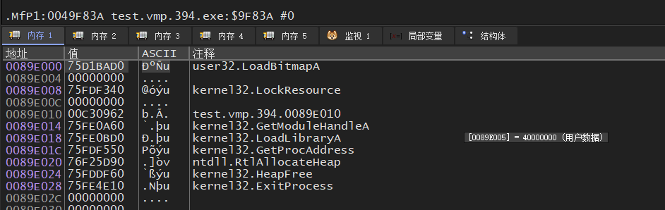

3. 我们运行代码，将原始函数一个个回填，效果如图所示

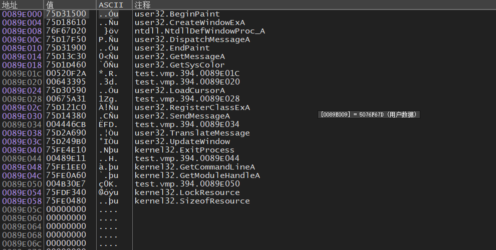


## 修复被破坏的IAT Stub

1. 还记得VMP会将原始的`FF 25 xxxx`修改为`E8 xxxx`形式的函数调用吗？如图所示：


2. 这也是我们需要还原的，还原非常简单，步进为6字节开始，一个个还原，代码如下所示：

```c
int main()
{
	cReadWriteMem ProcRw("test.vmp.394.exe");

	ULONG IATStubAddr = 0x00401394;
	ULONG CurStub = IATStubAddr;

	ULONG IAT_Addr = 0x0089e000;
	ULONG CurIATSlot = IAT_Addr;

	while (true)
	{
		if (ProcRw.Read<UCHAR>(CurStub) == 0)
		{
			break;
		}

		UCHAR StubCode[6] = { 0xFF, 0x25 };
		*(PULONG)(StubCode + 2) = CurIATSlot;
		ProcRw.ReadWriteMem(CurStub, StubCode, sizeof StubCode, FALSE);

		CurIATSlot += 4;

		// FF 25 xxxx
		CurStub += 6;
	}

	getchar();
	return 0;
}
```

3. 运行代码，还原后效果如图所示：

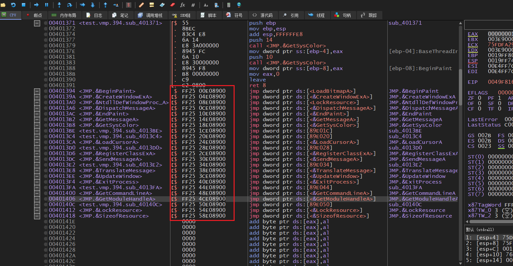


## 使用Scylla修复导入表

1. 我们修复导入表，并不是说全部流程都用代码实现，通晓其中实现原理即可
2. 我们打开调试器自带的`Scylla`，填入OEP、导入表地址、大小，点击`GetImport`按钮，解析完成后再`Fix Dump`即可
    1. 下图的解析失败，是因为资源相关导入函数没解密干净

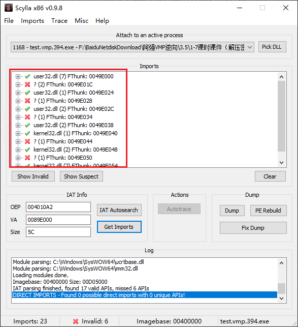

3. 到了这里，`VMProtect3.9.4`基础脱壳就完成了，当然，内嵌的代码变异、代码虚拟化这种才是后续真正麻烦所在


## 脱壳效果

1. 加壳后程序

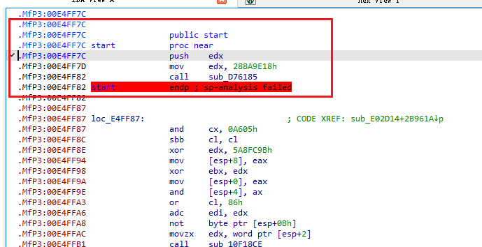

2. `OEP`处Dump PE

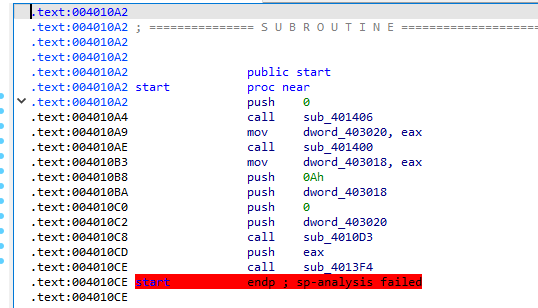

3. `OEP`处Dump PE、再修复IAT，可以发现导入函数识别正常了

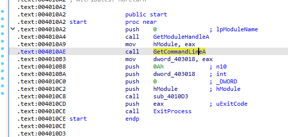
