<!--more-->

## 修复导入表

1. 在使用`Scylla`修复导入表，其实是这个软件帮你增加了一个节区、并将还原好的导入表数据放置到这个新节区中
2. 再修改PE头信息，将数据目录中的导入信息指向这个新节区
3. 这样IDA等静态分析工具，就可以正常工作了


## 强化理解脱壳流程

1. 这里，可以发现Dump、修复导入表其实是2个完全独立的步骤
2. Dump PE，将解压缩、解密后的代码（数据）保存一份快照到磁盘
3. 使用调试器手动定位导入表、使用工具自动搜索导入表，找到导入表后：
    1. 使用工具、脚本，根据IAT中的地址，反查模块导出表
    2. 得到DLL名称、导出函数名（符号名）
    3. 根据PE规范，重建导入表即可
4. 正常程序的IAT如下所示，不同DLL之间会使用`空指针`间隔

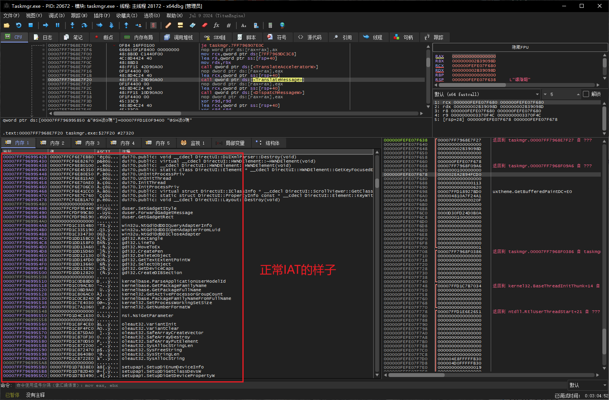


## 科锐课程演示脱壳实战

1. 得到一个`CrakeMe.exe`文件，拖到调试器打开，运行到EP处，很明显是压缩壳

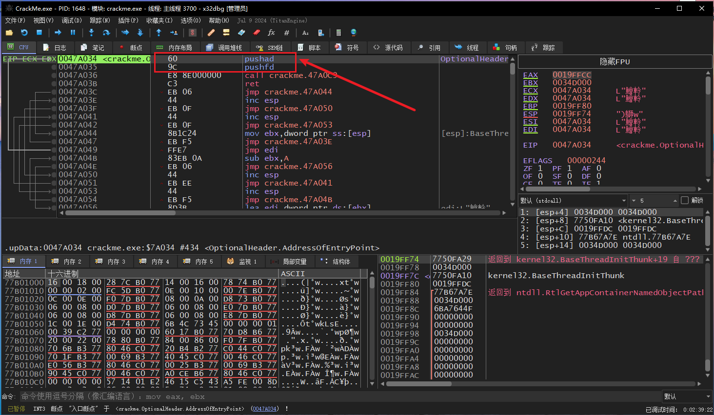

2. 我们堆栈访问法硬干，`F8`单步走、对着堆栈下`1字节`访问断点，这里上课涉及到一个小技巧
    1. 不要对着堆栈第一个DWORD下访问断点，可以选择第2、3个DWORD下访问断点
3. 直接`F9`放行，成功断下

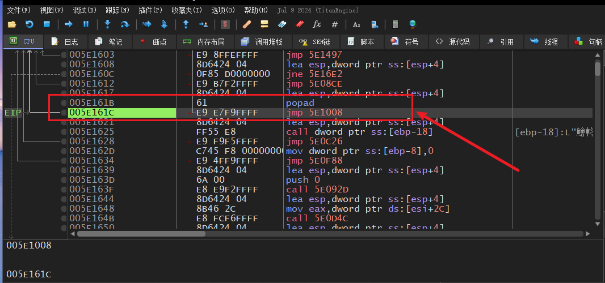

4. 一直`F7`步进跟，就会来到`OEP`

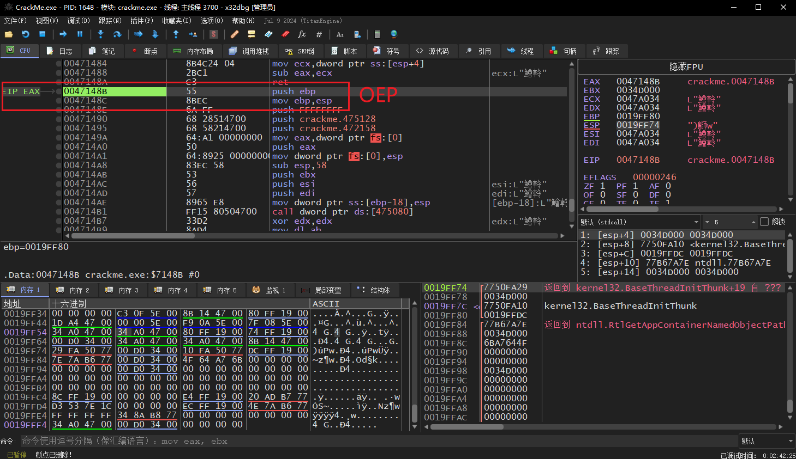

```c
0047148B           | 55                | push ebp                                |
0047148C           | 8BEC              | mov ebp,esp                             |
```


## Dump内存

1. 定位到OEP后，使用自带工具`Scylla`转储得到Dump文件

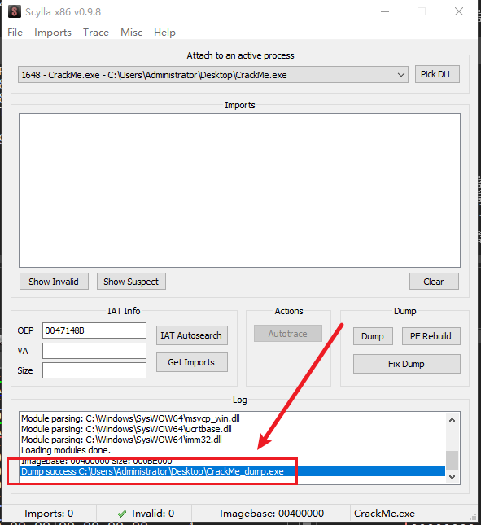


## IAT加密方式1

1. 本例中的`CrakeMe.exe`有着导入表加密，其加密方式如下所示：
    1. IAT表中的每一项都被替换为了`Stub函数`，其内部最终会调用真正的系统函数

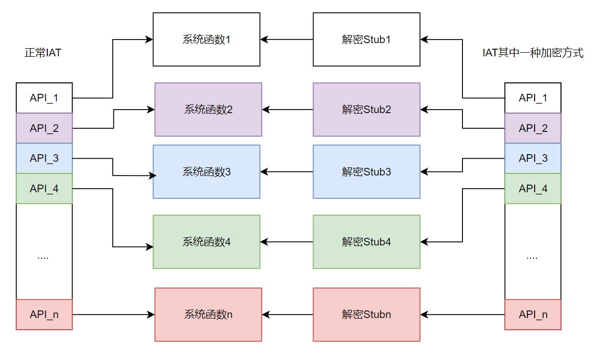

2. 我们找几个IAT函数来看一下：
    1. 在内存窗口查看IAT，会发现其中存放的没一个是正常的系统函数
    2. 这里每个存放的都是`Stub`，内部最终会调用到真正的系统函数处

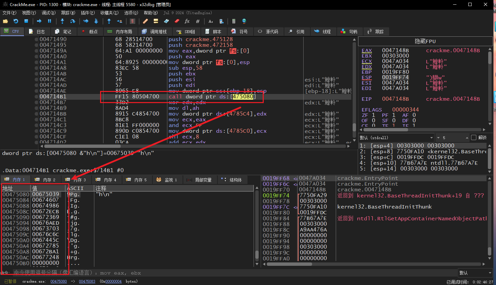

3. 我们随便挑一项，过去看，果然是一个`Stub函数`，我们修改`EIP`，让代码运行到这里：
    1. 这个过程其实很像是**模拟运行**
    2. 刚进入Stub桩函数、调用真实系统函数时的堆栈环境要保持一致，**不然参数不飞了**？

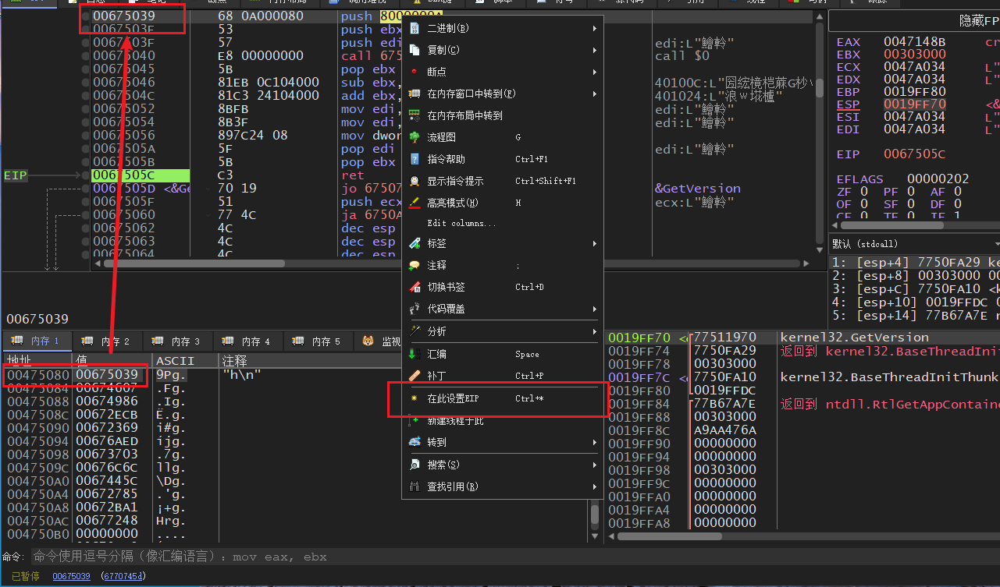

4. 我们`F7`步进一路跟，此时我们观察寄存器、堆栈窗口，因为这种解密Stub，最后大概率会将真实函数地址还原出来，这样寄存器、堆栈就能识别到
5. 最终一路跟，终于发现了，在Stub桩函数末尾，有着`pop ret`这种经典组合，其效果相当于`jmp xxx`

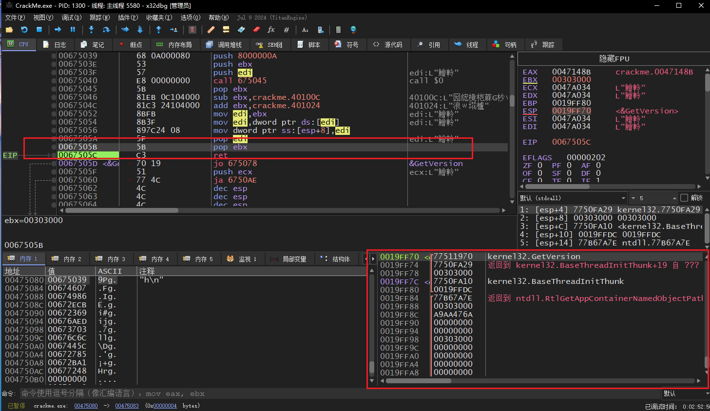


## Python脚本还原IAT思路

1. 到了这里，这个壳是如何破坏IAT、如何调用真实的函数已经明白了
2. 那么我们是不是可以模拟执行每一个IAT中的Stub函数？思路如下
    1. 遍历IAT表每一项
    2. 得到Stub函数地址
    3. 将EIP设置过去，步进运行，直到遇到了ret指令
    4. 此时读取栈顶的函数地址，就是真实的系统函数
    5. 将得到的系统函数，回填到该槽位
    6. 还原原始IAT结束


## 编写修复脚本、测试运行

1. 编写Python脚本如下：

```python
from x64dbgpy.pluginsdk._scriptapi import *
import scriptapi

# SetHardwareBreakpoint(0x0047148B)
Run()

dwIatStart = 0x0475000
dwIatEnd = dwIatStart + 0x120

dwCurIatSlot = dwIatStart

while dwCurIatSlot < dwIatEnd:
    dwStubFunc = ReadDword(dwCurIatSlot)

    if 0 == dwStubFunc:
        dwCurIatSlot += 4
        continue

    SetEIP(dwStubFunc)

    while True:
        StepIn()
        dbInstruction = ReadByte(GetEIP())

        if dbInstruction == 0xC3:
            dwOldSysFunc = ReadDword(GetESP())
            WriteDword(dwCurIatSlot, dwOldSysFunc)
            break

    dwCurIatSlot += 4
```

2. 如下所示，脚本一直跑，得到原始函数地址后、回填IAT槽位

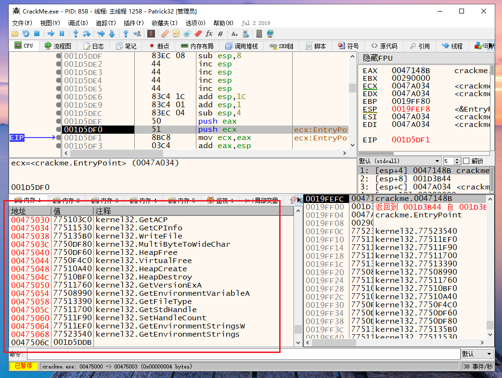


## 还原得到IAT，修复Dump PE

1. 脚本跑完后，我们使用`Scylla`修复Dump PE
2. 这里填入`OEP`、IAT地址、大小，选择修复

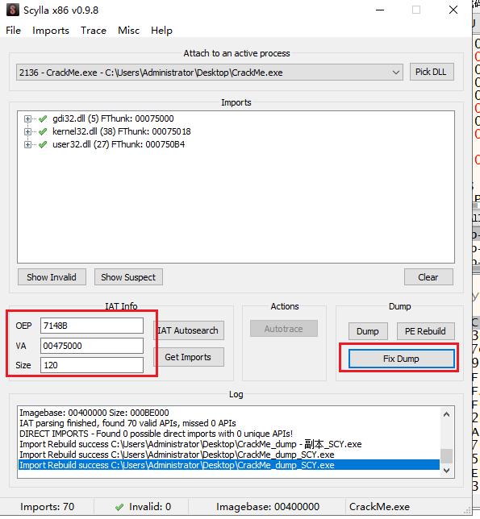

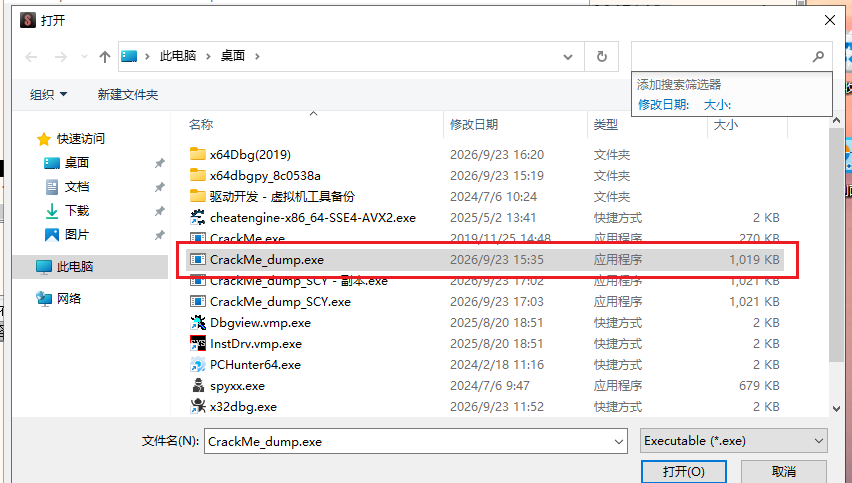


## 解决EP错误问题

1. 修复完导入表后，此时理论可以双击运行程序了，但是运行程序，直接崩溃了？
2. 挂上调试器，大小默认入口点怎么是这种乱七八糟的地方

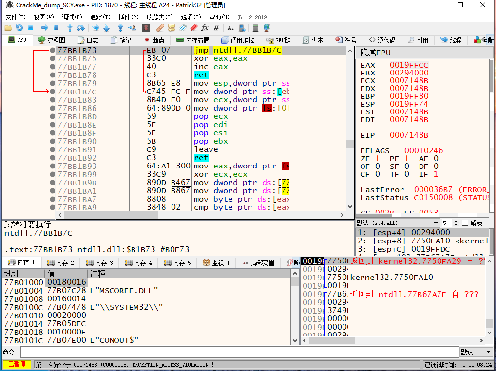

3. 使用`CFF`工具查看入口点信息，怎么是这样一个值，高12位的数值哪来？

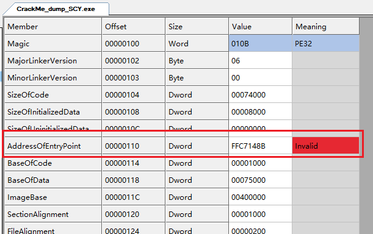

4. 我们手动修正，就可以正确识别节区了

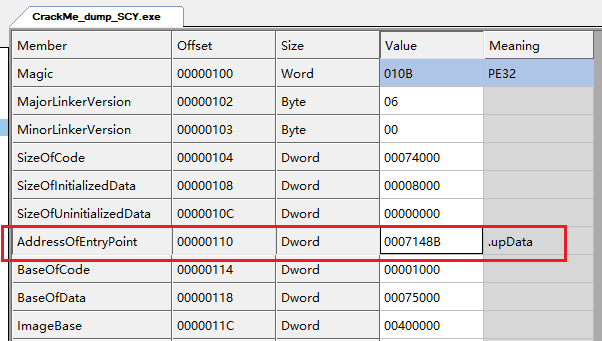


## 脱壳成功

1. 双击脱壳后的程序，顺利运行

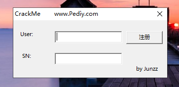
